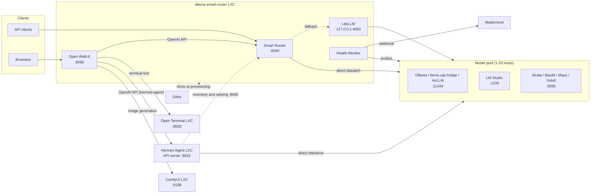
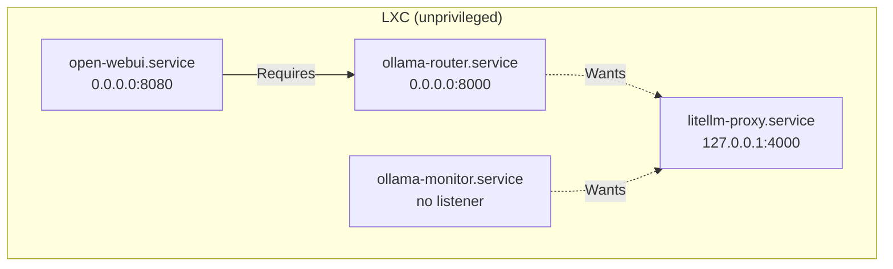
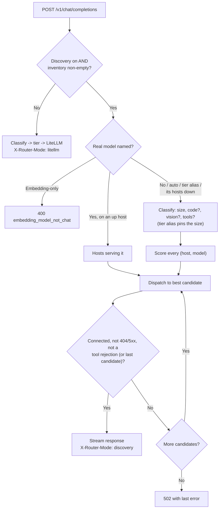

# Ollama Smart Router — Service Architecture

**System:** `ollama-smart-router`
**Platform:** Proxmox VE; an unprivileged Debian 13 router LXC and separate target LXCs
**Built by:** `ollama-smart-router-install.sh` and `targets/*/provision-lxc.sh`
**Last reviewed:** 2026-10-26

---

## 1. Purpose and scope

The router gives clients one OpenAI-compatible endpoint for 1–20 configured
model hosts. It inventories models and selects a host for each request by
size, capabilities and load-spreading score. The router CT also contains Open
WebUI, LiteLLM fallback and health monitoring. Optional `targets/` LXCs
provide model servers, Gitea, Mattermost, Open Terminal, Hermes and ComfyUI.

The design keeps GPU workloads separate from the router, stores configuration
in a Gitea repository when available, and applies changes with validation and
rollback. [README.md](README.md) covers installation and operation; the
individual [target READMEs](README.md#inference-targets) cover engine setup.

## 2. System context



| Dependency | Criticality | If unavailable |
|---|---|---|
| Model hosts (`:11434`, `:1234`, `:8080`) | **Critical** | Fail forward to other hosts; all down → 502 |
| Gitea (HTTP(S)) | Provisioning only | Install falls back to local config; running system unaffected |
| Mattermost (webhook) | Optional | Alerts logged and retried |
| Open Terminal (`:8000`) | Optional | Terminal tool unavailable; chat unaffected |
| Hermes API server (`:8642`) | Optional | `hermes-agent` unavailable in Open WebUI; other models unaffected |
| ComfyUI (`:8188`) | Optional | Image generation in Open WebUI fails; chat unaffected |

---

## 3. Deployment view

All four services run in one unprivileged LXC (default 2 vCPU, 4 GB, 32 GB)
as the non-login account `ollama-router`.



* `open-webui` **Requires** the router, its only backend. The router and
  monitor only **Want** LiteLLM: it is a fallback, and `Requires=` would let
  every LiteLLM restart cascade into the router and UI.
* All units are `Restart=always`. `open-webui` has `TimeoutStartSec=600`,
  because its first start downloads an embedding model.
* Every unit reads `/app/router/secrets.env` as an optional second
  `EnvironmentFile=` (§9).

**Hardening applied to every unit:**

```
User=/Group= service account   NoNewPrivileges=true   PrivateTmp=true   PrivateDevices=true
ProtectSystem=strict           ProtectHome=true       UMask=0027        CapabilityBoundingSet=
RestrictSUIDSGID=true          LockPersonality=true   SystemCallArchitectures=native
RestrictAddressFamilies=AF_UNIX AF_INET AF_INET6
```

Writable exceptions: `open-webui` → `/app/openwebui`; `ollama-monitor` →
`StateDirectory=ollama-monitor` (startup-notice timestamp); the router and
LiteLLM → nothing. `tests/test-repo.sh` checks `ProtectSystem=strict` and an
empty capability set on every unit. A unit that cannot start under them is
caught by `manage-model-servers apply`, which rolls it back (§6.1).

---

## 4. Component view

### 4.1 Smart Router (`ollama-router.service`)

FastAPI/uvicorn on `:8000`; the only component that makes routing decisions.

| Endpoint | Purpose |
|---|---|
| `POST /v1/chat/completions` | Classify, select, dispatch |
| `GET /v1/models` | `auto`, tier aliases and discovered chat models (`owned_by` = server kind) |
| `GET /routing/inventory` / `POST /routing/refresh` | Live inventory with per-host state; force a re-poll |
| `POST /routing/explain` | Decision and scored candidates, without executing |
| `GET /healthz` | Process liveness (never needs the key) |
| `ANY /v1/{path}` | Passthrough to LiteLLM (embeddings, etc.) |

With `ROUTER_API_KEY` set, every path except `/healthz` needs
`Authorization: Bearer <key>`. Without a key on a non-loopback address, the
router logs a warning at start-up.

* **Discovery task** — polls each host every `refresh_seconds` through its own
  API (§15) and swaps in a new inventory atomically. A host whose connection
  fails during dispatch is marked down until its next good poll.
* **Classifier** — size class (fast/medium/large/xlarge), code or not, image
  or not, tools or not. Only the newest user message is judged
  (`[classification] scope = last_user`), so a system prompt cannot pin a
  conversation to one tier. Images are looked for in every message. A request
  that offers tools (non-empty `tools`/`functions`, `tool_choice` not `none`)
  is raised to at least `tools_min_class` (default `large`).
* **Selector + dispatcher** — scores every `(host, model)` pair and fails
  forward through the ranking (§5).

### 4.2 LiteLLM proxy (`litellm-proxy.service`)

On `127.0.0.1:4000`, not reachable from the network. It is the fallback
dispatch path and backs the non-chat passthrough. `manage-model-servers`
generates `litellm_config.yaml` with one deployment per (tier, host), using
each kind's provider (`ollama/`, `lm_studio/`, `openai/`) and token reference,
`latency-based-routing` and cross-tier fallbacks. Everything under
`router_settings` (fallbacks included) is passed to `litellm.Router` as
keyword arguments (checked against the pinned 1.75.5.post1). It has no master
key; the loopback binding is its access control. It has its own hash-locked
venv, because `litellm[proxy]` pins fastapi/uvicorn versions that conflict
with the router's.

### 4.3 Open WebUI (`open-webui.service`)

Chat UI on `:8080`. It points at the **router**, not LiteLLM, and authenticates
with `ROUTER_API_KEY` (as `OPENAI_API_KEYS`). It runs on Python 3.12 in its
own venv (§7). The version is pinned in
`services/open-webui/requirements.txt`.

### 4.4 Health monitor (`ollama-monitor.service`)

No listener. Every `interval_seconds` (15) it probes each distinct host in
`MODEL_SERVERS`/`BACKEND_*` once, labelling alerts with that host's tiers:
Ollama on `/api/tags`, other kinds on `/v1/models` with their token.
Strata-style servers (Strata, Basalt, Maya, Xolotl) also count as down while
that list is empty, and a rejected
token counts as down. It also probes LiteLLM, the router's `/healthz` and Open
WebUI's `/health`. A state change needs `fail_threshold` (3) or
`recover_threshold` (2) consecutive results, and only transitions are posted.
Undelivered alerts are retried every cycle. A startup notice, at most once per
`notice_interval_seconds` (3600), doubles as a webhook check. That limit applies
only to the notice; it does not delay host-down alerts.

The **keep-alive maintainer** exists because Ollama's OpenAI endpoint ignores
`keep_alive`. It runs in its own thread, so a slow model load never delays
health checks, and it touches only Ollama hosts. The README's
[Keeping models loaded](README.md#keeping-models-loaded) describes what it
sends and how to set it.

---

## 5. Request routing

### 5.1 Decision flow



A named model whose hosts are all down is routed by content with
`X-Router-Warning: model-unavailable`. An image request with no vision
candidate gets `X-Router-Warning: no-vision-model`, or a 400 when
`vision_strict = true`. Likewise, a tool request whose candidates are all known
to lack tools gets `X-Router-Warning: no-tool-model`, or a 400
`no_tool_model` when `tools_strict = true`.

### 5.2 Scoring

| Signal | Effect |
|---|---|
| **Size-band fit** | Class → band `0:9`, `9:20`, `20:70`, `70:999` B, ceilings exclusive. In band scores 1.0; outside decays by `band_falloff`. If nothing is in band, candidates are ordered by distance to it (otherwise all would tie at the zero floor) |
| **Extremes within class** | Large requests bias larger, fast requests smaller |
| **Code** | `+code_match` for code→code model; `−code_match × offtask_penalty` for a code model on prose |
| **Vision** | `+vision_match` for image→vision model; `−vision_match` otherwise; small penalty for a vision model on text |
| **Residency** | `+loaded_bonus` for models reported loaded (LM Studio and Strata-style servers); `lmstudio_loaded_only` excludes cold LM Studio models |
| **Unknown size** | `unknown_params` (0.3): usable, never preferred |
| **Embeddings** | Structurally excluded; naming one on the chat endpoint is a 400 |
| **Tools** | On a tool request, models known to lack tools are excluded (kept only if nothing else is left); `+tool_match` for a model reported tool-capable over an unknown one. Support is known from Ollama's `/api/show` capabilities (also the llama.cpp bridge's `MODEL_CAPABILITIES` and AirLLM) and LM Studio's `trained_for_tool_use`; Strata-style servers and untrained LM Studio models are unknown. Shown per entry as `tools` in `/routing/inventory` |
| **Context length** | Recorded in `/routing/inventory`, not scored. Ollama uses the smaller of the model limit and configured `num_ctx`; the llama.cpp bridge reports active per-slot context, AirLLM its window, and other APIs their reported limit. Ollama's `/api/show` is cached for 60 s, retaining the last good answer after a failed poll. The value can still overstate served context; Hermes uses it (§17.1) |
| **Tie rotation** | Candidates within `tie_epsilon` of the best rotate, spreading load. For a tool request only the same model on several hosts rotates, so an agent loop keeps one model (and its prompt cache) |

Sizes come from `details.parameter_size` (Ollama), `params_string` (LM Studio)
or `parameter_size` (OpenAI-style). Failing that, from the tag (`qwen3:14b` →
14B), or from `[model_sizes]` for an exact ID (§15). All weights, bands and
keyword lists live in `router.ini`.

### 5.3 Dispatch and degradation

Chat is sent to `<base>/v1/chat/completions` with the real model name and the
backend's own token from `secrets.env`; the client's `Authorization` is never
forwarded. Retry happens only **before** the first byte reaches the client,
because a partial stream cannot be replayed. A 404/5xx from the *last*
candidate is passed through as-is.

| Layer | Trigger | Behaviour |
|---|---|---|
| 1. Best candidate | Normal | Direct dispatch |
| 2. Fail-forward | Connect error/timeout (host marked down), transport error, 404, 5xx; on a tool request, a 400 that rejects tool support, such as "does not support tools" (the model is then skipped for tool requests until the next poll; from the last candidate the 400 is returned). Any other 400, including a malformed `tools` schema, is returned as-is and nothing is demoted | Next candidate |
| 3. LiteLLM | Discovery off or inventory empty | Static tiers with LiteLLM's own fallbacks |

`[http] connect_timeout_seconds` (3) bounds how long a dead host delays
failover; `read_timeout_seconds` (300) bounds the gap between bytes.

---

## 6. Configuration architecture

Configuration is **version controlled in Gitea and injected at provisioning
time**.

```
services/ollama-router/     router.py  router.ini  requirements.txt  *.service
services/litellm-proxy/     litellm_config.yaml  requirements.txt/.lock  *.service
services/ollama-monitor/    monitor.py monitor.ini requirements.txt  *.service
services/open-webui/        requirements.txt  *.service
env/router.env              shared env for router/LiteLLM/monitor (no secrets)
env/openwebui.env           Open WebUI environment
install/apply-config.sh     copies everything into its runtime location
install/manage-model-servers.sh   management tool (§6.1)
install/update-router.sh    in-container component updater
targets/<name>/             inference targets, companions and services (§16, §17)
tools/                      sync-embedded.py, update-router-services.sh, install-{gitea,mattermost}.sh (forwarders to targets/, --create-only)
tests/, .gitea/workflows/   tests and CI (§18)
```

One directory per service lets each service's unit, code, tunables and pins
version independently. Secrets live outside git in `/app/router/secrets.env`.

**Why pull at provisioning, not on start.** A `git pull` in `ExecStartPre`
would make Gitea a boot dependency of every service, and a bad commit would
break startup instead of failing at install. Changes on a running CT are an
explicit act: `git pull` followed by `manage-model-servers apply`.

### 6.1 `manage-model-servers`

Seeded at `install/manage-model-servers.sh` and symlinked to
`/usr/local/bin/manage-model-servers`, so a `git pull` updates the command (the
command list is in the README). It rewrites `MODEL_SERVERS` and `BACKEND_*` in
`env/router.env` and regenerates `litellm_config.yaml`. Design points:

* **Servers are keyed by URL, never by index.** Non-Ollama servers carry a kind
  prefix (`maya+http://host:8080`), and a typed `host:port` resolves to the
  stored entry whatever its kind.
* **New hosts are identified before they are accepted** (§15.3), and must list
  their models (`--no-probe` overrides). Model tags are checked on the
  affected servers before they are written.
* **Models are per (tier, server)**, as in LiteLLM's model list. Regeneration
  keeps each pair's tag and the whole `router_settings` block, so hand edits
  survive. Fallbacks are rebuilt from existing tiers.
* A tier's tag governs only the LiteLLM path and keep-alive pinning; discovery
  picks from the live inventory.
* The env rewrite keeps the file's `0640 root:ollama-router` mode. Secret keys
  are refused in `env/router.env` and written to `secrets.env`.
* **`apply` validates, snapshots, applies, health-checks and restores on
  failure.** It restarts only services whose inputs changed and brings the
  LiteLLM and Open WebUI venvs in line with their pins (backing up `webui.db`
  first). The LiteLLM venv itself is not rolled back.
* **No automatic migration** of old tier names. The services do read the old
  env keys through a read-only fallback chain, and anything `router.ini` omits
  uses the defaults in `router.py`, so older configs still start.
* `commit` pushes with the deploy token through a temporary 0600 credential
  file. The credential uses the remote's URL scheme, because git will not match
  `https://` credentials to an `http://` request. Prompting is disabled, so a
  bad token fails at once.
* Guard rails: server count limits, unknown tier, unconfigured server,
  duplicate address, `ollama/` prefix, empty-tier warning.

**Component updates.** `install/update-router.sh` (in the CT) replaces only
the files in `INSTALLER_OWNED_CODE` and checks their LF endings and
bash/Python syntax before committing; after a venv rebuild it runs
`apply --all`. `tools/update-router-services.sh` drives it from the Proxmox
host or a second clone. Usage, flags and failure handling are in the
[README](README.md#router-components).

**Config lock.** Writers take an `flock` on
`/run/lock/ollama-smart-router-config.lock`. `update-router.sh` hands its held
descriptor to the `apply`/`commit` it runs (`CONFIG_LOCK_INHERITED_FD`), and
the child checks that the descriptor really holds the lock. The lock ends with
its process; `clear-lock [--force]` reports, or stops, a hung holder.

---

## 7. Provisioning architecture

The installer validates prompts, storage, network, GPU requirements and Gitea
credentials before creating the router CT. It creates selected Gitea and
Mattermost CTs first, using their URL, token and webhook as prompt defaults.
It then seeds missing configuration files in Gitea (or ships a local tree),
creates the router CT, clones and applies the configuration, and starts the
four services. A failed router build removes its half-built CT.

Selected model targets become the first configured server entries and are
provisioned after the router starts. Strata-style keys are returned on stdin
to `set-<kind>-token`, followed by one `apply`. Companions are provisioned
after Open WebUI starts and the operator supplies its admin API key. Each
target runs with its own CT settings; a target failure leaves the router
running and produces a retry summary. `NONINTERACTIVE=true` refuses selected
targets because their setup needs interactive steps.

Committed configuration wins over installer defaults. Installer-owned code is
updated when `CONFIG_UPDATE_CODE=true`. The repo is cloned at provisioning,
so Gitea is not a service-start dependency. `tools/sync-embedded.py` keeps
the installer's embedded files in sync with their sources.

The router and monitor use Debian 13's Python 3.13; LiteLLM has a separate,
hash-locked venv because of dependency conflicts. Open WebUI needs Python
3.11–3.12, so installation finds or provisions 3.12 and tests it as the
service account before building its venv.

## 8. Network and ports

| Port | Service | Binding | Exposure |
|---|---|---|---|
| 8000 | Smart Router | `0.0.0.0` | LAN API |
| 8080 | Open WebUI | `0.0.0.0` | LAN UI (port chosen at install) |
| 4000 | LiteLLM | `127.0.0.1` | CT-local only |
| 11434 / 1234 / 8080 | Model hosts | outbound | Router, LiteLLM, monitor → pool |
| 8000 | Open Terminal CT | outbound | Open WebUI → terminal |
| 8642 / 8765 | Hermes CT API / local dispatcher | `0.0.0.0` / `127.0.0.1` in its CT | Open WebUI → Hermes; dispatcher → router metadata and model servers |
| 8188 | ComfyUI CT | `0.0.0.0` in its CT | Open WebUI → ComfyUI (HTTP and WebSocket) |

With the CT firewall enabled, the installer accepts TCP 22, 8000 and the Open
WebUI port from `API_ALLOW_CIDR`. SSH is included because enabling the
firewall sets the input policy to drop. Target CTs are created with
`firewall=1`. Open Terminal, Hermes and ComfyUI admit only the router's address
(ComfyUI also `UI_ALLOW_CIDR`, for its web UI); model targets leave the rules to
the operator. The Hermes CT also restricts egress by
default: the router's API, registered model server endpoints, DNS and internet HTTP(S) (§17.1).

---

## 9. Security model

* Unprivileged LXCs; non-login service accounts (one per target, §16);
  hardened units (§3).
* The root password is set with `chpasswd` over stdin, never as an argument.
* Config files are **built on the host and pushed in**, never assembled by an
  inner shell, so `'`, `$` or backticks in a token cannot break quoting.
* The cloned repo is `root:root` and `go-rwx` (git writes 0644 by default).
* Tokens reach curl through a file descriptor, never `ps`.

| Secret | At rest | Notes |
|---|---|---|
| Gitea deploy token, Mattermost webhook | `/app/router/secrets.env` (0640 root:ollama-router) | Never committed; moved out of `env/router.env` by `commit`/`apply` |
| `ROUTER_API_KEY` (= Open WebUI `OPENAI_API_KEYS`) | `secrets.env` | Generated on new installs; `set-api-key` |
| `LMSTUDIO_API_TOKEN`, `STRATA_API_KEY`, `BASALT_API_KEY`, `MAYA_API_KEY`, `XOLOTL_API_KEY` | `secrets.env` | `set-<kind>-token`; sent only to that kind; LiteLLM reads `os.environ/...` |
| Target API keys | `/etc/<target>-target/api-key` (0600) in each target CT; Xolotl's also in its server config `/etc/xolotl/xolotl-ds41.json` (0640 root:xolotl) | Generated in the CT; never in a unit, log or the router's process list |
| Open Terminal key | `/etc/open-terminal/api-key`; Open WebUI connection settings | Generated in the terminal CT |
| Hermes API server key | `/etc/hermes-target/api-key` (0600), `~hermes/.hermes/.env` (0600); Open WebUI connection settings | Generated in the Hermes CT |
| Router and backend keys in the Hermes CT | `~hermes/.hermes/.env` (0600) for the router key; `/etc/hermes-target/backend-keys` (0640) for backend keys | Pushed as 0600 files, never in argv; `--reconfigure` after a rotation |
| Hugging Face token (ComfyUI `klein-9b` weights) | Not kept: the installer's memory, a 0600 file in the provisioner's stage directory and, during the guest step only, `/root/comfyui-target-deploy/hf-token` (0600) in the ComfyUI CT; removed afterwards, also on failure | Never in argv or the CT's environment; only root reads it, as a curl header file |

| Accepted risk | Mitigation |
|---|---|
| `GITEA_VERIFY_TLS=false` (TurnKey self-signed cert) | Install the appliance CA and flip the flag in `prompt_gitea_credentials` |
| Router API key optional | `set-api-key --generate`; firewall CIDR; TLS reverse proxy if exposed |
| Backend traffic is plain HTTP | Keep targets on a trusted segment; restrict their ports |
| A Strata-family key is also its admin key (Maya's dashboard) | Restrict the target port to the router CT |
| Gitea tokens cannot be restricted to one repository | Use a dedicated non-admin account with access only to the config repository; select the token scopes documented in README |
| LiteLLM has no master key | It listens only on 127.0.0.1; add a master key before exposing it |
| The gated 9B weights have no reviewed hash (Hugging Face hides it from accounts without access) | Checked against the hash Hugging Face sends for the authenticated request and the pinned size; `COMFYUI_KLEIN_9B_SHA256` pins it |
| ComfyUI has no authentication (queue, outputs, uploads) | Its CT firewall drops all inbound except :8188 from the router and `UI_ALLOW_CIDR`; the service runs unprivileged and cannot write its code or venv (§17.3) |
| Hermes users can read router and backend keys and share one agent memory | The agent runs as `hermes`, which owns its configuration. Keep `hermes-agent` admin-only or limited to one group; one Hermes profile per user or group for separation |

---

## 10. Failure modes

An unreachable model host is skipped until a successful inventory poll;
another candidate may answer the same request before streaming begins.
With no discovered hosts, routing falls back to LiteLLM's static tiers, then
returns an error if those hosts also fail. An empty `/v1/models` on a
Strata-style server or a rejected backend token removes its models from the
inventory. A failed config `apply` restores the previous files and restarts
the affected services. Target upgrades restore their previous runtime and
report whether it is running again. See the [troubleshooting table](README.md#troubleshooting)
for operator checks and fixes.

## 11. Scaling and performance

* **Horizontal:** 1–20 hosts; tiers may hold several. LiteLLM load-balances the
  static path, and the router rotates tied candidates.
* **Vertical:** the CT is I/O-bound glue. 2 vCPU / 4 GB is sized for Open
  WebUI's embedding model, not routing.
* **Disk:** default Open WebUI pulls CUDA torch (~7.5 GB venv). The CT has no
  GPU, so `TORCH_CPU_ONLY=true` installs CPU torch first and `apply` purges
  orphaned `nvidia-*`/`triton` wheels. If the CPU index is unreachable, it
  falls back to the CUDA build and removes nothing.
* **Discovery cost:** one model list per host per `refresh_seconds` (plus
  `/api/show` for Ollama models when its one-minute cache expires or a manual
  `/routing/refresh` is requested), independent of chat traffic.
* **Targets:** AirLLM and Maya (by default) serve one sequence at a time,
  which the router cannot see (§14).

---

## 12. Observability

The router exposes inventory, scored explanations and response headers for
each decision. The monitor logs failed webhook deliveries and posts host and
local-service transitions to Mattermost. The [README](README.md#troubleshooting)
lists the commands and endpoints to inspect a running installation.

## 13. Key design decisions

| Decision | Rejected alternative | Reason |
|---|---|---|
| Routing in the router | Extend LiteLLM | LiteLLM's map is static YAML; discovery would mean reloading config per change |
| Direct dispatch | Always via LiteLLM | Inventory-aware ranking and better-informed fail-forward |
| Keep LiteLLM as fallback | Remove it | A tested static path, plus the non-chat routes |
| Pull config at provisioning | `ExecStartPre` pull | Gitea must not be a boot dependency |
| Separate Python + venv for Open WebUI | Shared venv | `<3.13` constraint; pins conflicting with LiteLLM |
| Keyword lists as JSON arrays | Comma-separated | Exact spacing matters: `"def "` must not match `default` |
| Seed only missing config | Always overwrite | Operator commits win |
| Embeddings excluded structurally | Score them low | A low score is still selectable |
| Kind in the entry prefix | Separate kind list | One string tells every component the API |
| One kind table per component, cross-checked by a test | Shared module | Router, monitor and the bash manager deploy separately |
| Secrets in `secrets.env` | Committed env | Tokens out of git, still readable by every unit |
| Targets in their own LXCs | Engines in the router CT | GPU, memory and disk stay off the router; a failed target is just a down host |
| Hermes as a second Open WebUI connection | Hermes as a model-server kind in the pool | `auto` could route to Hermes, which calls `auto`: a loop. Hermes has no size or capabilities to score |
| ComfyUI as Open WebUI's image engine | An image route in the router | The router's API is chat-only; Open WebUI already drives ComfyUI's workflow API (queue, WebSocket progress, `/view`) |

---

## 14. Known limitations

1. **Hosts are configured, not discovered.** Discovery finds models on known
   hosts; adding a host is a deliberate `manage-model-servers` act.
2. **Classification is lexical** (length and keywords), not semantic.
3. **One shared router key**, not per-user; Open WebUI provides user accounts.
4. **No concurrency awareness.** A saturated host is only "up". Single-sequence
   targets queue extra requests; one that times out before its first byte fails
   forward, but the target keeps working on it.
5. **Context windows are ignored.** A long prompt may land on a model with a
   small context, and the resulting 4xx does not fail forward.
6. **The router CT is a single point of failure** for the API.

Next steps: feed observed latency into scoring; track in-flight requests per
host (e.g. Maya's `/slots`); use the inventory's `context_length` to exclude
models too small for the prompt; add hosts through an endpoint.

---

## 15. Model server kinds

`MODEL_SERVERS` and `BACKEND_*` may mix five APIs. Ollama entries are plain base
URLs; other kinds are identified only by their prefix.

| Kind | Entry | Models listed at | LiteLLM provider | Token (`secrets.env`) |
|---|---|---|---|---|
| Ollama (incl. llama.cpp bridge, AirLLM) | `http://host:11434` | `/api/tags` (+ `/api/show`) | `ollama/` | — |
| LM Studio | `lmstudio+http://host:1234` | `/api/v1/models` → `/api/v0/models` → `/v1/models` | `lm_studio/` | `LMSTUDIO_API_TOKEN` |
| Strata | `strata+http://host:8080` | `/v1/models` | `openai/` | `STRATA_API_KEY` |
| Basalt | `basalt+http://host:8080` | `/v1/models` | `openai/` | `BASALT_API_KEY` |
| Maya | `maya+http://host:8080` | `/v1/models` | `openai/` | `MAYA_API_KEY` |
| Xolotl | `xolotl+http://host:8080` | `/v1/models` | `openai/` | `XOLOTL_API_KEY` |

### 15.1 The kind table

Each non-Ollama kind is one row in `SERVER_KINDS` (`router.py`, `monitor.py`)
and in `server_kinds`/`kind_field` (`manage-model-servers.sh`). A row holds the
prefix, secret key, label, default port and whether the server is
Strata-style. Everything else is derived: kind detection, base URL, token,
discovery path, monitor probe, LiteLLM provider, `--type` and
`set-<kind>-token`. `tests/test_monitor.py` fails when the three tables
disagree. A new Strata-style server is one row in each table plus a detection
fingerprint.

### 15.2 LM Studio

The 0.4+ API gives `params_string`, `capabilities.vision` and
`loaded_instances`. The 0.3.x API gives `type` (llm/vlm/embeddings) and
`state`. `/v1/models` gives names only. Loaded models get `loaded_bonus`, and
`lmstudio_loaded_only` excludes cold ones. Keep-alive is not sent, because LM
Studio uses its own idle TTL.

### 15.3 Strata-style servers (Strata, Basalt, Maya, Xolotl)

* **Discovery:** model ID, image support (`input_modalities` or
  `architecture.input_modalities`), residency (`status`), `parameter_size` if
  given.
* **Sizes:** when no `parameter_size` is given, `[model_sizes]` in
  `router.ini` sizes exact IDs ([README](README.md#model-sizes-for-unsized-ids) lists the built-in
  entries and overrides).
* **Health:** an empty `/v1/models` means the engine is not running, so the
  host counts as down.
* **Detection without a key:** Strata and Basalt by the `service` field of
  their public `/health`; Maya by `glm-5.3-flash` plus a `version` field;
  Xolotl, which runs Strata's own server (`service: strata`), by a model id
  starting with `deepseek-v4` there. Xolotl has its own kind and key so that a
  Strata key is never sent to it (or the other way round).
  Strata also has older fingerprints. A keyed server that cannot identify
  itself is added as `kind://host`.
* **Keep-alive** is never sent.

---

## 16. Inference targets (`targets/`)

Each model target has a host-side `provision-lxc.sh` that validates settings,
creates an unprivileged CT and passes GPU devices through, and a guest-side
`install-target.sh` that installs and health-checks the engine. The router
treats it as another host of its API kind. Every target provisioner offers
`--dry-run`; see its README for requirements, settings and recovery steps.

| Target | Router kind | Engine |
|---|---|---|
| [llama.cpp](targets/llamacpp/README.md) | Ollama bridge, :11434 | One GGUF; CUDA, Vulkan or CPU |
| [AirLLM](targets/airllm/README.md) | Ollama API, :11434 | Disk-streamed HF model; slow, single generation |
| [Ollama](targets/ollama/README.md) | Ollama API, :11434 | Community-script CT adopted into a hardened service |
| [Strata](targets/strata/README.md) | `strata`, :8080 | Qwen3.8-Flash-Next |
| [Basalt](targets/basalt/README.md) | `basalt`, :8080 | Blackwell/CUDA 13, `.basalt` pack |
| [Maya](targets/maya/README.md) | `maya`, :8080 | GLM-5.3-Flash; CUDA chosen for CT and card |
| [Xolotl](targets/xolotl/README.md) | `xolotl`, :8080 | DeepSeek-V4.1-Flash; pinned weights |

Target units use their own service accounts, limited writable paths and no
capabilities. GPU nodes are group-accessible rather than root-owned.
Strata-style keys are generated inside the CT and stored outside unit files.
The [README's distribution table](README.md#lxc-distribution-support) lists
supported CT releases; GPU driver setup precedes CT creation.

**Upgrade contract.** Sources and downloads are prepared and verified before
service interruption. An unchanged healthy target is left alone. Successful
upgrades require a target-specific readiness check; on failure, code and
configuration are restored and the old runtime is health-checked. llama.cpp,
AirLLM, Ollama and ComfyUI preserve an intentionally stopped service. The
target README describes its snapshot or side-by-side release strategy.

Strata, Basalt, Maya and Xolotl save the last good settings and use them on
rerun unless non-empty environment overrides are given. An interrupted first
install resumes its pending settings. Existing installations without a
readable settings record require explicit values rather than fresh-install
defaults. Their upgrades take an exclusive lock, snapshot the runnable tree
and unit to `/var/lib/<target>-target/`, then remove the snapshot after a
successful upgrade or rollback. Leave disk for one snapshot; it can contain
secrets and is retained if rollback fails. Model data outside the checkout
is not copied. Individual target tests exercise these guarantees.

## 17. Companions and services (`targets/`)

These CTs extend Open WebUI or support the router; none is a model-pool host.

**Open Terminal** (`targets/open-terminal/`).
[Open Terminal](targets/open-terminal/README.md) is a separate CT registered
as an Open WebUI system terminal connection. It runs from a pinned release
with a hash-locked venv. Its bearer-protected API on port 8000 is reachable
only from the router CT when the firewall is enabled. The connection is
admin-only by default; users granted access share a shell and workspace.

### 17.1 Hermes Agent (`targets/hermes/`)

[Hermes](targets/hermes/README.md) is an Open WebUI agent connection, not a
model-pool host: routing `auto` through Hermes would loop back into `auto`.
Its API server listens on 8642 and calls a local dispatcher on 8765. The
dispatcher uses router inventory and ranking as metadata, then sends
inference directly to a tool-capable server with at least the configured
context length. It excludes AirLLM and refuses a named model without those
capabilities. Backend keys and the router key are pushed as private files;
`--reconfigure` refreshes them after rotation. By default its CT restricts
inbound API access to the router and egress to the router, registered model
hosts, DNS and public HTTP(S).

### 17.2 Gitea and Mattermost services (`targets/gitea/`, `targets/mattermost/`)

[Gitea](targets/gitea/README.md) holds configuration history;
[Mattermost](targets/mattermost/README.md) receives alerts. Their CTs come
from Proxmox community scripts, then guest installers create the router
account/token or channel/webhook without browser setup. Results and admin
passwords stay in root-only files under `/etc/<service>-target/`. A failed
service setup leaves its CT for `--reconfigure`. During the brief interval
between the community script and guest setup, use a trusted segment because
web setup or first-account registration may be open.

### 17.3 ComfyUI image generation (`targets/comfyui/`)

[ComfyUI](targets/comfyui/README.md) is Open WebUI's image engine on :8188,
outside the chat router's model pool. Open WebUI drives its queue, WebSocket
progress and image retrieval. The community-script CT is adopted under an
unprivileged `comfyui` service account with data in
`/var/lib/comfyui-target/`; its unauthenticated port is firewalled to the
router and optional `UI_ALLOW_CIDR`. The guest installer downloads and
checks the selected FLUX.2 Klein weights before Open WebUI integration.
Upgrades build a pinned release beside the running one and switch a symlink
after health checks.

## 18. Verification and CI

* `tests/run-tests.sh` runs every shell and pytest suite and every
  `targets/*/test-*.sh`. It enforces a test for every installer and manager
  function. Nothing touches the network, a CT or a GPU. Most target
  end-to-end cases need root (or `unshare -r`) and skip otherwise; the result
  lists every skip, and `--strict` (or `CI=true`) makes a skip fail the run.
  The provisioner suites (Hermes, Gitea, Mattermost) stub `id` and need no
  root.
* `tests/test-repo.sh` checks repository invariants: unit hardening, no secrets
  in `env/`, UTF-8, embedded copies in sync, Maya's update switch, Xolotl's
  pinned weights and the upgrade contract.
* `.gitea/workflows/tests.yml` runs the suites with `--strict` (so its job
  container must run as root), shellcheck and ruff, with
  separate router and bridge venvs. ShellCheck discovers all repository shell
  files, including test helpers. The `strata-upstream`, `maya-upstream` and
  `xolotl-upstream` jobs fetch one pinned commit each, kept separate so a GitHub outage cannot
  hide the main results.

---

## Appendix A — Runtime file layout

Router CT:

| Path | Purpose |
|---|---|
| `/app/router/.env`, `/app/router/secrets.env` | Runtime config and private keys/webhook (secrets outside git) |
| `/app/router/router.py`, `router.ini`, `monitor.py`, `monitor.ini` | Routing and monitoring code and tunables |
| `/app/router/litellm_config.yaml` | Tier deployments and fallbacks |
| `/app/router/venv/`, `/app/litellm/venv/` | Separate Python 3.13 environments |
| `/app/openwebui/.env`, `venv/`, `data/` | Open WebUI config, Python 3.12 environment and state |
| `/app/config-repo/` | Root-only clone of configuration repository |
| `/usr/local/bin/manage-model-servers` | Link to management script in config repo |
| `/var/lib/ollama-monitor/` | Monitor state and notice timestamp |
| `/var/backups/ollama-smart-router/` | Root-only `apply` snapshots |
| `/run/lock/ollama-smart-router-config.lock` | Configuration write lock |

Target paths vary by engine. Strata-style CTs use `/opt/<target>/` for code,
`/var/lib/<target>/` for models and `/etc/<target>-target/` for private
settings and keys. See each [target README](README.md#inference-targets) for
its exact paths and rollback files.

## Appendix B — Configuration surface

| File | Owns |
|---|---|
| `router.ini` | `[thresholds]`, `[keywords]`, `[tiers]`, `[classification]` (scope, vision_strict, tools_min_class, tools_strict), `[http]` timeouts, `[discovery]` (bands, name lists, LM Studio behaviour, capability probe), `[weights]`, `[model_sizes]` |
| `monitor.ini` | Interval, timeout, Ollama health path, alert thresholds, startup notice, local services, keep-alive |
| `env/router.env` | Hosts, per-tier backends and model tags, keep-alive, LiteLLM URLs, Gitea/Mattermost settings (no credentials) |
| `secrets.env` (not in git) | Gitea token, webhook, router key, backend tokens |
| `env/openwebui.env` | UI port, data dir, upstream API base, auth toggle |
| `litellm_config.yaml` | Static tier → host deployments, strategy, fallbacks |
| `requirements.txt` / `.lock` | Pins per service; LiteLLM hash-locked |
| `/etc/<target>-target/*.env` (target CTs) | Engine settings and launcher |
