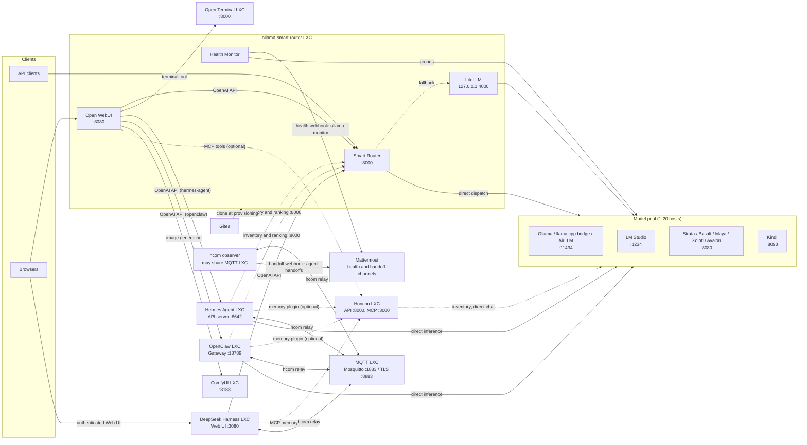
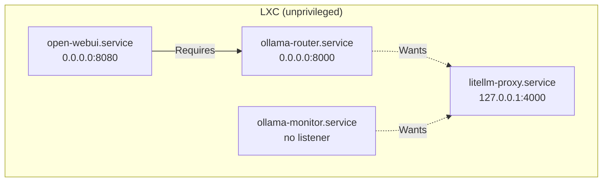
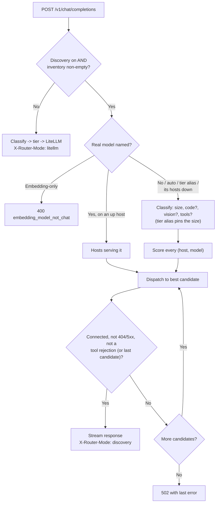

# Ollama Smart Router — Service Architecture

**System:** `ollama-smart-router`
**Platform:** Proxmox VE; an unprivileged Debian 13 router LXC and separate target LXCs
**Built by:** `ollama-smart-router-install.sh` and `targets/*/provision-lxc.sh`
**Last reviewed:** 2026-11-07

---

## 1. Purpose and scope

The router gives clients one OpenAI-compatible endpoint for 1–20 configured
model hosts. It inventories their models and picks a host per request by size,
capabilities and a load-spreading score. The router CT also runs Open WebUI,
a LiteLLM fallback and health monitoring. Optional `targets/` LXCs provide model
servers, Gitea, Mattermost, Honcho memory, the Hermes, OpenClaw and DeepSeek
Harness agents, Open Terminal and ComfyUI. Standalone MQTT and hcom tool
targets coordinate the agent CTs, with optional Mattermost handoffs (§17.7).

GPU workloads stay out of the router CT, configuration lives in a Gitea
repository when available, and changes are applied with validation and
rollback. [README.md](README.md) covers installation and operation; the
[target READMEs](README.md#inference-targets) cover each engine.

## 2. System context



| Dependency | Criticality | If unavailable |
|---|---|---|
| Model hosts (`:11434`, `:1234`, `:8080`, `:8093`) | **Critical** | Fail forward to other hosts; all down → 502 |
| Gitea (HTTP(S)) | Provisioning only | Install falls back to local config; running system unaffected |
| Mattermost (webhook) | Optional | Alerts logged and retried |
| Open Terminal (`:8000`) | Optional | Terminal tool unavailable; chat unaffected |
| Hermes API server (`:8642`) | Optional | `hermes-agent` unavailable in Open WebUI |
| OpenClaw Gateway (`:18789`) | Optional | `openclaw` unavailable in Open WebUI |
| DeepSeek Harness Web UI (`:3080`) | Optional | Its agent UI is unavailable |
| Honcho (`:8000`, `:3000`) | Optional | Agent memory and Open WebUI MCP tools unavailable; chat unaffected |
| ComfyUI (`:8188`) | Optional | Image generation fails; chat unaffected |
| Cloud provider APIs (HTTPS) | Optional | Only explicitly chosen cloud models fail |
| Subscription gateway (`SUBSCRIPTION_GATEWAY_BASE_URL`) | Optional | Requests with `x-router-subscription: 1` get 502 |
| MQTT broker (`:1883` or the TLS port) | Optional | Cross-CT hcom synchronization pauses; routing unaffected |
| hcom relay and Mattermost observer | Optional | Coordination or handoff posts pause; the observer retries from its saved cursor |

---

## 3. Deployment view

All four services run in one unprivileged LXC (default 2 vCPU, 4 GB, 32 GB)
as the non-login account `ollama-router`.



* `open-webui` **Requires** the router, its only backend. The router and
  monitor only **Want** LiteLLM: a fallback must not cascade its restarts.
* All units are `Restart=always`; `open-webui` has `TimeoutStartSec=600`
  because its first start downloads an embedding model.
* Every unit reads `/app/router/secrets.env` as an optional second
  `EnvironmentFile=` (§9).

**Hardening applied to every unit:**

```
User=/Group= service account   NoNewPrivileges=true   PrivateTmp=true   PrivateDevices=true
ProtectSystem=strict           ProtectHome=true       UMask=0027        CapabilityBoundingSet=
RestrictSUIDSGID=true          LockPersonality=true   SystemCallArchitectures=native
RestrictAddressFamilies=AF_UNIX AF_INET AF_INET6
```

Writable exceptions: `open-webui` → `/app/openwebui`; `ollama-monitor` →
`StateDirectory=ollama-monitor`; the router and LiteLLM → nothing.
`tests/test-repo.sh` checks the hardening on every unit, and
`manage-model-servers apply` rolls back a unit that cannot start (§6.1).

---

## 4. Component view

### 4.1 Smart Router (`ollama-router.service`)

FastAPI/uvicorn on `:8000`; the only component that makes routing decisions.

| Endpoint | Purpose |
|---|---|
| `POST /v1/chat/completions` | Classify, select, dispatch; a configured cloud ID goes to LiteLLM (§4.2) |
| `GET /v1/models` | `auto`, tier aliases, configured cloud IDs (`owned_by` = provider), discovered chat models (`owned_by` = kind) |
| `GET /routing/inventory` / `POST /routing/refresh` | Live inventory with per-host state and `kindi_read_timeout_seconds` (which the agent and Honcho dispatchers follow when lower than theirs); force a re-poll |
| `POST /routing/explain` | Decision and scored candidates, without executing |
| `GET /healthz` | Liveness (never needs the key) |
| `ANY /v1/{path}` | Passthrough to LiteLLM (embeddings, etc.) |

With `ROUTER_API_KEY` set, every path except `/healthz` needs
`Authorization: Bearer <key>` (subscription requests send the bare key in
`x-router-api-key` instead and get 503 while no key is set, §4.2). Without a
key on a non-loopback address the router logs a warning.

* **Discovery** polls each host every `refresh_seconds` through its own API
  (§15) and swaps in a new inventory atomically. A host whose connection fails
  during dispatch is marked down until its next good poll.
* **Classifier**: size class (fast/medium/large/xlarge), code, image, tools.
  Only the newest user message is judged (`[classification] scope =
  last_user`), so a system prompt cannot pin a conversation to one tier;
  images are looked for in every message. A request offering tools
  (non-empty `tools`/`functions`, `tool_choice` not `none`) is raised to at
  least `tools_min_class` (`large`).
* **Selector and dispatcher** score every `(host, model)` pair and fail forward
  through the ranking (§5).

### 4.2 LiteLLM proxy (`litellm-proxy.service`)

On `127.0.0.1:4000` only (no master key; the loopback binding is its access
control), in its own hash-locked venv because `litellm[proxy]` pins
fastapi/uvicorn versions that conflict with the router's. It is the fallback
dispatch path and serves the non-chat passthrough. `manage-model-servers`
generates `litellm_config.yaml` with one deployment per (tier, host), each
kind's provider (`ollama/`, `lm_studio/`, `openai/`) and token reference,
`latency-based-routing` and cross-tier fallbacks. `router_settings` is passed
to `litellm.Router` as keyword arguments (checked against the pinned
1.75.5.post1).

**Cloud API models.** `openai/<id>`, `anthropic/<id>` and `gemini/<id>` are
served through LiteLLM when their IDs (`CLOUD_*_MODELS` in `env/router.env`)
and keys (`secrets.env`) are set; every regeneration rebuilds one deployment
per ID (`model_name` = `model` = `<provider>/<id>`, `api_key:
os.environ/<PROVIDER>_API_KEY`). They never join discovery, tier fallbacks or
`auto`, so cloud billing is always an explicit choice. The router checks the
name before local selection: a configured ID goes to LiteLLM with
`X-Router-Mode: cloud` and the client's `Authorization` dropped; an
unconfigured prefixed name is treated as local if a host lists it (LM Studio's
`openai/gpt-oss-20b`), else 404 `cloud_model_not_configured`.

**Subscription gateway.** `SUBSCRIPTION_GATEWAY_BASE_URL` points to a separate,
newer LiteLLM gateway for signed-in Codex and Claude Code clients. A request
with `x-router-subscription: 1` on any `/v1` path goes there unchanged
(`X-Router-Mode: subscription`), authenticating to OSR with the bare key in
`x-router-api-key`; the client's `Authorization` login and `x-litellm-api-key`
pass through and the router strips its own two headers. The URL must be an
HTTPS or loopback HTTP root URL (otherwise logged and ignored, and refused by
`validate_config`); without it such requests get 503
`subscription_gateway_not_configured`. The pinned LiteLLM, discovery and Open
WebUI's shared connection never see these credentials.

### 4.3 Open WebUI (`open-webui.service`)

Chat UI on `:8080`, pointed at the **router** (not LiteLLM) with
`ROUTER_API_KEY` as `OPENAI_API_KEYS`. Python 3.12 in its own venv (§7);
version pinned in `services/open-webui/requirements.txt`.

### 4.4 Health monitor (`ollama-monitor.service`)

No listener. Every `interval_seconds` (15) it probes each distinct host in
`MODEL_SERVERS`/`BACKEND_*` once, labelling alerts with its tiers: Ollama on
`/api/tags`, other kinds on `/v1/models` with their token. Strata-style
servers (Strata, Basalt, Maya, Xolotl, Avalon, Kindi) count as down while that
list is empty, and any rejected token counts as down. It also probes LiteLLM,
the router's `/healthz` and Open WebUI's `/health`. A state change needs
`fail_threshold` (3) or `recover_threshold` (2) consecutive results; only
transitions are posted, and undelivered alerts are retried every cycle. A
startup notice, at most once per `notice_interval_seconds` (3600), doubles as a
webhook check without delaying host alerts.

The **keep-alive maintainer** exists because Ollama's OpenAI endpoint ignores
`keep_alive`. It runs in its own thread (a slow load never delays health
checks) and touches only Ollama hosts; see
[Keeping models loaded](README.md#keeping-models-loaded).

---

## 5. Request routing

### 5.1 Decision flow



Two checks come first and skip classification: `x-router-subscription: 1`
goes to the subscription gateway, and a configured cloud ID to LiteLLM (§4.2).

A named model whose hosts are all down is routed by content with
`X-Router-Warning: model-unavailable`. An image request with no vision
candidate gets `X-Router-Warning: no-vision-model` (400 with `vision_strict =
true`); a tool request whose candidates all lack tools gets `no-tool-model`
(400 `no_tool_model` with `tools_strict = true`).

### 5.2 Scoring

| Signal | Effect |
|---|---|
| **Size-band fit** | Class → band `0:9`, `9:20`, `20:70`, `70:999` B (ceilings exclusive). In band scores 1.0, outside decays by `band_falloff`; if nothing is in band, candidates are ordered by distance to it |
| **Extremes within class** | Large requests bias larger, fast requests smaller |
| **Code** | `+code_match` for code→code model; `−code_match × offtask_penalty` for a code model on prose |
| **Vision** | `+vision_match` for image→vision model; `−vision_match` otherwise; small penalty for a vision model on text |
| **Residency** | `+loaded_bonus` for models reported loaded (LM Studio, Strata-style); `lmstudio_loaded_only` excludes cold LM Studio models |
| **Unknown size** | `unknown_params` (0.3): usable, never preferred |
| **Embeddings** | Structurally excluded; naming one is a 400 |
| **Tools** | On a tool request, models known to lack tools are excluded (unless nothing else is left); `+tool_match` for reported support over unknown. Support comes from Ollama's `/api/show` capabilities (also the llama.cpp bridge's `MODEL_CAPABILITIES` and AirLLM), LM Studio's `trained_for_tool_use`, and `tool_kinds` in `router.ini` for the `/v1/models` kinds (all six Strata-style kinds by default; their text models count as capable, image generators not). Shown as `tools` in `/routing/inventory` |
| **Context length** | Recorded in `/routing/inventory`, not scored: Ollama the smaller of model limit and configured `num_ctx`; the llama.cpp bridge its per-slot context; AirLLM its window; the `/v1/models` kinds `context_length`, `max_model_len`, `context_window` or `meta.n_ctx`. Ollama's `/api/show` is cached 60 s, keeping the last good answer. It can overstate served context; the agent and Honcho dispatchers use it (§17.1) |
| **Tie rotation** | Candidates within `tie_epsilon` rotate. For a tool request only the same model on several hosts rotates, so an agent loop keeps one model (and its prompt cache) |

Sizes come from `details.parameter_size` (Ollama), `params_string` (LM Studio)
or `parameter_size` (OpenAI-style), else the tag (`qwen3:14b` → 14B), else
`[model_sizes]` for an exact ID (§15). All weights, bands and keywords live in
`router.ini`.

### 5.3 Dispatch and degradation

Chat goes to `<base>/v1/chat/completions` with the real model name and the
backend's own token from `secrets.env`; the client's `Authorization` is never
forwarded. Retries happen only **before** the first byte reaches the client. A
404/5xx from the *last* candidate is passed through.

| Layer | Trigger | Behaviour |
|---|---|---|
| 1. Best candidate | Normal | Direct dispatch |
| 2. Fail-forward | Connect error/timeout (host marked down), transport error, 404, 5xx; on a tool request a 400 rejecting tools (the model is skipped for tool requests until the next poll). Other 400s, including malformed `tools`, are returned and nothing is demoted | Next candidate |
| 3. LiteLLM | Discovery off or inventory empty | Static tiers with LiteLLM's fallbacks |

`[http] connect_timeout_seconds` (3) bounds how long a dead host delays
failover; `read_timeout_seconds` (300) bounds the gap between bytes.

**Kindi.** Kindi serves one request at a time and can read a long prompt for
minutes, so `kindi_read_timeout_seconds` (3600, never below the general read
timeout) applies to Kindi hosts, and to the LiteLLM hop when the tier contains
Kindi. Kindi deployments in `litellm_config.yaml` get that `timeout` (kept in
step by regeneration and `apply`; others keep 600) and Kindi tiers a
`model_group_retry_policy` (no retry after a timeout, one after a 429); because
LiteLLM 1.75 ignores `InternalServerErrorRetries`, the router sends
`x-litellm-num-retries: 1` for them. A Kindi tier is a fallback only for
another Kindi tier on other servers. A Kindi request sent but unanswered within
the budget is never replayed: the router and the Hermes, OpenClaw and Honcho
dispatchers answer 424 with `x-should-retry: false` (LiteLLM's 408 on a Kindi
tier becomes the same) and then send that Kindi nothing until its `/health`
shows it idle, answering a retryable 503 meanwhile. Details:
[Kindi README](targets/kindi/README.md#timeouts-and-retries).

---

## 6. Configuration architecture

Configuration is **version controlled in Gitea and injected at provisioning**.

```
services/ollama-router/     router.py  router.ini  requirements.txt  *.service
services/litellm-proxy/     litellm_config.yaml  requirements.txt/.lock  *.service
services/ollama-monitor/    monitor.py monitor.ini requirements.txt  *.service
services/open-webui/        requirements.txt  *.service
env/router.env              shared env for router/LiteLLM/monitor (no secrets)
env/openwebui.env           Open WebUI environment
install/apply-config.sh     copies everything into its runtime location
install/manage-model-servers.sh   management tool (§6.1)
install/update-router.sh    in-container component updater
targets/<name>/             model targets, services, companions and coordination tools (§16, §17)
targets/*.sh, *.pl          shared helpers: pve-select, nvidia-lxc, signal-rollback, upgrade-guard, pve-firewall-swap
tools/                      sync-embedded.py, update-router-services.sh, upgrade-all.sh, pct-cluster.sh,
                            setup-cluster-ssh.sh, setup-host-gpu.sh,
                            install-nvidia-driver.sh, update-gpu-drivers.sh,
                            install-{gitea,mattermost}.sh (--create-only forwarders),
                            install-{mqtt,hcom}.sh (coordination provisioners, §17.7)
tests/, .gitea/workflows/   tests and CI (§18)
```

One directory per service lets each unit, code, tunables and pins version
independently. Secrets live outside git in `/app/router/secrets.env`. The
coordination targets keep their private configuration outside Gitea too
(§9, §17.7).

**Why pull at provisioning, not on start.** A `git pull` in `ExecStartPre`
would make Gitea a boot dependency and turn a bad commit into a failed boot.
Changes on a running CT are explicit: `git pull`, then `manage-model-servers
apply`.

### 6.1 `manage-model-servers`

Seeded at `install/manage-model-servers.sh` and symlinked to
`/usr/local/bin/manage-model-servers` (commands in the README). It rewrites
`MODEL_SERVERS` and `BACKEND_*` in `env/router.env` and regenerates
`litellm_config.yaml`.

* **Servers are keyed by URL, never by index.** Non-Ollama servers carry a kind
  prefix (`maya+http://host:8080`); a typed `host:port` resolves to the stored
  entry whatever its kind.
* **New hosts are identified before they are accepted** (§15.3) and must list
  models (`--no-probe` overrides). Model tags are checked on the affected
  servers before they are written.
* **Models are per (tier, server)**, as in LiteLLM's model list. Regeneration
  keeps each pair's tag and the whole `router_settings` block; fallbacks are
  rebuilt from existing tiers. A tier's tag governs only the LiteLLM path and
  keep-alive pinning.
* The env rewrite keeps `0640 root:ollama-router`; secret keys are refused in
  `env/router.env` and written to `secrets.env`. Anything `router.ini` omits
  uses `router.py`'s defaults.
* **`apply` validates, snapshots, applies, health-checks and restores on
  failure**, restarting only services whose inputs changed and syncing the
  LiteLLM and Open WebUI venvs with their pins (backing up `webui.db`). The
  LiteLLM venv itself is not rolled back.
* `commit` pushes with the deploy token through a temporary 0600 credential
  file in the remote's URL scheme (git will not match `https://` credentials to
  `http://`), with prompting disabled so a bad token fails at once.
* Guard rails: server count limits, unknown tier, unconfigured server,
  duplicate address, `ollama/` prefix, empty-tier warning.

**Component updates.** `install/update-router.sh` (in the CT) replaces only the
files in `INSTALLER_OWNED_CODE`, checks LF endings and bash/Python syntax before
committing, and runs `apply --all` after a venv rebuild.
`tools/update-router-services.sh` drives it from the host or a second clone
([README](README.md#router-components)).
`tools/upgrade-all.sh` upgrades the router and every target in a Proxmox
cluster in dependency order through their own update paths (§16), with a
before/after functional check and a Proxmox snapshot around each, then prompts
or follows `--on-failure` when one fails
([README](README.md#everything-at-once)). Snapshots are deleted after success
or a verified rollback; skipped failures keep them for recovery. A provisioner's
failure defaults to rolling back, because a
provisioner can stop after changing the CT. Hermes Agent's own code is not
pinned: it moves only with `--update-hermes` (`hermes update`), never past a
`HERMES_COMMIT` pin, and Hermes's API server, dispatcher and dashboard are
checked over HTTP. It runs on one node. Proxmox's `pct`
acts only on its own node's CTs, so the run puts `tools/pct-cluster.sh` first
on `PATH` as `pct` for itself and every provisioner. That wrapper runs the real
`pct` on the CT's node, over root SSH for another node with Proxmox VE 9's own
options (the node name as `HostKeyAlias`, the host key pinned in
`/etc/pve/nodes/<node>/ssh_known_hosts` when published, its address from `/etc/pve/.members`),
streaming `push`/`pull` files. Provisioners also get `PVE_LXC_DIR` pointing at a view of every node's
CT configurations, which their shared `pve-select.sh` helpers read for tags and
addresses. So they reach a router, Honcho, broker or Mattermost CT on any node
without node-specific code. Offline or unreachable nodes are reported and
their CTs are not run. On a terminal the run first offers
`tools/setup-cluster-ssh.sh` for unreachable nodes, then checks them again. A
lock in `/etc/pve/priv` allows one run per cluster.

**Config lock.** Writers take an `flock` on
`/run/lock/ollama-smart-router-config.lock`. `update-router.sh` passes its held
descriptor to the `apply`/`commit` it runs (`CONFIG_LOCK_INHERITED_FD`), which
verifies it really holds the lock. The lock ends with its process;
`clear-lock [--force]` reports, or stops, a hung holder.

---

## 7. Provisioning architecture

The installer validates prompts, storage, network, GPU requirements and Gitea
credentials before creating the router CT. On a cluster it also runs
`tools/setup-cluster-ssh.sh` (`CLUSTER_SSH=fix|check|skip`). That tool checks
root SSH from this node to every node and between all nodes, against each
node's pinned host key. It repairs with `pvecm updatecerts` here and on the
nodes it reaches, and on a terminal can sign in once with a node's root
password; an unverifiable host key must be confirmed by fingerprint first.
Remote repairs need the same consent as local ones (`--yes`, or a terminal
answer). `pvecm updatecerts` imports keys from a regular
`/root/.ssh/authorized_keys` or an existing `authorized_keys.org` into the
shared cluster file. The tool lists entries that could change root SSH access
on every node and asks before proceeding; unattended, it leaves that node
alone. That only postpones the import, since pve-cluster runs
`pvecm updatecerts --silent` whenever it starts; the tool says so, and that
removing the entries (and any `authorized_keys.org`) is what keeps them local.
Upgrades from any node then reach every node; a leftover problem is a warning,
since the router itself does not need it. Selected Gitea and Mattermost CTs
are created on the node running the installer, as are all other new CTs. They
come first and supply their URL, token and webhook as prompt defaults. It then
seeds missing configuration in Gitea (or ships a local tree), creates the
router CT, clones and applies the configuration and starts the four services;
a failed router build removes its half-built CT. Every new CT's ID defaults
to the cluster's next free ID (`pvesh get /cluster/nextid`); the installer
steps past IDs it has already given out in the run, since none of its CTs
exists until created, and each provisioner (through `pve_new_ct_id` in
`targets/pve-select.sh`) offers it to a person or takes it unattended. A preset
or typed ID overrides it; dry runs make no query and need an explicit ID.
Addresses are never chosen automatically.

Selected model targets become the first server entries and are provisioned
after the router starts; Strata-style keys are passed on stdin to
`set-<kind>-token`, followed by one `apply`. Honcho is provisioned before the
agents; companions that register with Open WebUI wait for its admin API key;
DeepSeek Harness needs none. Each target uses its own CT settings; a target
failure leaves the router running with a retry summary.
`NONINTERACTIVE=true` refuses selected targets (they need interactive steps).

MQTT and hcom are standalone follow-ups: `tools/install-mqtt.sh` provisions the
broker, then `tools/install-hcom.sh` attaches each existing agent CT
(`HCOM_TARGET` = `hermes`, `openclaw`, `deepseek-harness` or `observer`;
creates no CT). The observer can share the broker CT and needs a configured
Mattermost CT. All offer a dry run; the broker bundle moves through private
`pct` files; reruns keep credentials, repair drift and restore managed files on
failure (§17.7).

Committed configuration wins over installer defaults; installer-owned code is
updated when `CONFIG_UPDATE_CODE=true`, and `tools/sync-embedded.py` keeps the
installer's embedded copies in sync with their sources. The router and monitor
use Debian 13's Python 3.13; LiteLLM has its own hash-locked venv; Open WebUI
needs Python 3.11–3.12, so 3.12 is found or provisioned and tested as the
service account before its venv is built.

## 8. Network and ports

| Port | Service | Binding | Exposure |
|---|---|---|---|
| 8000 | Smart Router | `0.0.0.0` | LAN API |
| 8080 | Open WebUI | `0.0.0.0` | LAN UI (port chosen at install) |
| 4000 | LiteLLM | `127.0.0.1` | CT-local only |
| 443 | Cloud APIs; subscription gateway | Outbound | LiteLLM → providers; router → gateway (any HTTPS port, or loopback HTTP) |
| 11434 / 1234 / 8080 / 8093 | Model hosts | Outbound | Router, LiteLLM, monitor, agent and Honcho dispatchers → pool |
| 8000 | Open Terminal CT | `0.0.0.0` in its CT | Open WebUI → terminal |
| 8642 / 8765 | Hermes API / local dispatcher | `0.0.0.0` / `127.0.0.1` in its CT | Open WebUI → Hermes; dispatcher → router metadata and model servers |
| 9119 | Hermes dashboard | `0.0.0.0` in its CT, when enabled | Authenticated browser UI |
| 18789 / 8765 | OpenClaw Gateway (API, Control UI) / dispatcher | `0.0.0.0` (loopback without Open WebUI and Control UI) / `127.0.0.1` | Open WebUI and browsers → OpenClaw; dispatcher as for Hermes |
| 3080 | DeepSeek Harness | CT IPv4 address | Browser UI; inbound limited by `DSH_ACCESS_CIDR` |
| 8000 / 3000 / 8765, 8766 | Honcho API / MCP / proxy, embeddings | In its CT / in its CT / `127.0.0.1` | Router, selected agents and Open WebUI; source-restricted firewall |
| 8188 | ComfyUI | `0.0.0.0` in its CT | Open WebUI → ComfyUI (HTTP and WebSocket) |
| 3000 / 8065 | Gitea / Mattermost | CT addresses | Configuration repository / alerts and handoffs |
| 1883, or 8883 for TLS | MQTT broker | `MQTT_BIND_IP` (CT IP; loopback for direct guest installs) | Relays → broker; inbound limited by `MQTT_CLIENT_CIDR` |

With the router CT's firewall enabled, the installer accepts TCP 22, 8000 and
the Open WebUI port from `API_ALLOW_CIDR` (SSH is included because enabling the
firewall sets the input policy to drop). Target CTs are created with
`firewall=1`. Open Terminal, Hermes, OpenClaw and ComfyUI admit only the
router's address (ComfyUI also `UI_ALLOW_CIDR`; Hermes's dashboard and
OpenClaw's Control UI anyone); Honcho admits the router and selected agents;
DeepSeek Harness `DSH_ACCESS_CIDR`; model targets leave rules to the operator.
Hermes and OpenClaw also restrict egress by default to the router API, the
registered model servers, DNS and internet HTTP(S) (§17.1, §17.4). Honcho and
DeepSeek Harness keep one tagged rule each in the router CT's firewall file so
they can reach its API. hcom adds owned outbound rules to the broker (and, for
an observer, Mattermost) before an agent's private-address drops. The MQTT
target installs its own inbound allowlist, effective only with the host or
datacenter firewall enabled. Provisioners that rewrite an existing firewall
file (Hermes, OpenClaw, Honcho, DeepSeek Harness, hcom, MQTT) go through
`targets/pve-firewall-swap.pl`, under the CT's lock and only if the file is
unchanged. No agent coordination API is added to the router.

---

## 9. Security model

* Unprivileged LXCs; non-login service accounts (one per target, §16);
  hardened units (§3).
* The root password is set with `chpasswd` over stdin, never as an argument.
* Config files are **built on the host and pushed in**, never assembled by an
  inner shell, so `'`, `$` or backticks in a token cannot break quoting.
* The cloned repo is `root:root` and `go-rwx` (git writes 0644 by default).
* Tokens reach curl through a file descriptor or header file, never argv.

| Secret | At rest | Notes |
|---|---|---|
| Gitea deploy token, Mattermost webhook | `/app/router/secrets.env` (0640 root:ollama-router) | Never committed; moved out of `env/router.env` by `commit`/`apply` |
| `ROUTER_API_KEY` (= Open WebUI `OPENAI_API_KEYS`) | `secrets.env` | Generated on new installs; `set-api-key` |
| `LMSTUDIO_API_TOKEN`, `STRATA_API_KEY`, `BASALT_API_KEY`, `MAYA_API_KEY`, `XOLOTL_API_KEY`, `AVALON_API_KEY`, `KINDI_API_KEY` | `secrets.env` | `set-<kind>-token`; sent only to that kind; LiteLLM reads `os.environ/...` |
| `OPENAI_API_KEY`, `ANTHROPIC_API_KEY`, `GEMINI_API_KEY` | `secrets.env` | `set-cloud-key`; never forwarded to clients |
| Codex/Claude Code logins, gateway virtual keys | Not kept by OSR | Sent per request and passed through to the subscription gateway |
| Target API keys | `/etc/<target>-target/api-key` (0600) in each target CT; also Xolotl's `/etc/xolotl/xolotl-ds41.json`, Avalon's `/etc/avalon/api-key` and Kindi's `/etc/kindi/kindi.conf` (0640, service group) | Generated in the CT; never in a unit, log or the router's process list |
| Open Terminal key | `/etc/open-terminal/api-key`, root-only `service.env`; Open WebUI connection | Generated in the terminal CT |
| Hermes API server key | `/etc/hermes-target/api-key` (0600), `~hermes/.hermes/.env` (0600); Open WebUI connection | Generated in the Hermes CT |
| Router and backend keys in the Hermes CT | `~hermes/.hermes/.env` (router key); `/etc/hermes-target/backend-keys` (0640) | Pushed as 0600 files; `--reconfigure` after rotation |
| OpenClaw Gateway token | `/etc/openclaw-target/api-key` (0600), `~openclaw/.openclaw/.env` (`OPENCLAW_GATEWAY_TOKEN`; config holds an env SecretRef); Open WebUI connection | Also the Control UI login |
| Router and backend keys in the OpenClaw CT | `/etc/openclaw-target/router.env`, `backend-keys` (0640 root:openclaw-direct) | Readable only by the dispatcher's account |
| Honcho JWT secret, admin key, `osr` workspace key | `/etc/honcho-target/` in the Honcho CT; the workspace key also in Open WebUI's MCP connection and the agents' Honcho settings | Admin key never leaves the CT; `--rotate-keys` |
| Router key in the DeepSeek Harness CT | `/etc/deepseek-harness/service.env` (root-only), service environment | Readable by the agent's tools (§17.6) |
| Hugging Face token (ComfyUI `klein-9b`) | Not kept: installer memory, a 0600 stage file and, during the guest step only, `/root/comfyui-target-deploy/hf-token` (0600) | Never in argv or the CT's environment; removed also on failure |
| MQTT password and hcom relay key/group | `/etc/mqtt-target/relay.json` (0600 root); each CT's `/var/lib/osr-hcom/.osr-hcom/config.toml` (0600 `osr-hcom`; `hermes` in native mode) | Per-group topic ACL; private `pct` transfer; never committed |
| Mattermost handoff webhook | `/etc/mattermost-target/agent-handoffs-webhook-url`, observer `/etc/osr-hcom/mattermost-webhook` (0600 root) | Given only to the observer via systemd `LoadCredential` |

| Accepted risk | Mitigation |
|---|---|
| `GITEA_VERIFY_TLS=false` (TurnKey self-signed cert) | Install the appliance CA and flip the flag in `prompt_gitea_credentials` |
| Router API key optional | `set-api-key --generate`; firewall CIDR; TLS reverse proxy if exposed |
| Backend traffic is plain HTTP | Keep targets on a trusted segment; restrict their ports |
| A Strata-family key is also its admin key (Maya's dashboard) | Restrict the target port to the router CT |
| Gitea tokens cannot be limited to one repository | Dedicated non-admin account with access only to the config repository |
| LiteLLM has no master key | Loopback only; add a master key before exposing it |
| Every router-key holder can spend cloud credit; Open WebUI lists cloud IDs | Opt-in per ID, never chosen by `auto`; restrict their visibility in Open WebUI |
| The gated 9B weights have no reviewed hash | Checked against Hugging Face's authenticated hash and the pinned size; `COMFYUI_KLEIN_9B_SHA256` pins it |
| ComfyUI has no authentication | Firewall allows only the router and `UI_ALLOW_CIDR`; unprivileged service that cannot write its code or venv (§17.3) |
| Hermes users can read router and backend keys and share one memory | Keep `hermes-agent` admin-only or one group; one Hermes profile per user or group |
| OpenClaw's chat token is full Gateway operator access; users share one agent | Token only in Open WebUI and root-only files; keep `openclaw` admin-only or one group; router and backend keys are out of the agent's reach |
| OpenClaw's installer chain is unpinned beyond nvm (Node, npm `latest`) | nvm's `install.sh` SHA-256-checked; Node checked against nodejs.org checksums; `OPENCLAW_VERSION`, `OPENCLAW_NODE_VERSION` pin releases |
| DeepSeek Harness tools can read the router and Honcho keys | Limit its Web UI (`DSH_ACCESS_CIDR`) to people trusted to operate OSR |
| MQTT on 1883 authenticates without TLS | Trusted segment and source allowlist; `mqtts://` for untrusted networks; hcom encrypts payloads |
| Any holder of a group's key can send hcom remote requests to every peer | Key owned by `osr-hcom`; agents use a send-only socket that stamps the sender; one group per trusted set; native Hermes mode opts in |
| Agent memory plugins may capture bus content the agent reads | Separate stores, no bus-to-memory archive; absolute exclusion needs plugin capture-policy changes |

---

## 10. Failure modes

An unreachable model host is skipped until a good poll; another candidate may
answer before streaming begins. With no discovered hosts, routing falls back to
LiteLLM's static tiers, then errors if those fail. An empty `/v1/models` on a
Strata-style server or a rejected token removes its models from the inventory.
A failed `apply` restores the previous files and restarts affected services.
Target upgrades restore their previous runtime and report whether it runs
again. See the [troubleshooting table](README.md#troubleshooting).

A broker outage pauses cross-CT coordination only. MQTT retains a bounded
recent tail, not an unlimited offline queue. The Mattermost observer retries
failed HTTP delivery without advancing its cursor, then restarts under
systemd; a first install starts at the current tail, later starts resume the
saved cursor (or the newest event if the database was replaced while stopped).
A crash after HTTP acceptance but before the cursor is saved can duplicate a
post: delivery is at least once (§17.7).

## 11. Scaling and performance

* **Horizontal:** 1–20 hosts; tiers may hold several. LiteLLM load-balances the
  static path; the router rotates tied candidates.
* **Vertical:** the CT is I/O-bound glue; 2 vCPU / 4 GB is sized for Open
  WebUI's embedding model, not routing.
* **Disk:** Open WebUI pulls CUDA torch by default (~7.5 GB venv). The CT has no
  GPU, so `TORCH_CPU_ONLY=true` installs CPU torch first and `apply` purges
  orphaned `nvidia-*`/`triton` wheels (if the CPU index is unreachable, it
  falls back to CUDA and removes nothing).
* **Discovery cost:** one model list per host per `refresh_seconds`, plus
  Ollama `/api/show` when its one-minute cache expires or on `/routing/refresh`.
* **Single-sequence targets:** AirLLM, Kindi and Maya (by default) serve one
  sequence at a time, which the router cannot see (§14).

---

## 12. Observability

The router exposes inventory, scored explanations and per-decision response
headers; the monitor logs failed webhook deliveries and posts host and
local-service transitions to Mattermost; the
[README](README.md#troubleshooting) lists the commands. Agent dispatchers log
their own decisions (`hermes-direct`, `openclaw-direct`, `honcho-proxy`). The
coordination plane logs to `mosquitto.service` (broker),
`osr-hcom-relay.service` (each participant), `osr-hcom-bus@` units (each bus
request) and `osr-hcom-mattermost.service` (observer). `osr-bus status`,
`inbox` and `follow` go through the bus socket; `tui` is root-only. Handoff
posts include local event IDs and use a channel distinct from health alerts.

## 13. Key design decisions

| Decision | Rejected alternative | Reason |
|---|---|---|
| Routing in the router | Extend LiteLLM | LiteLLM's map is static YAML; discovery would mean reloading config per change |
| Direct dispatch | Always via LiteLLM | Inventory-aware ranking and better-informed fail-forward |
| Keep LiteLLM as fallback | Remove it | A tested static path, plus the non-chat routes |
| Pull config at provisioning | `ExecStartPre` pull | Gitea must not be a boot dependency |
| Separate Python + venv for Open WebUI | Shared venv | `<3.13` constraint; pins conflicting with LiteLLM |
| Keyword lists as JSON arrays | Comma-separated | Exact spacing matters: `"def "` must not match `default` |
| Seed only missing config | Always overwrite | Operator commits win |
| Embeddings excluded structurally | Score them low | A low score is still selectable |
| Kind in the entry prefix | Separate kind list | One string tells every component the API |
| One kind table per component, cross-checked by a test | Shared module | Router, monitor and the bash manager deploy separately |
| Secrets in `secrets.env` | Committed env | Tokens out of git, still readable by every unit |
| Targets in their own LXCs | Engines in the router CT | GPU, memory and disk stay off the router; a failed target is just a down host |
| Hermes as a second Open WebUI connection | Hermes as a pool kind | `auto` could route to Hermes, which calls `auto`: a loop; Hermes has no size or capabilities to score |
| OpenClaw and Honcho reuse Hermes's dispatcher (`DIRECT_ETC`, `DIRECT_SECRETS_FILE`, `DIRECT_CONTEXT_SETTING`) | A copy per agent | One implementation of ranking, task pinning, failover, Kindi gating and stream checks (`tests/test-repo.sh` checks the copies match) |
| Cloud models only when named | Cloud models in the pool or fallbacks | Automatic routing must never incur API charges |
| Subscription logins via a separate gateway selected by header | The pinned LiteLLM, or OSR storing OAuth tokens | Per-client logins need a newer LiteLLM with its own database; OSR never holds them |
| ComfyUI as Open WebUI's image engine | An image route in the router | The router is chat-only; Open WebUI already drives ComfyUI's workflow API |

---

## 14. Known limitations

1. **Hosts are configured, not discovered.** Adding a host is a deliberate
   `manage-model-servers` act.
2. **Classification is lexical** (length and keywords), not semantic.
3. **One shared router key**, not per user; Open WebUI provides user accounts.
4. **No concurrency awareness.** A saturated host is just "up". Single-sequence
   targets queue extra requests; one that times out before its first byte fails
   forward, but the target keeps working on it.
5. **Context windows are not used for routing.** A long prompt may land on a
   small-context model, and the resulting 4xx does not fail forward.
6. **The router CT is a single point of failure** for the API.

Next steps: feed observed latency into scoring; track in-flight requests per
host (e.g. Maya's `/slots`); use the inventory's `context_length` to exclude
models too small for the prompt; add hosts through an endpoint.

---

## 15. Model server kinds

`MODEL_SERVERS` and `BACKEND_*` may mix Ollama, LM Studio and OpenAI-style
APIs. Ollama entries are plain base URLs; other kinds use a prefix.

| Kind | Entry | Models listed at | LiteLLM provider | Token (`secrets.env`) |
|---|---|---|---|---|
| Ollama (incl. llama.cpp bridge, AirLLM) | `http://host:11434` | `/api/tags` (+ `/api/show`) | `ollama/` | — |
| LM Studio | `lmstudio+http://host:1234` | `/api/v1/models` → `/api/v0/models` → `/v1/models` | `lm_studio/` | `LMSTUDIO_API_TOKEN` |
| Strata | `strata+http://host:8080` | `/v1/models` | `openai/` | `STRATA_API_KEY` |
| Basalt | `basalt+http://host:8080` | `/v1/models` | `openai/` | `BASALT_API_KEY` |
| Maya | `maya+http://host:8080` | `/v1/models` | `openai/` | `MAYA_API_KEY` |
| Xolotl | `xolotl+http://host:8080` | `/v1/models` | `openai/` | `XOLOTL_API_KEY` |
| Avalon | `avalon+http://host:8080` | `/v1/models` | `openai/` | `AVALON_API_KEY` |
| Kindi | `kindi+http://host:8093` | `/v1/models` | `openai/` | `KINDI_API_KEY` |

### 15.1 The kind table

Each non-Ollama kind is one row in `SERVER_KINDS` (`router.py`, `monitor.py`)
and in `server_kinds`/`kind_field` (`manage-model-servers.sh`): prefix, secret
key, label, default port and whether it is Strata-style. Everything else is
derived (detection, base URL, token, discovery path, monitor probe, LiteLLM
provider, `--type`, `set-<kind>-token`). `tests/test_monitor.py` fails when the
three tables disagree. A new Strata-style server is one row in each table plus
a detection fingerprint.

### 15.2 LM Studio

The 0.4+ API gives `params_string`, `capabilities.vision` and
`loaded_instances`; 0.3.x gives `type` (llm/vlm/embeddings) and `state`;
`/v1/models` gives names only. Loaded models get `loaded_bonus`;
`lmstudio_loaded_only` excludes cold ones. No keep-alive is sent (LM Studio
uses its own idle TTL).

### 15.3 Strata-style servers (Strata, Basalt, Maya, Xolotl, Avalon, Kindi)

* **Discovery:** model ID, image support (`input_modalities` or
  `architecture.input_modalities`), residency (`status`), `parameter_size` if
  given; otherwise `[model_sizes]` sizes exact IDs
  ([README](README.md#model-sizes-for-unsized-ids)).
* **Health:** an empty `/v1/models` means the engine is not running: down.
* **Detection without a key:** Strata and Basalt by the `service` field of their
  public `/health`; Maya by `glm-5.3-flash` plus a `version` field; Xolotl
  (Strata's server, `service: strata`) by a `deepseek-v4` model id, with its own
  kind and key so a Strata key is never sent to it; Avalon (llama-server, no
  `/health` marker) by `/v1/models` (`"owned_by": "llamacpp"` and an `avalon`
  id), which answers without a key only when none is set; Kindi by `"kindi":
  "<version>"` on its public `/health`. Strata also has older fingerprints. A
  keyed server that cannot identify itself is added as `kind://host`.
* **Keep-alive** is never sent.

---

## 16. Inference targets (`targets/`)

Each model target has a host-side `provision-lxc.sh` that validates settings,
creates an unprivileged CT and passes GPU devices through, and a guest-side
`install-target.sh` that installs and health-checks the engine (both with
`--dry-run`). The router treats it as another host of its kind.

| Target | Router kind | Engine |
|---|---|---|
| [llama.cpp](targets/llamacpp/README.md) | Ollama bridge, :11434 | One GGUF; CUDA, Vulkan or CPU |
| [AirLLM](targets/airllm/README.md) | Ollama API, :11434 | Disk-streamed HF model; slow, single generation |
| [Ollama](targets/ollama/README.md) | Ollama API, :11434 | Community-script CT adopted into a hardened service |
| [Strata](targets/strata/README.md) | `strata`, :8080 | Qwen3.8-Flash-Next |
| [Basalt](targets/basalt/README.md) | `basalt`, :8080 | Blackwell/CUDA 13, `.basalt` pack |
| [Maya](targets/maya/README.md) | `maya`, :8080 | GLM-5.3-Flash; CUDA chosen for CT and card |
| [Xolotl](targets/xolotl/README.md) | `xolotl`, :8080 | DeepSeek-V4.1-Flash; pinned weights |
| [Avalon](targets/avalon/README.md) | `avalon`, :8080 | Qwen3.8-Flash-Next llama.cpp fork; ROCm (RDNA 3) or CUDA; pinned weights |
| [Kindi](targets/kindi/README.md) | `kindi`, :8093 | Ternary-Bonsai-2 2B–27B (or Nanbeige 33B) on NVIDIA from Kepler or the CPU; CUDA 10.2, CuPy 9.6, pinned weights |

Target units run as their own accounts with limited writable paths and no
capabilities; GPU nodes are group-accessible, not root-owned; Strata-style
keys are generated in the CT and kept out of unit files. Supported CT releases
are in the [README's table](README.md#lxc-distribution-support).

**GPUs.** Driver setup precedes CT creation. The installer asks each target
that also runs on AMD Radeon or Intel Arc (Ollama, llama.cpp, Avalon, ComfyUI),
and Kindi, which of the host's GPUs it gets (`tools/setup-host-gpu.sh
--list`), then checks or installs the driver once per chosen card (`--card`)
and once for the NVIDIA-only targets, so targets on one host can use different
cards and vendors. Ollama and ComfyUI receive `GPU_CARD` and drop the other
cards' nodes after their community scripts pass all of the vendor's; llama.cpp,
Avalon (`/dev/kfd` and the render node for ROCm) and Kindi receive the card's
nodes as `GPU_DEVICES`. `tools/update-gpu-drivers.sh` keeps drivers current:
it finds GPU containers from their configs, offers the newest compatible NVIDIA
release (checked against the cards' `supported-gpus.json` and test-built for
the kernels before any container stops), verifies every NVIDIA container can be
synchronized (Debian apt NVIDIA packages are replaced with the `.run`
libraries by `targets/nvidia-lxc.sh`'s cleanup; a guest that cannot be checked
or cleaned blocks the change before any download), then replaces the host
driver and its containers' NVML and CUDA libraries together. For AMD and Intel
it offers the Proxmox kernel-series and `pve-firmware` updates and each
container's own GPU packages.

**Upgrade contract.** Sources and downloads are prepared and verified before
any service interruption; an unchanged healthy target is left alone; success
requires a target-specific readiness check; on failure code and configuration
are restored and the old runtime health-checked. llama.cpp, AirLLM, Ollama and
ComfyUI preserve an intentionally stopped service. Each README describes its
snapshot or side-by-side release strategy. A signal (Ctrl-C, closed SSH,
`kill`) rolls back like a failure: ERR-trap installers carry
`targets/signal-rollback.sh` (runs that trap's rollback, ignoring further
signals), subshell upgrades carry `targets/upgrade-guard.sh` (records the
signal so the subshell takes the rollback path), and DeepSeek Harness and
Honcho turn a signal into a failing exit for their EXIT-trap rollback. After a
hangup the output goes to `/var/log/osr-install-interrupted.log`
(`OSR_INTERRUPT_LOG`).
`tools/upgrade-all.sh` runs these upgrades cluster-wide without overriding any
recorded setting, and additionally compares services, listening ports and the
router's view of the target before and after each one.

Strata, Basalt, Maya, Xolotl, Avalon and Kindi save the last good settings and
reuse them unless non-empty overrides are given; an interrupted first install
resumes its pending settings, and an existing install without a readable
record requires explicit values. Their upgrades take an exclusive lock,
snapshot the runnable tree and unit to `/var/lib/<target>-target/` and remove
the snapshot after success or rollback. Leave disk for one snapshot (it can
contain secrets). If rollback fails, the snapshot is kept beside a
`rollback-failed` marker and every later run stops there until it is deleted
(an upgrade would snapshot over the last good runtime; an unchanged run would
hide it). Model data outside the checkout is not copied.

## 17. Companions and services (`targets/`)

These CTs extend Open WebUI or support the router; none is a model-pool host.

**Open Terminal** ([README](targets/open-terminal/README.md)) is a separate CT
registered as an Open WebUI system terminal connection, from a pinned release
with a hash-locked venv. Its bearer-protected API on 8000 is reachable only
from the router CT when the firewall is on. The connection is admin-only by
default; users granted access share one shell and workspace.

### 17.1 Hermes Agent (`targets/hermes/`)

[Hermes](targets/hermes/README.md) is an Open WebUI agent connection, not a
pool host (routing `auto` through Hermes would loop back into `auto`). Its API
server on 8642 calls a local dispatcher on 8765, which uses router inventory
and ranking as metadata and sends inference directly to a tool-capable server
with at least the configured context (AirLLM excluded; a named model lacking
either is refused). Backend and router keys are pushed as private files;
`--reconfigure` refreshes them. By default inbound API access is limited to the
router and egress to the router, registered model hosts, DNS and public
HTTP(S).

### 17.2 Gitea and Mattermost services (`targets/gitea/`, `targets/mattermost/`)

[Gitea](targets/gitea/README.md) holds configuration history;
[Mattermost](targets/mattermost/README.md) receives alerts. Their CTs come from
Proxmox community scripts; guest installers then create the router account and
token, or channel and webhook, without browser setup. Results and admin
passwords stay in root-only files under `/etc/<service>-target/`; a failed
setup leaves the CT for `--reconfigure`. Use a trusted segment: web setup or
first-account registration is briefly open between the community script and
guest setup.

### 17.3 ComfyUI image generation (`targets/comfyui/`)

[ComfyUI](targets/comfyui/README.md) is Open WebUI's image engine on :8188,
outside the chat pool; Open WebUI drives its queue, WebSocket progress and
image retrieval. The community-script CT is adopted under an unprivileged
`comfyui` account with data in `/var/lib/comfyui-target/`, its unauthenticated
port firewalled to the router and optional `UI_ALLOW_CIDR`. The guest
downloads and verifies the selected FLUX.2 Klein weights before integration;
upgrades build a pinned release beside the running one and switch a symlink
after health checks.

### 17.4 OpenClaw (`targets/openclaw/`)

[OpenClaw](targets/openclaw/README.md) is a second agent connection on Hermes's
pattern. Its Gateway on 18789 serves the agent, the Control UI and, for Open
WebUI, `/v1/chat/completions` (token auth; model `openclaw`). Its provider
`osr` and one provider per model server point at the Hermes dispatcher on
8765, run as `openclaw-direct` with this target's files; model lists (with the
configured context window) are written from the dispatcher's `/v1/models` on
each install run. OpenClaw is installed as the brax.me script does (nvm
v0.40.4, Node 24, `npm install -g openclaw`) without its Ollama step, with the
nvm installer's hash and a Node security floor checked. Firewall and egress
follow Hermes; the Control UI port is open to the LAN when enabled.

### 17.5 Honcho memory (`targets/honcho/`)

[Honcho](targets/honcho/README.md) is shared agent memory in a CPU-only Debian
13 CT: PostgreSQL with pgvector, the Honcho API (8000) and deriver from a
pinned upstream release, and its Streamable HTTP MCP server (3000) on a
checksum-pinned Bun. Its chat model is a router tier or model
(`HONCHO_MODEL=fast`), reached through a local copy of the Hermes dispatcher
(`honcho-proxy`, 127.0.0.1:8765) that picks a model reporting tools and enough
context and probes tool calls and JSON-schema output before anything changes.
Embeddings stay in the CT: `honcho-embedding.service` runs the llama.cpp
target's pinned v0.5.0 `llama-server`, built for the CPU's instruction sets,
with Qwen3-Embedding-0.6B Q8_0 (pinned revision and SHA-256; 1024 dimensions)
on 127.0.0.1:8766. Because llama.cpp scores the whole vocabulary per embedded
token (~1.2 GB per 1000 tokens), the batch is 2048 tokens and Honcho's chunks
1536. A CT using another embedding model is refused by reconfigure before its
data changes (Honcho has no verified in-place vector rebuild).

The admin JWT stays in the CT; Open WebUI (MCP tool server, admin-only until
granted), Hermes, OpenClaw and DeepSeek Harness get a key scoped to the `osr`
workspace and share the `user` peer. The installer provisions Honcho before
the agents and passes its URL and CT to them; an agent's later `--reconfigure`
keeps it (`HONCHO_URL=` turns it off). Inbound is limited to the router and the
selected agents (an agent's MCP rule carries its own tag), and one tagged rule
in the router CT's firewall lets Honcho reach the router. `HONCHO_CONTEXT_TOKENS`
(asked by the installer; 65536 on a first install that omits it) sizes Honcho's
token budgets via `budgets.py`; `HONCHO_<SETTING>` overrides one. Budgets,
release, chat model, output mode and Bun pins persist in the CT
(`budgets.env`, `settings.env`), so reconfigures never fall back to defaults. A
rerun sets aside env, keys, units, Bun and `llama-server`, stops Honcho and
dumps the database before migrations (even for an unchanged commit), restoring
all of them on failure. `--rotate-keys` replaces the JWT secret and both keys
after checking Open WebUI admin access, restoring the prior secret, keys and
Open WebUI connection if a later step fails.

### 17.6 DeepSeek Harness (`targets/deepseek-harness/`)

[DeepSeek Harness](targets/deepseek-harness/README.md) (`dsh`, npm
`@deepseek-ai/dsh`, pinned to 0.2.1-rc.5) is a third agent with its own Web UI
(3080) instead of an Open WebUI registration, so it needs no admin token. A
generated Cordis overlay (`--patch`) adds an `osr` provider (`llm-pi-ai`,
`openai-completions`, `system` role, `max_tokens`) with one model as the
default; the router key is a service environment variable the overlay names,
which the agent's shell tools can read. Inference goes through the router (no
direct dispatcher). Each release installs beside the running one under
`/opt/deepseek-harness/releases/` with a `current` link; a run snapshots the
overlay, env, keys, unit, `AGENTS.md` and profiles, validates the patch with
the new release (`--dump-config`) and on a failed restart restores and
health-checks the previous release and files. A settings record lets
`--reconfigure` keep unspecified settings and an unchanged rerun do nothing.
With Honcho the overlay adds a Streamable HTTP `dsh-mcp-client` entry and a
managed `AGENTS.md` block; unlike the Hermes and OpenClaw plugins, recording
and recall are tool calls the model makes.

### 17.7 MQTT and hcom agent coordination

| Target | Placement | Responsibility |
|---|---|---|
| [MQTT](targets/mqtt/README.md) | Dedicated unprivileged Debian 12/13 LXC; 1 core, 512 MB, 4 GB | Mosquitto, generated credentials, per-group topic ACL, optional TLS and inbound allowlist |
| [hcom](targets/hcom/README.md) | Existing agent CTs | Pinned CLI, local SQLite state in a separate relay account, authenticated MQTT relay, agent bus socket, managed instructions |
| hcom observer | One existing CT per group; can share the broker CT | Relay plus durable Mattermost notifier as `osr-hcom` |

These tools register no model host and need no Open WebUI token. The hcom
installer verifies the upstream 0.7.31 Linux x86_64/aarch64 musl archive's
SHA-256 (no Rust build). `osr-hcom-relay.service` supervises `hcom
relay-worker` as the `osr-hcom` account, which alone can read `HCOM_DIR` and
the group key (any key holder can send remote requests to peers). Agents use
`osr-bus`, a client of `/run/osr-hcom/bus.sock` (`osr-hcom-bus.socket`); each
connection runs `osr-hcom-bus@.service` as the relay account, admits root and
the CT's agent, accepts only send/inbox/follow/status and stamps the sender.
Agents never run hcom, so they never start a stray worker; the unit also stops
one before starting. MQTT does not replace local SQLite: file-only `[relay]`
settings hold the broker, group, password and encryption key, while each CT
keeps its own database and event IDs.

`osr-bus` sends short JSON envelopes with hcom's `send --from ... --go --intent
request -- ...`, addressing stable OSR target names (`hermes`, `openclaw`,
`deepseek-harness`, `all`) without native hcom identities. `inbox` filters
recent envelopes for this target and shows native messages; `follow` streams
new events from a local `--after-id` cursor. The 2,000-character limit and
recent-event inbox suit handoffs, not transcript archival or durable task
acknowledgements.

**Framework integration.** Hermes, OpenClaw and DeepSeek Harness poll `osr-bus
inbox` through their terminal tools, as managed instruction blocks tell them
(Hermes reads `/home/hermes/AGENTS.md`, its working directory's). hcom 0.7.31
has no native hooks or wakeups for OpenClaw and Harness. Hermes's native plugin
is opt-in (`HCOM_HERMES_NATIVE=true`): the relay then runs as `hermes`, which
holds the key, and `/hcom start hermes` works only in messaging-platform chats
(the plugin treats Open WebUI's API-server sessions as not a chat). Tool use
depends on the model; received messages are peer input and the bus executes
nothing. `HCOM_INSTRUCTIONS_FILE` selects a custom path; unrelated instructions
are preserved.

**Mattermost flow.** The observer provisioner runs
`targets/mattermost/configure-agent-handoffs.sh` with local `mmctl` in the
configured Mattermost CT, keeping or creating the dedicated `agent-handoffs`
channel and webhook and rejecting the health webhook's channel.
`osr-hcom-mattermost.service` gets its webhook through `LoadCredential` and
follows JSONL from `hcom events --follow --full --type message --after-id ...`,
forwarding bus envelopes and native request/handoff signals with capped text,
active mentions disabled and no channel override. Only a successful delivery or
an intentionally skipped event advances the atomically saved cursor (§10). One
observer per group avoids duplicate streams.

**Memory boundary.** No bus-to-Honcho archive or transcript retention job is
installed; Honcho's plugins and Harness's MCP memory stay separate from hcom's
stores, but an agent can pass what it reads to memory, so separate storage and
instructions alone do not enforce exclusion.

**Reconfiguration and recovery.** Healthy unchanged installs report `nothing to
do`; file digests detect drift; broker credentials persist. hcom snapshots its
binary, library, managed instructions, Hermes plugin configuration and units;
MQTT its bundle and managed listener/password/ACL/TLS files. Failures restore
managed files and check previous services; a failed rollback retains
`/etc/osr-hcom/rollback` or `/etc/mqtt-target/rollback` and blocks further
installs. Apt packages and runtime databases are outside the snapshots. Rerun
clients after changing the broker's advertised host or port, and supply TLS
files on every TLS broker reconfigure.

## 18. Verification and CI

* `tests/run-tests.sh` runs every shell and pytest suite and every
  `targets/*/test-*.sh`, and requires a `describe` test for every installer and
  manager function. Nothing touches the network, a CT or a GPU. Most target
  end-to-end cases need root (or `unshare -r`) and skip otherwise; the result
  lists skips, and `--strict` (or `CI=true`) fails on any.
* `tests/test-repo.sh` checks repository invariants: unit hardening, no secrets
  in `env/`, UTF-8, embedded copies in sync, Honcho's copy of the Hermes
  dispatcher, Maya's update switch, pinned weights and commits (Xolotl, Avalon,
  Kindi), LiteLLM locks and the upgrade contract.
* `.gitea/workflows/tests.yml` runs the suites with `--strict` (its job
  container must run as root), ShellCheck on every repository shell file and
  ruff, with separate router, bridge and LiteLLM venvs. The `strata-upstream`,
  `maya-upstream`, `xolotl-upstream`, `avalon-upstream`, `kindi-upstream` and
  `honcho-upstream` jobs each fetch one pinned upstream, kept separate so a
  GitHub outage cannot hide the main results.
* `tests/test-upgrade-all.sh` keeps `upgrade-all.sh`'s deploy file lists equal
  to what each provisioner copies and its service lists complete, and runs it
  against a mocked `pct`: order, filters, snapshots (kept after a skipped failure),
  retry, rollback, skip, abort, unattended policies, recorded MQTT and Open
  Terminal settings, the Hermes HTTP checks and `--update-hermes`, and a
  three-node cluster (a CT on another node, offline and unreachable nodes,
  `--node`, several routers, dependencies across nodes, the cluster lock, and
  `pve-select.sh` reading the merged configuration view).
* `tests/test-setup-cluster-ssh.sh` plays a three-node cluster (plus an offline
  node) with a fake `ssh` that knows each connection's source and destination.
  It covers: standalone hosts; this node's key, link and published host key;
  refused keys; stale and unpublished host keys; refused connections and
  firewalls between nodes; repairs over existing SSH (once per node);
  password sign-ins only on a terminal, with a confirmed one-time host key; and
  `--check`, `--yes` and `--node`.
* `tests/test-pct-cluster.sh` checks the cluster `pct` wrapper with a fake
  `ssh`: local passthrough, forwarding to the CT's node and exit statuses,
  argument quoting, stdin handling, streamed `push`/`pull` without leftovers,
  offline and unreachable nodes, shared connections that never hold a caller's
  output, cluster-wide `list` and the guard against calling itself.
* `hcom-install`, `mqtt-install`, `hcom-integration` and
  `mattermost-agent-handoffs` cover configuration, routing, file modes,
  snapshot restore, cursor/retry/reset behaviour and channel separation without
  root. The optional `targets/hcom/test-live.py` exercises real hcom and
  Mosquitto with a local webhook; it does not validate a real Proxmox, systemd,
  agent or Mattermost deployment.

---

## Appendix A — Runtime file layout

Router CT:

| Path | Purpose |
|---|---|
| `/app/router/.env`, `/app/router/secrets.env` | Runtime config and private keys/webhook |
| `/app/router/router.py`, `router.ini`, `monitor.py`, `monitor.ini` | Routing and monitoring code and tunables |
| `/app/router/litellm_config.yaml` | Tier deployments and fallbacks |
| `/app/router/venv/`, `/app/litellm/venv/` | Separate Python 3.13 environments |
| `/app/openwebui/.env`, `venv/`, `data/` | Open WebUI config, Python 3.12 environment and state |
| `/app/config-repo/` | Root-only clone of the configuration repository |
| `/usr/local/bin/manage-model-servers` | Link to the management script in the config repo |
| `/var/lib/ollama-monitor/` | Monitor state and notice timestamp |
| `/var/backups/ollama-smart-router/` | Root-only `apply` snapshots |
| `/run/lock/ollama-smart-router-config.lock` | Configuration write lock |

Target paths vary by engine; Strata-style CTs use `/opt/<target>/` for code,
`/var/lib/<target>/` for models, `/etc/<target>-target/` for private settings
and keys and `/var/lib/<target>-target/` for upgrade snapshots. Each
[target README](README.md#inference-targets) lists its paths.

Coordination paths (§17.7):

| Location | Path | Purpose |
|---|---|---|
| Broker CT | `/etc/mqtt-target/relay.json` | Root-only group/password/encryption-key bundle |
| Broker CT | `/etc/mosquitto/conf.d/osr-hcom.conf`, `/etc/mosquitto/osr-hcom.{passwd,acl,crt,key}` | Managed listener, authentication, ACL and optional TLS |
| Agent CTs | `/var/lib/osr-hcom/.osr-hcom/` | Relay-account `config.toml`, `hcom.db`, logs and state (Hermes native mode: `/home/hermes/.osr-hcom/`) |
| Observer CT | `/var/lib/osr-hcom/bridge/cursor.json`, `/etc/osr-hcom/mattermost-webhook` | Acknowledged notification cursor; root-only webhook credential source |
| Each hcom CT | `/usr/local/bin/hcom`, `/usr/local/bin/osr-bus`, `/usr/local/lib/osr-hcom/` | Pinned binary, adapter, Python helpers |
| Each hcom CT | `/etc/osr-hcom/bus.json`, `/etc/osr-hcom/target` | This CT's target, relay account and state path (world-readable, no secrets) |
| Agent CTs | `/run/osr-hcom/bus.sock`, `osr-hcom-bus@.service` | Restricted agent access to the relay account (Hermes gateway gets an `HCOM_DIR` drop-in only in native mode) |
| Mattermost CT | `/etc/mattermost-target/agent-handoffs-webhook-url` | Separate handoff webhook; health `webhook-url` preserved |

## Appendix B — Configuration surface

| File | Owns |
|---|---|
| `router.ini` | `[thresholds]`, `[keywords]`, `[tiers]`, `[classification]` (scope, vision_strict, tools_min_class, tools_strict, tool_kinds), `[http]` timeouts, `[discovery]` (bands, name lists, LM Studio behaviour, capability probe), `[weights]`, `[model_sizes]` |
| `monitor.ini` | Interval, timeout, Ollama health path, alert thresholds, startup notice, local services, keep-alive |
| `env/router.env` | Hosts, per-tier backends and tags, keep-alive, LiteLLM URLs, `CLOUD_*_MODELS`, `SUBSCRIPTION_GATEWAY_BASE_URL`, Gitea/Mattermost settings (no credentials) |
| `secrets.env` (not in git) | Gitea token, webhook, router key, backend tokens, cloud keys |
| `env/openwebui.env` | UI port, data dir, upstream API base, auth toggle |
| `litellm_config.yaml` | Static tier → host deployments, strategy, fallbacks, Kindi timeouts and retry policies |
| `requirements.txt` / `.lock` | Pins per service; LiteLLM hash-locked |
| `/etc/<target>-target/*` (target CTs) | Engine settings, settings records, launcher |
| `/etc/mqtt-target/relay.json` (broker, not in git) | Broker URL, relay group, password, encryption key |
| `HCOM_DIR/config.toml` (each participant, not in git) | File-only relay settings |
| Managed `osr-hcom` instruction blocks and relay/bus units | Agent coordination workflow and relay state separation |
