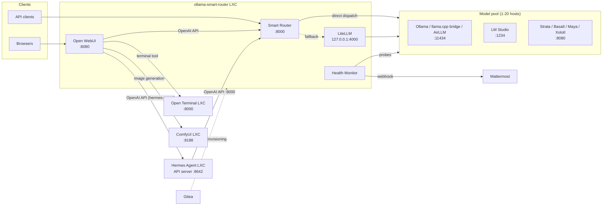
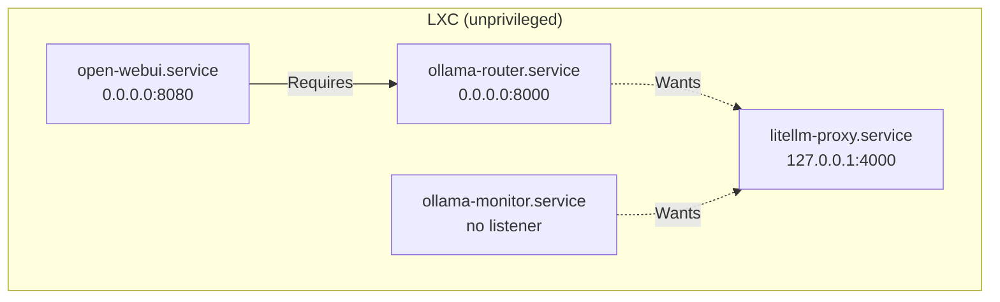
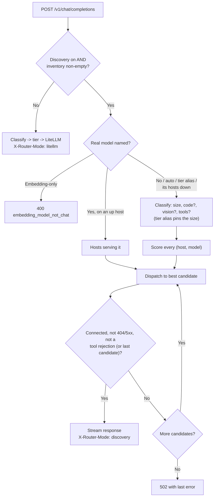
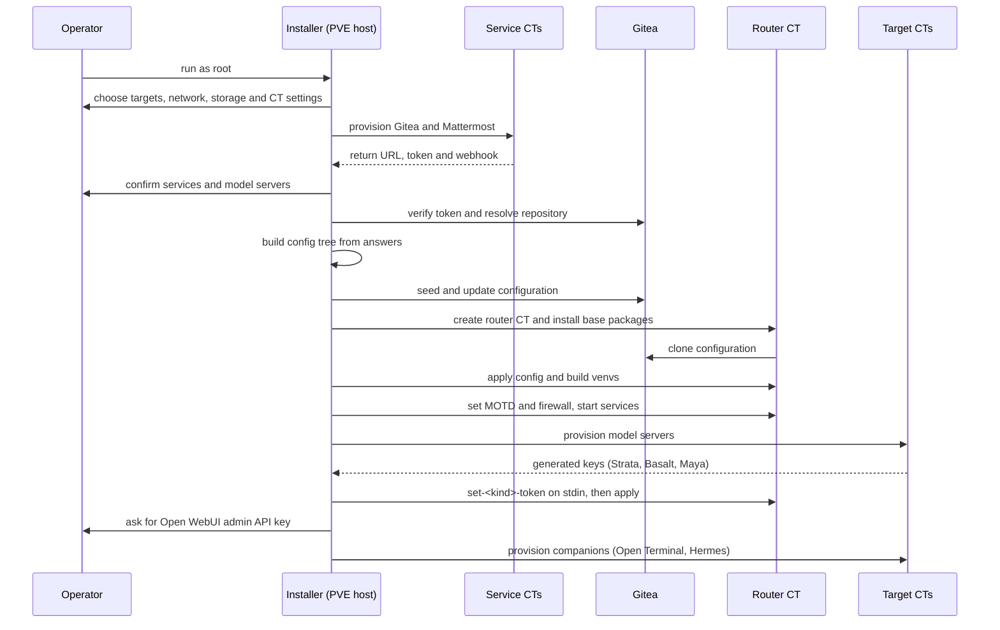

# Ollama Smart Router — Service Architecture

**System:** `ollama-smart-router`
**Platform:** Proxmox VE; an unprivileged Debian 13 LXC for the router, one LXC per inference target
**Built by:** `ollama-smart-router-install.sh` and `targets/*/provision-lxc.sh`
**Last reviewed:** 2026-10-22

Operating procedures are in [README.md](README.md); this document explains how
the system is put together and why.

---

## 1. Purpose and scope

The router presents a **single OpenAI-compatible endpoint** in front of a pool
of self-hosted model servers (Ollama, LM Studio, llama.cpp, AirLLM, Strata,
Basalt, Project Maya, Xolotl) and decides *per request* which model on which host
answers. It addresses three problems:

1. **Model sprawl.** Clients should not need to know which host serves what.
2. **Cost/latency mismatch.** Small prompts should not occupy a large model, and
   hard prompts should not go to a small one.
3. **Operational drift.** Models come and go on hosts, so static configuration
   goes stale.

The router CT covers routing, load spreading, health alerting, a chat UI and
the configuration lifecycle. `targets/` provisions inference servers (§16),
an Open Terminal companion (§17), a Hermes Agent client (§17.1), the Gitea
and Mattermost services (§17.2) and a ComfyUI image engine (§17.3) in their own LXCs. The router treats an inference target like any other external model
host; Hermes consumes the router's public API and is offered in Open WebUI as
one more model.

| Quality attribute | How it is addressed |
|---|---|
| **Availability** | No service start depends on Gitea; three-layer degradation; failed hosts skipped mid-request |
| **Correct routing** | Live inventory, not static assumptions; embedding models structurally excluded |
| **Operability** | Every decision inspectable via headers and endpoints; config version controlled; every change can be rolled back |
| **Reproducibility** | Router rebuilt from one script plus a git repo; targets from their own scripts |
| **Least privilege** | One unprivileged account per CT; localhost-bound internals; hardened units; secrets outside git |

---

## 2. System context



| Dependency | Criticality | If unavailable |
|---|---|---|
| Model hosts (`:11434`, `:1234`, `:8080`) | **Critical** | Fail forward to other hosts; all down → 502 |
| Gitea (HTTP(S)) | Provisioning only | Install falls back to local config; running system unaffected. `targets/gitea` can provision a Debian CT from the community script, already set up for the router (§17.2) |
| Mattermost (webhook) | Optional | Alerts logged and retried. `targets/mattermost` can provision one in its own CT from the community script, with its webhook (§17.2) |
| Open Terminal (`:8000`) | Optional | Terminal tool unavailable; chat unaffected |
| Hermes API server (`:8642`) | Optional | `hermes-agent` unavailable in Open WebUI; other models unaffected |
| ComfyUI (`:8188`) | Optional | Image generation in Open WebUI fails; chat unaffected |

> After provisioning, the only runtime dependency is the model pool. Gitea and
> Mattermost outages cannot stop the service or prevent it booting.

Hermes is an optional agent client. It calls the router's OpenAI-compatible
`/v1` API with the router key; it is not part of the model pool (§17.1).

---

## 3. Deployment view

All four services run in one unprivileged LXC (default 2 vCPU, 4 GB, 32 GB)
as the non-login account `ollama-router`.



* `open-webui` **Requires** the router, its only backend. The router and
  monitor only **Want** LiteLLM: it is a fallback, and `Requires=` would let
  every LiteLLM restart cascade into the router and UI.
* All units are `Restart=always`. `open-webui` has `TimeoutStartSec=600`,
  because its first start downloads an embedding model.
* Every unit reads `/app/router/secrets.env` as an optional second
  `EnvironmentFile=` (§9).

**Hardening applied to every unit:**

```
User=/Group= service account   NoNewPrivileges=true   PrivateTmp=true   PrivateDevices=true
ProtectSystem=strict           ProtectHome=true       UMask=0027        CapabilityBoundingSet=
RestrictSUIDSGID=true          LockPersonality=true   SystemCallArchitectures=native
RestrictAddressFamilies=AF_UNIX AF_INET AF_INET6
```

Writable exceptions: `open-webui` → `/app/openwebui`; `ollama-monitor` →
`StateDirectory=ollama-monitor` (startup-notice timestamp); the router and
LiteLLM → nothing. `tests/test-repo.sh` checks `ProtectSystem=strict` and an
empty capability set on every unit. A unit that cannot start under them is
caught by `manage-model-servers apply`, which rolls it back (§6.1).

---

## 4. Component view

### 4.1 Smart Router (`ollama-router.service`)

FastAPI/uvicorn on `:8000`; the only component that makes routing decisions.

| Endpoint | Purpose |
|---|---|
| `POST /v1/chat/completions` | Classify, select, dispatch |
| `GET /v1/models` | `auto`, tier aliases and discovered chat models (`owned_by` = server kind) |
| `GET /routing/inventory` / `POST /routing/refresh` | Live inventory with per-host state; force a re-poll |
| `POST /routing/explain` | Decision and scored candidates, without executing |
| `GET /healthz` | Process liveness (never needs the key) |
| `ANY /v1/{path}` | Passthrough to LiteLLM (embeddings, etc.) |

With `ROUTER_API_KEY` set, every path except `/healthz` needs
`Authorization: Bearer <key>`. Without a key on a non-loopback address, the
router logs a warning at start-up.

* **Discovery task** — polls each host every `refresh_seconds` through its own
  API (§15) and swaps in a new inventory atomically. A host whose connection
  fails during dispatch is marked down until its next good poll.
* **Classifier** — size class (fast/medium/large/xlarge), code or not, image
  or not, tools or not. Only the newest user message is judged
  (`[classification] scope = last_user`), so a system prompt cannot pin a
  conversation to one tier. Images are looked for in every message. A request
  that offers tools (non-empty `tools`/`functions`, `tool_choice` not `none`)
  is raised to at least `tools_min_class` (default `large`).
* **Selector + dispatcher** — scores every `(host, model)` pair and fails
  forward through the ranking (§5).

### 4.2 LiteLLM proxy (`litellm-proxy.service`)

On `127.0.0.1:4000`, not reachable from the network. It is the fallback
dispatch path and backs the non-chat passthrough. `manage-model-servers`
generates `litellm_config.yaml` with one deployment per (tier, host), using
each kind's provider (`ollama/`, `lm_studio/`, `openai/`) and token reference,
`latency-based-routing` and cross-tier fallbacks. Everything under
`router_settings` (fallbacks included) is passed to `litellm.Router` as
keyword arguments (checked against the pinned 1.75.5.post1). It has no master
key; the loopback binding is its access control. It has its own hash-locked
venv, because `litellm[proxy]` pins fastapi/uvicorn versions that conflict
with the router's.

### 4.3 Open WebUI (`open-webui.service`)

Chat UI on `:8080`. It points at the **router**, not LiteLLM, and authenticates
with `ROUTER_API_KEY` (as `OPENAI_API_KEYS`). It runs on Python 3.12 in its
own venv (§7.3). The version is pinned in
`services/open-webui/requirements.txt`.

### 4.4 Health monitor (`ollama-monitor.service`)

No listener. Every `interval_seconds` (15) it probes each distinct host in
`MODEL_SERVERS`/`BACKEND_*` once, labelling alerts with that host's tiers:
Ollama on `/api/tags`, other kinds on `/v1/models` with their token.
Strata/Basalt/Maya also count as down while that list is empty, and a rejected
token counts as down. It also probes LiteLLM, the router's `/healthz` and Open
WebUI's `/health`. A state change needs `fail_threshold` (3) or
`recover_threshold` (2) consecutive results, and only transitions are posted.
Undelivered alerts are retried every cycle. A startup notice, at most once per
`notice_interval_seconds` (3600), doubles as a webhook check. That limit applies
only to the notice; it does not delay host-down alerts.

The **keep-alive maintainer** (own thread) exists because Ollama's OpenAI
endpoint ignores `keep_alive`. When `OLLAMA_KEEP_ALIVE` is set, every 240 s it
calls the native `/api/chat` on each up Ollama host of a tier, with an empty
message list, the tier's model and that keep-alive. This loads the model and
resets its timer without generating anything. Other kinds are skipped.

---

## 5. Request routing

### 5.1 Decision flow



A named model whose hosts are all down is routed by content with
`X-Router-Warning: model-unavailable`. An image request with no vision
candidate gets `X-Router-Warning: no-vision-model`, or a 400 when
`vision_strict = true`. Likewise, a tool request whose candidates are all known
to lack tools gets `X-Router-Warning: no-tool-model`, or a 400
`no_tool_model` when `tools_strict = true`.

### 5.2 Scoring

| Signal | Effect |
|---|---|
| **Size-band fit** | Class → band `0:9`, `9:20`, `20:70`, `70:999` B, ceilings exclusive. In band scores 1.0; outside decays by `band_falloff`. If nothing is in band, candidates are ordered by distance to it (otherwise all would tie at the zero floor) |
| **Extremes within class** | Large requests bias larger, fast requests smaller |
| **Code** | `+code_match` for code→code model; `−code_match × offtask_penalty` for a code model on prose |
| **Vision** | `+vision_match` for image→vision model; `−vision_match` otherwise; small penalty for a vision model on text |
| **Residency** | `+loaded_bonus` for models reported loaded (LM Studio, Strata, Basalt, Maya); `lmstudio_loaded_only` excludes cold LM Studio models |
| **Unknown size** | `unknown_params` (0.3): usable, never preferred |
| **Embeddings** | Structurally excluded; naming one on the chat endpoint is a 400 |
| **Tools** | On a tool request, models known to lack tools are excluded (kept only if nothing else is left); `+tool_match` for a model reported tool-capable over an unknown one. Support is known from Ollama's `/api/show` capabilities (also the llama.cpp bridge's `MODEL_CAPABILITIES` and AirLLM) and LM Studio's `trained_for_tool_use`; Strata-style servers and untrained LM Studio models are unknown. Shown per entry as `tools` in `/routing/inventory` |
| **Tie rotation** | Candidates within `tie_epsilon` of the best rotate, spreading load. For a tool request only the same model on several hosts rotates, so an agent loop keeps one model (and its prompt cache) |

Sizes come from `details.parameter_size` (Ollama), `params_string` (LM Studio)
or `parameter_size` (OpenAI-style). Failing that, from the tag (`qwen3:14b` →
14B), or from `[model_sizes]` for an exact ID (§15). All weights, bands and
keyword lists live in `router.ini`.

### 5.3 Dispatch and degradation

Chat is sent to `<base>/v1/chat/completions` with the real model name and the
backend's own token from `secrets.env`; the client's `Authorization` is never
forwarded. Retry happens only **before** the first byte reaches the client,
because a partial stream cannot be replayed. A 404/5xx from the *last*
candidate is passed through as-is.

| Layer | Trigger | Behaviour |
|---|---|---|
| 1. Best candidate | Normal | Direct dispatch |
| 2. Fail-forward | Connect error/timeout (host marked down), transport error, 404, 5xx; on a tool request, a 400 that rejects tool support, such as "does not support tools" (the model is then skipped for tool requests until the next poll; from the last candidate the 400 is returned). Any other 400, including a malformed `tools` schema, is returned as-is and nothing is demoted | Next candidate |
| 3. LiteLLM | Discovery off or inventory empty | Static tiers with LiteLLM's own fallbacks |

`[http] connect_timeout_seconds` (3) bounds how long a dead host delays
failover; `read_timeout_seconds` (300) bounds the gap between bytes.

---

## 6. Configuration architecture

Configuration is **version controlled in Gitea and injected at provisioning
time**.

```
services/ollama-router/     router.py  router.ini  requirements.txt  *.service
services/litellm-proxy/     litellm_config.yaml  requirements.txt/.lock  *.service
services/ollama-monitor/    monitor.py monitor.ini requirements.txt  *.service
services/open-webui/        requirements.txt  *.service
env/router.env              shared env for router/LiteLLM/monitor (no secrets)
env/openwebui.env           Open WebUI environment
install/apply-config.sh     copies everything into its runtime location
install/manage-model-servers.sh   management tool (§6.1)
install/update-router.sh    in-container component updater
targets/<name>/             inference targets, companions and services (§16, §17)
tools/                      sync-embedded.py, update-router-services.sh, install-{gitea,mattermost}.sh (forwarders to targets/, --create-only)
tests/, .gitea/workflows/   tests and CI (§18)
```

One directory per service lets each service's unit, code, tunables and pins
version independently. Secrets live outside git in `/app/router/secrets.env`.

**Why pull at provisioning, not on start.** A `git pull` in `ExecStartPre`
would make Gitea a boot dependency of every service, and a bad commit would
break startup instead of failing at install. Changes on a running CT are an
explicit act: `git pull` followed by `manage-model-servers apply`.

### 6.1 `manage-model-servers`

Seeded at `install/manage-model-servers.sh` and symlinked to
`/usr/local/bin/manage-model-servers`, so a `git pull` updates the command (the
command list is in the README). It rewrites `MODEL_SERVERS` and `BACKEND_*` in
`env/router.env` and regenerates `litellm_config.yaml`. Design points:

* **Servers are keyed by URL, never by index.** Non-Ollama servers carry a kind
  prefix (`maya+http://host:8080`), and a typed `host:port` resolves to the
  stored entry whatever its kind.
* **New hosts are identified before they are accepted** (§15.3), and must list
  their models (`--no-probe` overrides). Model tags are checked on the
  affected servers before they are written.
* **Models are per (tier, server)**, as in LiteLLM's model list. Regeneration
  keeps each pair's tag and the whole `router_settings` block, so hand edits
  survive. Fallbacks are rebuilt from existing tiers.
* A tier's tag governs only the LiteLLM path and keep-alive pinning; discovery
  picks from the live inventory.
* The env rewrite keeps the file's `0640 root:ollama-router` mode. Secret keys
  are refused in `env/router.env` and written to `secrets.env`.
* **`apply` validates, snapshots, applies, health-checks and restores on
  failure.** It restarts only services whose inputs changed and brings the
  LiteLLM and Open WebUI venvs in line with their pins (backing up `webui.db`
  first). The LiteLLM venv itself is not rolled back.
* **No automatic migration** of old tier names. The services do read the old
  env keys through a read-only fallback chain, and anything `router.ini` omits
  uses the defaults in `router.py`, so older configs still start.
* `commit` pushes with the deploy token through a temporary 0600 credential
  file. The credential uses the remote's URL scheme, because git will not match
  `https://` credentials to an `http://` request. Prompting is disabled, so a
  bad token fails at once.
* Guard rails: server count limits, unknown tier, unconfigured server,
  duplicate address, `ollama/` prefix, empty-tier warning.

**Component updates.** `install/update-router.sh` (in the CT) takes only
installer-owned code (`INSTALLER_OWNED_CODE`), plus `router.ini`/`monitor.ini`
with `--with-tunables`. It checks LF endings and bash/Python syntax, commits to
the config repo, rebuilds the router venv if requirements changed, runs
`apply` (`--all` after a venv change) and pushes. A failed apply resets the
commit and restores the venv's packages. `tools/update-router-services.sh`
drives it from the Proxmox host or a second clone.

**Config lock.** Writers take an `flock` on
`/run/lock/ollama-smart-router-config.lock`. `update-router.sh` hands its held
descriptor to the `apply`/`commit` it runs (`CONFIG_LOCK_INHERITED_FD`), and
the child checks that the descriptor really holds the lock. The lock ends with
its process; `clear-lock [--force]` reports, or stops, a hung holder.

---

## 7. Provisioning architecture



**Targets chosen at install.** An interactive install offers the `targets/`
provisioners from a menu.
* **Services first.** Selected Gitea and Mattermost targets are created right
  after the target settings, before the Gitea and Mattermost prompts. Their
  results (Gitea's URL, router account and token; Mattermost's webhook) are
  read from the CTs and become those prompts' defaults, still verified there.
  A failed service stops the install before the router exists.
* **Before the router is built.** Each selected target's CT ID, static address,
  storage and (for Strata, Basalt and Maya) template are asked with the other
  settings and checked: no clash with the router or with each other. Model
  targets are pre-filled as the first entries of the model-server prompt, so
  the router is configured with them and gets their tiers.
* **After the router runs.** The model targets are provisioned in turn. A
  Strata-style target's generated key goes to the router through
  `set-<kind>-token` on stdin, followed by one `apply`. The companions then
  run against the router CT, after Open WebUI's first start and one admin-key
  prompt.
* **Isolation.** Each provisioner runs in a subshell from which the router's
  CT, network and sizing variables are unset. The admin key reaches only the
  companions, as an environment variable.
* **Failures.** A failed target never touches the router: the run ends with a
  per-target summary and a non-zero status. `NONINTERACTIVE=true` refuses
  targets, since the Ollama community menu, GPU selection and the admin key
  need a person.

### 7.1 Fail-fast ordering

Everything checkable cheaply happens **before** `pct create`: prompts, input
validation, Gitea authentication and repo resolution, and storage capacity.
An `ERR` trap destroys a half-provisioned CT. Without `GITEA_SERVER_URL`
the install is local; a token without a URL stops it.

**Storage selection.** `pvesm status -content <type>` returns nothing on some
setups. The installer then intersects the full `pvesm status` table with the
`content=` lines in `/etc/pve/storage.cfg`. If the readable config declares
the type nowhere, that is a definite "none", and the installer prints the
`pvesm set <storage> --content rootdir,images` fix. If the config is
unreadable, all active storages are offered with a warning. Columns are found
by header name, with parenthesised units stripped: pvesm has reordered
columns between releases, and `Total (KiB)` splits into extra tokens. KiB are
floored to GiB. Only storages with room for the rootfs are selectable, and the
same check guards the template storage against `TEMPLATE_MIN_GIB`.

### 7.2 Seeding policy

Files the repo **does not already have** are pushed, so committed
*configuration* always wins. Installer-owned *code* is **updated** when it
differs (`CONFIG_UPDATE_CODE=true`), so a re-install never leaves stale code.
The repo files are the source of truth; `tools/sync-embedded.py` keeps the
installer's embedded copies identical (checked by the tests). With no token,
the tree is shipped into the CT and applied the same way.

### 7.3 Dual Python runtimes

| Runtime | Used by | Source |
|---|---|---|
| System Python 3.13 | Router + monitor (`/app/router/venv`); LiteLLM (`/app/litellm/venv`, hash-locked) | Debian 13 |
| Python 3.12 | Open WebUI | Existing binary → distro package → `uv` standalone in `/opt/python` |

Open WebUI requires `>=3.11,<3.13`, so pip filters out every release on
Debian's 3.13. Candidate interpreters are tested **as the service account**,
because one under `/root` passes a root check and then fails at service
start. Venvs are built with `umask 022`.

---

## 8. Network and ports

| Port | Service | Binding | Exposure |
|---|---|---|---|
| 8000 | Smart Router | `0.0.0.0` | LAN API |
| 8080 | Open WebUI | `0.0.0.0` | LAN UI (port chosen at install) |
| 4000 | LiteLLM | `127.0.0.1` | CT-local only |
| 11434 / 1234 / 8080 | Model hosts | outbound | Router, LiteLLM, monitor → pool |
| 8000 | Open Terminal CT | outbound | Open WebUI → terminal |
| 8642 | Hermes CT API server | `0.0.0.0` in its CT | Open WebUI → Hermes; Hermes → router :8000 |
| 8188 | ComfyUI CT | `0.0.0.0` in its CT | Open WebUI → ComfyUI (HTTP and WebSocket) |

With the CT firewall enabled, the installer accepts TCP 22, 8000 and the Open
WebUI port from `API_ALLOW_CIDR`. SSH is included because enabling the
firewall sets the input policy to drop. Target CTs are created with
`firewall=1`. Open Terminal, Hermes and ComfyUI admit only the router's address
(ComfyUI also `UI_ALLOW_CIDR`, for its web UI); model targets leave the rules to
the operator. The Hermes CT also restricts egress by
default: the router's API, DNS and internet HTTP(S) only (§17.1).

---

## 9. Security model

* Unprivileged LXCs; non-login service accounts (one per target, §16);
  hardened units (§3).
* The root password is set with `chpasswd` over stdin, never as an argument.
* Config files are **built on the host and pushed in**, never assembled by an
  inner shell, so `'`, `$` or backticks in a token cannot break quoting.
* The cloned repo is `root:root` and `go-rwx` (git writes 0644 by default).
* Tokens reach curl through a file descriptor, never `ps`.

| Secret | At rest | Notes |
|---|---|---|
| Gitea deploy token, Mattermost webhook | `/app/router/secrets.env` (0640 root:ollama-router) | Never committed; moved out of `env/router.env` by `commit`/`apply` |
| `ROUTER_API_KEY` (= Open WebUI `OPENAI_API_KEYS`) | `secrets.env` | Generated on new installs; `set-api-key` |
| `LMSTUDIO_API_TOKEN`, `STRATA_API_KEY`, `BASALT_API_KEY`, `MAYA_API_KEY`, `XOLOTL_API_KEY` | `secrets.env` | `set-<kind>-token`; sent only to that kind; LiteLLM reads `os.environ/...` |
| Target API keys | `/etc/<target>-target/api-key` (0600) in each target CT; Xolotl's also in its server config `/etc/xolotl/xolotl-ds41.json` (0640 root:xolotl) | Generated in the CT; never in a unit, log or the router's process list |
| Open Terminal key | `/etc/open-terminal/api-key`; Open WebUI connection settings | Generated in the terminal CT |
| Hermes API server key | `/etc/hermes-target/api-key` (0600), `~hermes/.hermes/.env` (0600); Open WebUI connection settings | Generated in the Hermes CT |
| `ROUTER_API_KEY` in the Hermes CT | `~hermes/.hermes/config.yaml` (`model.api_key`) and `.env` (0600, owned by `hermes`) | Pushed as a 0600 file, never in argv; `--reconfigure` after a rotation |
| Hugging Face token (ComfyUI `klein-9b` weights) | Not kept: the installer's memory, a 0600 file in the provisioner's stage directory and, during the guest step only, `/root/comfyui-target-deploy/hf-token` (0600) in the ComfyUI CT; removed afterwards, also on failure | Never in argv or the CT's environment; only root reads it, as a curl header file |

| Accepted risk | Mitigation |
|---|---|
| Commits before 2026-09 hold the old deploy token | Rotate it, especially before sharing or mirroring the repo |
| `GITEA_VERIFY_TLS=false` (TurnKey self-signed cert) | Install the appliance CA and flip the flag in `prompt_gitea_credentials` |
| Router API key optional | `set-api-key --generate`; firewall CIDR; TLS reverse proxy if exposed |
| Backend traffic is plain HTTP | Keep targets on a trusted segment; restrict their ports |
| A Strata-family key is also its admin key (Maya's dashboard) | Restrict the target port to the router CT |
| Gitea tokens cannot be restricted to one repository | Use a dedicated non-admin account with access only to the config repository; select the token scopes documented in README |
| LiteLLM has no master key | It listens only on 127.0.0.1; add a master key before exposing it |
| The gated 9B weights have no reviewed hash (Hugging Face hides it from accounts without access) | Checked against the hash Hugging Face sends for the authenticated request and the pinned size; `COMFYUI_KLEIN_9B_SHA256` pins it |
| ComfyUI has no authentication (queue, outputs, uploads) | Its CT firewall drops all inbound except :8188 from the router and `UI_ALLOW_CIDR`; the service runs unprivileged and cannot write its code or venv (§17.3) |
| Hermes users can read the router key and share one agent memory | The agent runs as `hermes`, which owns its configuration. Keep `hermes-agent` admin-only or limited to one group; one Hermes profile per user or group for separation |

---

## 10. Failure modes

| Failure | Detection | Behaviour | Operator signal |
|---|---|---|---|
| One model host down | Connect error; next poll | Fail-forward; marked down until it answers a poll | Alert after 3 failed checks; `/routing/inventory` |
| All hosts down | Empty inventory | LiteLLM path, which also fails → 502 | Per-host alerts |
| Model removed from a host | Next poll | No longer a candidate within `refresh_seconds` | Inventory |
| Strata/Basalt/Maya engine stopped | Empty `/v1/models` | No candidates from that host | Host reported down |
| Backend token wrong/missing | 401 on discovery/probe | Host's models absent | Host reported down |
| Named model on a down host | Inventory | Routed by content | `X-Router-Warning: model-unavailable` |
| Prompt exceeds a model's context | 4xx from host | Not failed forward | Client error |
| Gitea unreachable | Install: auth probe; runtime: — | Install: local mode. Runtime: no effect | Console warning |
| Webhook rejected | HTTP status | Logged and retried | `journalctl -u ollama-monitor` |
| LiteLLM down | Unit/local check | Discovery unaffected; fallback fails | Monitor alert |
| Router down | Unit/local check | UI and API down until `Restart=always` recovers | Monitor alert |
| Bad `router.ini` | Validation | Missing keys default; bad syntax or values can stop startup | `apply` refuses it |
| Failed `apply` | Post-restart health checks | Snapshot restored, services restarted | Non-zero exit |
| Provisioning failure | `ERR` trap | Router CT destroyed (target CTs are kept for inspection) | Non-zero exit |
| Target upgrade failure | Target readiness check | Previous code and config restored and health-checked (§16) | "running again" or "failed too"; non-zero exit |

---

## 11. Scaling and performance

* **Horizontal:** 1–20 hosts; tiers may hold several. LiteLLM load-balances the
  static path, and the router rotates tied candidates.
* **Vertical:** the CT is I/O-bound glue. 2 vCPU / 4 GB is sized for Open
  WebUI's embedding model, not routing.
* **Disk:** default Open WebUI pulls CUDA torch (~7.5 GB venv). The CT has no
  GPU, so `TORCH_CPU_ONLY=true` installs CPU torch first and `apply` purges
  orphaned `nvidia-*`/`triton` wheels. If the CPU index is unreachable, it
  falls back to the CUDA build and removes nothing.
* **Discovery cost:** one model list per host per `refresh_seconds` (plus
  cached `/api/show` for Ollama), independent of traffic.
* **Targets:** AirLLM and Maya (by default) serve one sequence at a time,
  which the router cannot see (§14).

---

## 12. Observability

| Surface | Answers |
|---|---|
| `X-Router-Model` / `-Server` / `-Class` / `-Mode` / `-Candidates` | Why this request went where it went |
| `X-Router-Warning` | `model-unavailable`, `no-vision-model`, `no-tool-model`: answered, but not as asked |
| `GET /routing/inventory` | What each host serves; who is down and why |
| `POST /routing/explain` | What would happen to a prompt, with scores |
| `journalctl -u <unit>` | Every route decision (router); undelivered alerts (monitor) |
| Mattermost channel | Host and local-service transitions; startup notice |
| `manage-model-servers status` / `discover` / `models` | Configured hosts with live probe; router inventory; tags per host |
| `/etc/motd` | Ports, tier map and paths at login |

---

## 13. Key design decisions

| Decision | Rejected alternative | Reason |
|---|---|---|
| Routing in the router | Extend LiteLLM | LiteLLM's map is static YAML; discovery would mean reloading config per change |
| Direct dispatch | Always via LiteLLM | Inventory-aware ranking and better-informed fail-forward |
| Keep LiteLLM as fallback | Remove it | A tested static path, plus the non-chat routes |
| Pull config at provisioning | `ExecStartPre` pull | Gitea must not be a boot dependency |
| Separate Python + venv for Open WebUI | Shared venv | `<3.13` constraint; pins conflicting with LiteLLM |
| Keyword lists as JSON arrays | Comma-separated | Exact spacing matters: `"def "` must not match `default` |
| Seed only missing config | Always overwrite | Operator commits win |
| Embeddings excluded structurally | Score them low | A low score is still selectable |
| Kind in the entry prefix | Separate kind list | One string tells every component the API |
| One kind table per component, cross-checked by a test | Shared module | Router, monitor and the bash manager deploy separately |
| Secrets in `secrets.env` | Committed env | Tokens out of git, still readable by every unit |
| Targets in their own LXCs | Engines in the router CT | GPU, memory and disk stay off the router; a failed target is just a down host |
| Hermes as a second Open WebUI connection | Hermes as a model-server kind in the pool | `auto` could route to Hermes, which calls `auto`: a loop. Hermes has no size or capabilities to score |
| ComfyUI as Open WebUI's image engine | An image route in the router | The router's API is chat-only; Open WebUI already drives ComfyUI's workflow API (queue, WebSocket progress, `/view`) |

---

## 14. Known limitations

1. **Hosts are configured, not discovered.** Discovery finds models on known
   hosts; adding a host is a deliberate `manage-model-servers` act.
2. **Classification is lexical** (length and keywords), not semantic.
3. **One shared router key**, not per-user; Open WebUI provides user accounts.
4. **No concurrency awareness.** A saturated host is only "up". Single-sequence
   targets queue extra requests; one that times out before its first byte fails
   forward, but the target keeps working on it.
5. **Context windows are ignored.** A long prompt may land on a model with a
   small context, and the resulting 4xx does not fail forward.
6. **The router CT is a single point of failure** for the API.
7. **Old secrets remain in git history** (before 2026-09); rotate them.

Next steps: feed observed latency into scoring; track in-flight requests per
host (e.g. Maya's `/slots`); keep context length in the inventory and exclude
models too small for the prompt; add hosts through an endpoint.

---

## 15. Model server kinds

`MODEL_SERVERS` and `BACKEND_*` may mix five APIs. Ollama entries are plain base
URLs; other kinds are identified only by their prefix.

| Kind | Entry | Models listed at | LiteLLM provider | Token (`secrets.env`) |
|---|---|---|---|---|
| Ollama (incl. llama.cpp bridge, AirLLM) | `http://host:11434` | `/api/tags` (+ `/api/show`) | `ollama/` | — |
| LM Studio | `lmstudio+http://host:1234` | `/api/v1/models` → `/api/v0/models` → `/v1/models` | `lm_studio/` | `LMSTUDIO_API_TOKEN` |
| Strata | `strata+http://host:8080` | `/v1/models` | `openai/` | `STRATA_API_KEY` |
| Basalt | `basalt+http://host:8080` | `/v1/models` | `openai/` | `BASALT_API_KEY` |
| Maya | `maya+http://host:8080` | `/v1/models` | `openai/` | `MAYA_API_KEY` |
| Xolotl | `xolotl+http://host:8080` | `/v1/models` | `openai/` | `XOLOTL_API_KEY` |

### 15.1 The kind table

Each non-Ollama kind is one row in `SERVER_KINDS` (`router.py`, `monitor.py`)
and in `server_kinds`/`kind_field` (`manage-model-servers.sh`). A row holds the
prefix, secret key, label, default port and whether the server is
Strata-style. Everything else is derived: kind detection, base URL, token,
discovery path, monitor probe, LiteLLM provider, `--type` and
`set-<kind>-token`. `tests/test_monitor.py` fails when the three tables
disagree. A new Strata-style server is one row in each table plus a detection
fingerprint.

### 15.2 LM Studio

The 0.4+ API gives `params_string`, `capabilities.vision` and
`loaded_instances`. The 0.3.x API gives `type` (llm/vlm/embeddings) and
`state`. `/v1/models` gives names only. Loaded models get `loaded_bonus`, and
`lmstudio_loaded_only` excludes cold ones. Keep-alive is not sent, because LM
Studio uses its own idle TTL.

### 15.3 Strata-style servers (Strata, Basalt, Maya, Xolotl)

* **Discovery:** model ID, image support (`input_modalities` or
  `architecture.input_modalities`), residency (`status`), `parameter_size` if
  given.
* **Sizes:** `[model_sizes]` maps exact IDs (case-insensitive): `strata` and
  `qwen3.8-flash-next` 125B, `glm-5.3-flash` 321B, `deepseek-v4.1-flash` 552B.
  A blank value removes an
  entry. The legacy `[discovery] strata_default_params`,
  `basalt_/maya_default_id`/`_params` keys are still read.
* **Health:** an empty `/v1/models` means the engine is not running, so the
  host counts as down.
* **Detection without a key:** Strata and Basalt by the `service` field of
  their public `/health`; Maya by `glm-5.3-flash` plus a `version` field;
  Xolotl, which runs Strata's own server (`service: strata`), by a model id
  starting with `deepseek-v4` there. Xolotl has its own kind and key so that a
  Strata key is never sent to it (or the other way round).
  Strata also has older fingerprints. A keyed server that cannot identify
  itself is added as `kind://host`.
* **Keep-alive** is never sent.

---

## 16. Inference targets (`targets/`)

Each target is an unprivileged LXC built by `provision-lxc.sh` (on the PVE
host: validates, creates the CT, passes GPU nodes through, pushes files) and
`install-target.sh` (in the CT: installs, starts, health-checks; `--upgrade`).
Every provisioner offers `--dry-run`; the Strata, Basalt, Maya and Xolotl guest
installers also offer it. Each target has its own README and tests. The router
sees the result as one more host of the matching kind.

| Target | Kind | Port | Engine and model | Notes |
|---|---|---|---|---|
| `llamacpp` | Ollama (bridge) | 11434 | `llama-server`, one GGUF | CUDA on Debian 12, Vulkan (AMD/Intel Arc) on Debian 13; GPU gid 993 |
| `airllm` | Ollama | 11434 | AirLLM, one HF model streamed from disk | Seconds–minutes per token |
| `ollama` | Ollama | 11434 | Ollama from the PVE community script | Adopted with a drop-in; NVIDIA, AMD (ROCm) or Intel Arc (Vulkan) |
| `strata` | `strata` | 8080 | Strata, Qwen3.8-Flash-Next (125B) | Options parsed from `setup.sh --help` |
| `basalt` | `basalt` | 8080 | Basalt, `.basalt` pack of Qwen3.8-Flash-Next | Blackwell (sm_120), CUDA 13 |
| `maya` | `maya` | 8080 | Project Maya, GLM-5.3-Flash (321B, 18B active) | CUDA 12.8 default; V100 and newer |
| `xolotl` | `xolotl` | 8080 | Xolotl (Strata fork), DeepSeek-V4.1-Flash-1017 V4 (552B MoE) | Built from source, CUDA 13.0 default, compute capability 7.5+; ~372 GB of pinned weights |

**Common conventions**

* Own service account; unit with `ProtectSystem=strict`, no capabilities, and
  only its install and data directories writable.
* GPU nodes get a non-root group (`GPU_GID`, default 44 `video`; 993 for
  llama.cpp) that the account joins. Nodes owned by group root are refused.
* The bundled NVIDIA user-space helper matches host driver 580.173.02. Use
  `NVIDIA_GUEST_INSTALLER` for another driver.
* **Host GPU driver.** `tools/setup-host-gpu.sh` makes sure the host has a
  working GPU driver before any GPU target is created.
  * *Installer side.* The target table's GPU column is `need:vendors[:gens]`
    (e.g. `required:nvidia:rtx50` for Basalt, `optional:nvidia,amd,intel` for
    Ollama and ComfyUI). `target_gpu_spec` refines it from the settings:
    llama.cpp `BACKEND` (`cuda` → nvidia, `vulkan` → amd,intel, `cpu` → none),
    AirLLM `GPU_DEVICES`, Ollama/ComfyUI `GPU`. `prepare_host_gpu` intersects
    the selected targets' vendors (refusing targets that share none), and runs
    the tool once, right after the target prompts and before any service or
    router CT, with `--need`, `--vendors`, `--for` and `--allow`. It keeps
    `GPU_STATE`, `GPU_VENDOR` and `GPU_RENDER_NODE`; `target_gpu_env` turns
    them into `GPU=<vendor|none>` for Ollama and ComfyUI and `BACKEND` plus the
    render node as `GPU_DEVICES` for llama.cpp, unless preset.
  * *Tool side.* A working GPU of an allowed vendor, in preference order, is
    only reported: NVIDIA when `nvidia-smi -L` lists one; AMD when a known card
    is bound to `amdgpu` with a render node (from sysfs) and `/dev/kfd`; Intel
    when an Arc card is bound to `i915` or `xe` with a render node. Otherwise
    it lists the cards of the allowed vendors (`lspci -Dnnk`; Intel iGPUs and
    older AMD cards are skipped: AMD and Intel generations match by PCI device
    ID, 1002:744x-749x RDNA 3, 755x/759x RDNA 4, 8086:56xx Alchemist, e2xx
    Battlemage), asks the generation (suggested when only one is on the bus),
    and with consent (or `INSTALL_HOST_DRIVER=yes`) sets it up. NVIDIA:
    `install_nvidia_580_173_02.sh host --no-reboot` with open kernel modules
    (its host mode loads `nvidia`/`nvidia_uvm` at boot and creates the
    `/dev/nvidia*` nodes before `pve-guests.service` via
    `nvidia-lxc-devices.service`). AMD/Intel: `pve-firmware` when the card's
    firmware (`amdgpu/gc_11_0_*`, `gc_12_0_*`, `i915/dg2_*`, `xe/bmg_*`) is
    missing, `modprobe` of `amdgpu`, `i915` (Arc A) or `xe` (Arc B, Linux 6.12+)
    and the module in `/etc/modules-load.d/gpu-lxc.conf`. A blacklisted module
    or a `vfio-pci` card is an error for required and `GPU_STATE=absent` for
    optional targets; nothing is changed. Once the driver has the card, the
    real card (compute capability, PCI ID) wins over the answer. An NVIDIA card
    outside RTX 20-50 (V100, A100, H100, GTX 10) or with an unreadable compute
    capability is reported ready without a generation; only targets with a
    generation limit (`--allow`, i.e. Basalt) refuse it. Exit 2 (nouveau
    still holds the card, or the loaded driver could not take it without a
    restart) stops the installer for a reboot and a rerun; nothing else exists
    yet. A working driver is never replaced. Strata, Basalt, Maya and Xolotl
    provisioners run by hand point to the tool when the driver or its nodes
    are missing.
  * *Targets.* Ollama passes the vendor's devices through the community script
    and adds the runtime: the release's checksum-verified ROCm archive for AMD
    (kept across `--upgrade`), Mesa's Vulkan driver for Intel Arc. llama.cpp's
    `BACKEND=vulkan` builds `-DGGML_VULKAN=ON` on Debian 13 with the render
    node at gid 993 and checks for a discrete Vulkan GPU first. ComfyUI's
    `GPU=amd|intel` was already supported (ROCm or XPU PyTorch).
* Strata, Basalt, Maya and Xolotl: `lxc.prlimit.memlock: unlimited` and
  `LimitMEMLOCK=infinity`. The API key is generated in the CT and never written
  to the unit. The previous commit is kept under a local ref, so rollback needs
  no network.

**Upgrade contract** (exercised by each target's tests; `tests/test-repo.sh`
`upgrade_contract` checks that no target drops a part):

1. **Prepare first.** Sources are fetched and verified before stopping.
   Strata, Basalt, Maya and Xolotl stop and snapshot their checkout before setup or
   compilation. llama.cpp, AirLLM, Ollama, Open Terminal and ComfyUI prepare
   the new build, venv or release while the old one runs, then restart. A failed fetch
   leaves the service running. Every Strata, Basalt, Maya and Xolotl rerun, with or
   without `--upgrade`, starts from the installation's own settings
   (`installed-env`; for older installs the `installed-settings`
   fingerprint) and applies non-empty environment overrides. An override of
   Strata's family or Maya's CUDA version drops the saved model or nvcc that
   depends on it. A malformed record is refused before anything changes.
   A fresh install writes the settings it runs with to `pending-env` before
   its first change and removes it on success, so an interrupted first install
   resumes with them. This checkpoint precedes API-key generation as well as
   package installation. Settings records and new API keys are written to
   private temporary files in the same directory, flushed to disk (`sync`) and
   atomically renamed. The containing directory is flushed after each rename,
   including between settings and fingerprint publication; the parent is
   flushed when the record directory is created. Checkpoint removal is also
   flushed after both installed records are durable. Leftovers of a killed run
   are removed before the next write. A real run takes an exclusive `flock`
   on `/etc/<target>-target.lock` before reading settings and holds it until
   exit; overlapping runs fail before reading or changing installation state.
   Commands run as the service account get the lock's descriptor closed, so
   their descendants cannot retain the lock after the installer exits.
   `git fetch` also runs its housekeeping in the foreground. Root-side helpers
   can still inherit the descriptor and retain the lock if they outlive the
   installer. Dry runs create no lock file. Both installed records are staged before
   either is published, and
   `installed-env` is published before the `installed-settings` fingerprint,
   so an interruption between the two re-applies the new settings once rather
   than reverting them. A failed staging write preserves previous records and the
   pending checkpoint.
   Existing checkouts, units or `pending-env` files with no
   readable record (missing, unreadable or dangling) require every setting
   explicitly. Only a fresh install uses the defaults.
2. **Unchanged means nothing to do.** No reinstall, no restart, and the kept
   `*.prev` stays. "Unchanged" means:
   * Strata, Basalt, Maya: the same commit, settings fingerprint and unit;
     Xolotl also the same server config and verified weights.
   * llama.cpp: the same commit, requested ref, backend, `bridge.py`,
     requirements and both units, with no new settings to add
     (`FORCE_REBUILD=true` always rebuilds).
   * AirLLM: the same `server.py`, requirements, lock, README and unit, with no
     new settings to add.
   * Ollama: the installed release is the requested one (checked before
     downloading).
   * Open Terminal: the commit and dependency lock hash identify the active
     venv, and `service.env` and the unit would be unchanged.
   * ComfyUI: the running release was built from the requested commit and the
     drop-in would be unchanged (`FORCE_REBUILD=true` always rebuilds).

   An unchanged target is left alone only while healthy, or while explicitly
   stopped (`ActiveState=inactive`) for llama.cpp, AirLLM, Ollama and ComfyUI. A failed
   or unhealthy unit is re-applied. Strata, Basalt, Maya and Open Terminal also
   bring a stopped service back. AirLLM still needs `ALLOW_INTERRUPT=true`
   while its model loads.
3. **Success requires the target's own readiness check**, unless an explicitly
   stopped service is kept stopped.
4. **Rollback restores code and configuration** without network:
   * Strata, Basalt, Maya, Xolotl stop the service and snapshot the runnable checkout
     (venv, build, launcher), its launcher env and unit to
     `/var/lib/<target>-target/` (root-only, 0700) before changing anything.
     Rollback resets to the previous commit and restores that snapshot at the
     same paths, without setup, pip or a compiler, then health-checks it with
     the settings of the last good install (`installed-env`; the fingerprint's
     port for older installs). The snapshot is deleted after a successful
     upgrade or rollback and kept only when the rollback fails. If the
     snapshot itself fails, the upgrade is aborted and the old service
     restarted. It may hold secrets and needs disk for one copy of the
     runtime; model stores outside the checkout are not copied. Each success
     records `installed-settings` (fingerprint) and `installed-env`, and
     healthy legacy reruns backfill the latter.
   * llama.cpp and AirLLM set aside every file they replace and copy every
     settings file before editing it (`*.prev`).
   * The ERR traps act only in the main shell (`$BASHPID == $$`), so a failure
     inside a subshell rolls back once; `test-repo.sh` checks every target.
   * Ollama replaces only its release directory (`/usr/local/lib/ollama.prev`).
   * Open Terminal switches the venv symlink back and restores `service.env`
     and the unit, including after failed restarts or settings-only changes.
   * ComfyUI switches its `current` link back to the previous release (and its
     drop-in, when the upgrade replaced it); `comfyui.env` and the data are
     never changed by an upgrade.
5. **The rollback is health-checked** and reported as "running again" or
   failed too. Either way the run exits non-zero. An explicitly stopped service
   stays stopped (llama.cpp, AirLLM, Ollama, ComfyUI).

### 16.1 llama.cpp (`targets/llamacpp/`)

```
router / LiteLLM / monitor
          | :11434  (Ollama + OpenAI subset)
llama-ollama-bridge.service   bridge.py (FastAPI)
          | 127.0.0.1:8081
llama-server.service          llama.cpp, one GGUF, GPU via /dev/nvidia*
```

* **Install** builds llama.cpp from a pinned release (`BACKEND=cuda|cpu`) and
  never overwrites an existing install. **`--upgrade`** rebuilds when the
  resolved commit or the backend differs from `build-info.txt`, always
  refreshes the bridge, venv and units, and checks `/healthz`. Existing
  settings are never rewritten, except that a backend switch sets
  `GPU_LAYERS` for the new backend (`auto`/`0`, or the given `GPU_LAYERS`).
* **The bridge** reports the model and its size (from llama-server's
  `n_params` if not configured) on `/api/tags`/`/api/show`, capabilities from
  `MODEL_CAPABILITIES`, and the resident model on `/api/ps`. Sampling options
  are forwarded. Load-time options (`num_ctx`, `num_gpu`) are ignored and
  listed in `X-Bridge-Ignored-Options`. Pull, delete and `keep_alive: 0` return
  501.
* **Tuning** in `/etc/llama-target/llama-server.env`: `CONTEXT_SIZE`,
  `PARALLEL_SLOTS`, `THREADS`, `GPU_LAYERS`, and `LLAMA_EXTRA_ARGS` for any
  other flag. Only llama-server may write, and only to `/var/lib/llama-target`.

### 16.2 AirLLM (`targets/airllm/`)

Serves one Hugging Face model far larger than RAM/VRAM, a layer at a time from
disk. The CT (Debian 12/13, Ubuntu 24.04/26.04) needs disk for the weights
twice (download plus shards). Code is in `/opt/airllm-target` (hash-locked
venv), settings in `/etc/airllm-target/airllm.env` (0640, holds `HF_TOKEN`),
data in `/var/lib/airllm-target`. `/api/tags` and `/healthz` answer 503 until
the model is loaded. A failed load exits; systemd retries three times, then
leaves the unit failed. `/api/chat` and `/api/generate` handle one generation
at a time within `AIRLLM_MAX_SEQ_LEN` (the oldest tokens are dropped), with no
tools, images or embeddings. Give it its own tier, never a fallback chain, and
mind LiteLLM's 600 s timeout.

### 16.3 Ollama (`targets/ollama/`)

The CT and first install come from the PVE community script `ct/ollama.sh`,
run with this repo's `var_*` preset. Its SHA-256 is printed, and
`COMMUNITY_SCRIPT_SHA256` pins it. `install-target.sh` adopts the install with
the drop-in `ollama.service.d/10-ollama-target.conf`: user `ollama`, hardened,
`/etc/ollama-target/ollama.env`, models moved from `/root/.ollama` to
`/var/lib/ollama-target/models`. `--upgrade` installs a pinned release checked
against `sha256sum.txt` (and optionally `OLLAMA_SHA256`), and succeeds only
when the server reports that version.

### 16.4 Strata (`targets/strata/`)

[Strata](https://github.com/Niko1221/Strata) runs as `strata` on 8080 (or
11434). Its `setup.sh` options vary by release, so the installer reads
`setup.sh --help`, passes only supported options, and refuses to run without
`--host`, `--no-start` and the others it relies on. It also refuses to run
without `--api-key` unless `STRATA_ALLOW_NO_KEY=true`. Family, model and
vision are checked against the listed choices. `STRATA_REF` defaults to
`main`, so pin `STRATA_COMMIT` in production. The unit runs the `run-*.sh`
that setup reports (recorded in `strata.env`). CI's `strata-upstream` job runs
the launcher generator at the pinned commit.

### 16.5 Basalt (`targets/basalt/`)

[Basalt](https://github.com/jesdga95/basalt) is built for compute capability
12.0 with CUDA 13 and CMake. It downloads one `.basalt` model (default: the
81 GiB IQ3_S pack of Qwen3.8-Flash-Next) and serves it as `basalt` on 8080
under `BASALT_ALIAS`. Defaults are 128 GiB RAM and a 200 GiB disk. The build is
fixed upstream, so nothing is parsed from help output. As with Maya, both
scripts refuse a CUDA release the CT's NVIDIA repository lacks (Debian 13 needs
`CUDA_VERSION=13.1` or later) unless a toolkit that meets it is installed.

### 16.6 Project Maya (`targets/maya/`)

[Project Maya](https://github.com/mw00/project-maya) (GLM-5.3-Flash) runs as
`maya` on 8080.

* **CUDA:** an exact toolkit (`/usr/local/cuda-<ver>`, 12.8 default) from
  NVIDIA's repository for the CT's distro. Both scripts refuse a release that
  repository lacks: Ubuntu 24.04 starts at 12.5, Ubuntu 22.04 at 11.7, Debian 12
  at 12.3, Debian 13 at 13.1 (no V100). A toolkit of that exact release already
  at `MAYA_NVCC` is accepted regardless (`cuda-toolkit.sh --check`; the host
  uses `--check-repo`).
* **Install:** the newest `vX.Y.Z` tag (or `MAYA_REF`/`MAYA_COMMIT`), then
  upstream `setup.sh --setup --no-start --yes --download-model` with `--draft`
  (default `mtp`) and `--nvcc`, after checking the options against the help.
  The unit runs the `run-maya-<quant>.sh` that setup prints (it must be under
  `/opt/maya`).
* **Update switch:** `maya.service` sets `MAYA_UPDATE_CHECK=0`, so the
  dashboard cannot move `/opt/maya` off the pin. `test-repo.sh` asserts this,
  and CI's `maya-upstream` job checks the upstream behaviour at the pin.
* **Health:** `/health` `status=ok` and the model listed in `/v1/models`. One
  sequence at a time by default.

### 16.7 Xolotl (`targets/xolotl/`)

[Xolotl](https://github.com/Indras-Mirror/Xolotl) is a fork of Strata (its
engine, server and kernels merged at 0.1.44.1) with its own DeepSeek-V4.1-Flash,
GLM-5.3-Flash and Qwen3.8 engines. The target runs the DeepSeek-V4.1 engine
(`ds41_generate`) as `xolotl` on 8080; GLM and Qwen are left to Maya and
Strata.

* **No upstream installer.** Xolotl's `setup.sh` is Strata's and only knows
  the Qwen families, so the target follows Xolotl's README by hand: a CUDA
  toolkit (`cuda-toolkit.sh`, 13.0 default, as Maya's), the checkout's pinned
  `requirements.txt` (CMake and Ninja included) in a venv,
  `tools/xolotl/fetch-llama.sh` (llama.cpp at Xolotl's pin plus its ggml patch;
  a tree at another commit is fetched again, because the script keeps any
  patched tree), and CMake for GPU 0's compute capability
  (`XOLOTL_CUDA_ARCH=auto`). Before building, `validate_checkout` refuses a
  commit without the files, CMake options, engine flags and server config keys
  the target uses.
* **Weights:** `xolotl-weights.txt` pins every file (repository commit, size,
  SHA-256 or git blob id): the 163 GB V4 quant in 16 byte-range parts, its rank
  file, tokenizer and DSpark sidecar, and the two DeepSeek safetensors shards
  holding the Engram tables (203 GB). Missing files are checked against Hugging
  Face's `X-Linked-Size`/`X-Linked-Etag` and the free disk space before any
  download; parts are verified, appended and deleted one at a time; downloads
  resume; verified files are recorded so reruns neither rehash nor need the
  network. `engram-index.py` writes the Engram index from the verified shards'
  headers (upstream's index has no published hash), and the engine reads the
  tables in place.
* **Service:** Strata's server through `tools/v41/serve/serve_ds41.py`, from a
  config in `/etc/xolotl/` (root-owned, readable by the `xolotl` group) that
  holds the engine arguments, `STRATA_*` settings and the API key. The checkout
  is read-only for the unit (`ReadWritePaths=/var/lib/xolotl /dev/shm`).
  `STRATA_ENGRAM_RAWDEV=0`, because an unprivileged CT cannot open the block
  device under the tables.
* **Host driver:** the provisioner requires a loaded NVIDIA driver and, without
  one, points to `tools/setup-host-gpu.sh` (see Host GPU driver above).
* **Health:** `/health` `loaded=true` with the configured model id, and the id
  listed in `/v1/models` with the key.
* **Upgrade:** as Maya, with the weights verified (or completed) while the old
  service runs, and the server config in the snapshot. CI's `xolotl-upstream`
  job sends the generated config through the pinned server's own config,
  argument and environment code and checks the engine flags, settings,
  `/health` fields and Engram lookup the target relies on.

---

## 17. Open Terminal companion (`targets/open-terminal/`)

Not a model host. A separate Debian LXC runs
[Open Terminal](https://github.com/open-webui/open-terminal) as
`open-terminal`, from a pinned tag verified against a reviewed commit with a
hash-locked venv per commit and dependency lock hash. It is registered in the
router's Open WebUI as a
**system Open Terminal connection**. The provisioner reaches Open WebUI by CT
ID (`pct exec`) or root SSH, verifies it before creating anything, and adds the
connection through the admin API, keeping other connections. The admin
credential is prompted without echo and deleted after use. The connection is
admin-only by default; everyone granted access shares one shell and
`/srv/open-terminal/workspace`. A bearer key protects the API, and with the PVE
firewall on, only the router CT may reach TCP 8000.

### 17.1 Hermes Agent (`targets/hermes/`)

Not a model host. A separate Debian LXC runs
[Hermes Agent](https://hermes-agent.nousresearch.com/), installed by the
official `install.sh` as the unprivileged `hermes` account (optionally pinned
by commit and installer SHA-256). Its custom provider is the router's `/v1`
with `ROUTER_API_KEY` as `model.api_key`.

```
Open WebUI -> Hermes API server :8642 (hermes-gateway.service) -> router :8000/v1 -> pool
```

* **Provisioning.**
  * The provisioner reads the router key from `secrets.env` into a 0600
    file, detects the router's address for the new CT, and checks that the
    router accepts the key before `pct create`.
  * The guest installer sends one chat request that offers a tool, so the key,
    tool support and inference are proven before Hermes is installed.
  * A settings record (with a hash of the router key) makes an unchanged
    rerun a no-op. A failure restores `config.yaml`, `.env` and the unit, and
    health-checks the previous gateway.
* **Open WebUI.** `integrate-webui.py` adds an OpenAI connection through the
  admin API, keyed by URL, keeping the router's connection and any others. It
  verifies through Open WebUI's backend, which also proves the firewall. It
  also points the external task model at a router model, so titles and tags
  do not start agent runs.
* **Network.** Inbound, only the router's address may reach TCP 8642. Egress
  (`EGRESS=restricted`) allows the router's API, DNS and HTTP(S) to
  non-private addresses, so the agent's shell cannot reach the model hosts or
  other LAN services. The API and router rules carry a rule comment, which
  Proxmox keeps through GUI edits. `--reconfigure` rewrites only those two,
  in two steps: before the guest step it adds the new rules next to the old
  ones (so a moved router is reachable and a failure changes nothing that
  worked), and after it removes the old ones. A file in which they cannot be
  identified stops the run before the CT is touched; a missing file is left
  missing.
* **Upgrades.** Hermes's code is upgraded by its own `hermes update`, so the
  §16 upgrade contract does not apply. `--reconfigure` re-pushes the current
  router key and settings.
* **Why not a pool member.** `auto` could select Hermes, which itself calls
  `auto`: a loop. Hermes also has no size, residency or capabilities for the
  scorer.

### 17.2 Gitea and Mattermost services (`targets/gitea/`, `targets/mattermost/`)

Not model hosts: the router's configuration repository and its alert channel.
Each provisioner runs the Proxmox VE community script (`ct/gitea.sh`,
`ct/mattermost.sh`) with the CT settings as `var_*` presets, optionally pinned
by SHA-256. Then `install-target.sh` runs in the CT and replaces the browser
setup:

* **Gitea.** A locked `app.ini` (SQLite, generated secrets, registration off,
  sign-in required), migrated before the restart. An administrator who must
  change the generated password, and a non-admin router account with a
  `write:repository,write:user` token. An existing locked `app.ini` is
  adopted; a token that still authenticates is kept.
* **Mattermost.** Local mode through a systemd drop-in, so `mmctl --local`
  manages the server over a socket only root and `mattermost` can open. An
  administrator, team and channel; incoming webhooks and username overrides
  on; one incoming webhook, kept while it still exists.
* **Results.** Root-only files in `/etc/<service>-target/`. The router
  installer reads them with `pct exec … cat`, so no secret is on a command
  line or in the host's process list.
* **Alerts during target provisioning.** The router monitor starts before
  model targets are provisioned. A configured but absent host raises one down
  alert after three failed checks; when the host becomes ready, two passing
  checks trigger a recovery notice (both counts are the `[alerting]`
  defaults). The startup-notice limit is separate.
* **Modes.** `--create-only` is the earlier wrapper (community script plus
  browser steps), and `tools/install-*.sh` forward to it. `--reconfigure`
  reruns only the setup in an existing CT.
* **Upgrades.** Gitea and Mattermost are upgraded by their community
  scripts' update or apt, so the §16 upgrade contract does not apply.
* **Exposure window.** Between the community script finishing and the setup
  locking the server (seconds), the web installer or first-account sign-up is
  open on the CT's address. Create these CTs on a trusted segment.

### 17.3 ComfyUI image generation (`targets/comfyui/`)

Not a model host: Open WebUI's image generation engine. Open WebUI queues
ComfyUI workflows itself (`POST /prompt`, progress over the `/ws` WebSocket,
images from `/view`); the router is not involved.

```
Open WebUI (router CT) -> ComfyUI :8188 (comfyui.service, ComfyUI CT) -> GPU
```

* **Provisioning.** `provision-lxc.sh` checks the router's Open WebUI and takes
  the admin key before anything is created, then runs the community script
  `ct/comfyui.sh` with `var_*` presets (Debian 13; `var_comfyui_gpu_type`
  answers its GPU menu), optionally pinned by SHA-256. That script installs
  the latest ComfyUI release, unverified, in `/opt/ComfyUI` with a uv Python
  3.12 venv and runs it as root on all addresses.
* **Firewall.** ComfyUI has no authentication, so the CT's firewall file drops
  all inbound traffic except TCP 8188 from the router's source address
  (`ip route get` on the router) and `UI_ALLOW_CIDR`, and `net0` gets
  `firewall=1`. It is written before the guest step; an existing file is never
  replaced.
* **Adoption.** `install-target.sh` adds the drop-in
  `comfyui.service.d/10-comfyui-target.conf`: user `comfyui`, hardened, the
  release `/opt/comfyui-target/current` points to, and
  `--base-directory /var/lib/comfyui-target`, so models, custom nodes, inputs,
  outputs, user settings and the database are the only writable paths. uv
  installs Python under `/root`, which the service account cannot enter, so
  the interpreter is copied to `/opt/comfyui-target/python` and the venv
  repointed (no reinstall). Model files from the community tree are moved,
  other data copied.
* **Weights.** The installer prompts for a distilled FLUX.2 Klein 4B or 9B
  model. `klein-weights.txt` lists each variant's diffusion model, text encoder
  and VAE with size, SHA-256 and URL. The provisioner checks the URLs (and, for
  the gated 9B, the Hugging Face token) before creating the CT; the guest
  install checks free space, downloads with resume and verifies every hash.
  The gated file's hash comes from Hugging Face's `X-Linked-Etag` unless
  `COMFYUI_KLEIN_9B_SHA256` pins it. The token travels as an environment
  variable to the provisioner, as a 0600 file into the CT (removed after the
  guest step) and as a root-only curl header file; curl runs as root while
  every file operation in the data directory runs as `comfyui`.
* **Open WebUI.** The selected variant picks the workflow. `integrate-webui.py` (in the router CT) reads
  `/api/v1/images/config`, sets engine `comfyui`, the URL and the selected
  API-format workflow with its node mapping (unless an admin configured a
  custom one), then writes the whole set back. It verifies the
  diffusion model, text encoder and VAE through ComfyUI's `/object_info`, and
  has Open WebUI verify the URL and list the diffusion model. On failure the
  previous settings are restored. Until all three model assets are present,
  generation is configured but left off.
  `--integrate-only` with `auto` keeps the configured Klein workflow, else uses
  the variant whose files ComfyUI has (4B first).
* **Upgrades** follow §16: `--upgrade` clones the pinned tag, refuses it unless
  `HEAD` is the reviewed commit, builds a new venv under
  `/opt/comfyui-target/releases/` with the current Python and PyTorch build
  while the old release runs, then switches the `current` link and checks
  `/system_stats` for the new version. Dependencies other than PyTorch's index
  are resolved from `requirements.txt` as upstream does (no hash lock).

---

## 18. Verification and CI

* `tests/run-tests.sh` runs every shell and pytest suite and every
  `targets/*/test-*.sh`. It enforces a test for every installer and manager
  function. Nothing touches the network, a CT or a GPU. Most target
  end-to-end cases need root (or `unshare -r`) and skip otherwise; the result
  lists every skip, and `--strict` (or `CI=true`) makes a skip fail the run.
  The provisioner suites (Hermes, Gitea, Mattermost) stub `id` and need no
  root.
* `tests/test-repo.sh` checks repository invariants: unit hardening, no secrets
  in `env/`, UTF-8, embedded copies in sync, Maya's update switch, Xolotl's
  pinned weights and the upgrade contract.
* `.gitea/workflows/tests.yml` runs the suites with `--strict` (so its job
  container must run as root), shellcheck and ruff, with
  separate router and bridge venvs. ShellCheck discovers all repository shell
  files, including test helpers. The `strata-upstream`, `maya-upstream` and
  `xolotl-upstream` jobs fetch one pinned commit each, kept separate so a GitHub outage cannot
  hide the main results.

---

## Appendix A — Runtime file layout

Router CT:

```
/app/router/.env                  shared runtime config (0640, no secrets)
/app/router/secrets.env           deploy token, webhook, router key, backend tokens (0640, not in git)
/app/router/router.py, router.ini routing code and tunables
/app/router/monitor.py, monitor.ini   health monitor and tunables
/app/router/litellm_config.yaml   tier -> backend deployments, fallbacks
/app/router/venv/                 router + monitor (py3.13)
/app/litellm/venv/                litellm[proxy] (py3.13, hash-locked)
/app/openwebui/.env, venv/, data/ Open WebUI config (0640), venv (py3.12), state
/app/config-repo/                 cloned config repo (root-only, 0700)
/opt/python/                      standalone CPython 3.12 (if uv-provisioned)
/usr/local/bin/manage-model-servers   symlink into the config repo
/var/lib/ollama-monitor/          monitor state
/var/backups/ollama-smart-router/ apply snapshots (root-only)
/run/lock/ollama-smart-router-config.lock
/etc/systemd/system/*.service     the four units
/etc/motd                         login summary
```

Strata-style target CTs (`<name>` = strata, basalt, maya, xolotl; Xolotl's
server config, with the key, is `/etc/xolotl/xolotl-ds41.json`, its
`xolotl.env` holds the port, and `/etc/xolotl-target/verified-weights` records
the checked weights):

```
/opt/<name>/                      upstream checkout, venv, build, launcher
/var/lib/<name>/                  models and engine data
/etc/<name>-target.lock           installer lock (0600; kept between runs)
/etc/<name>-target/api-key        API key (0600)
/etc/<name>-target/<name>.env     launcher path for the unit
/etc/<name>-target/installed-settings, installed-env   last good install (fingerprint, settings)
/etc/<name>-target/pending-env    settings of a first install in progress (removed on success)
/var/lib/<name>-target/rollback-runtime.tar, rollback.env, rollback.service   pre-upgrade snapshot (0700 dir; only during an upgrade or after a failed rollback)
/etc/systemd/system/<name>.service
```

ComfyUI CT:

```
/opt/ComfyUI/                     community install (the first release; its venv is removed two upgrades later)
/opt/comfyui-target/current       link to the release comfyui.service runs
/opt/comfyui-target/releases/     pinned builds: <tag>-<commit>-<time>/ (code, .comfyui-target-commit, venv/)
/opt/comfyui-target/python/       the Python the venvs run (copied out of /root/.local/share/uv)
/var/lib/comfyui-target/          models/, custom_nodes/, input/, output/, temp/, user/ (owned by comfyui)
/etc/comfyui-target/verified-weights   weights already hashed: path, SHA-256, size, mtime
/etc/comfyui-target/comfyui.env   listen address, port, extra ComfyUI options (0640)
/etc/comfyui-target.lock          installer lock
/etc/systemd/system/comfyui.service.d/10-comfyui-target.conf   the drop-in
```

Hermes CT:

```
/home/hermes/.hermes/             Hermes checkout (hermes-agent/), config.yaml, .env (0600), memory, skills
/home/hermes/.local/bin/hermes    launcher
/etc/hermes-target/api-key        API server key (0600)
/etc/hermes-target/settings       settings of the last good run (router key as a hash)
/etc/hermes-target.lock           installer lock
/etc/systemd/system/hermes-gateway.service   API server (only with Open WebUI integration)
```

## Appendix B — Configuration surface

| File | Owns |
|---|---|
| `router.ini` | `[thresholds]`, `[keywords]`, `[tiers]`, `[classification]` (scope, vision_strict, tools_min_class, tools_strict), `[http]` timeouts, `[discovery]` (bands, name lists, LM Studio behaviour, capability probe), `[weights]`, `[model_sizes]` |
| `monitor.ini` | Interval, timeout, Ollama health path, alert thresholds, startup notice, local services, keep-alive |
| `env/router.env` | Hosts, per-tier backends and model tags, keep-alive, LiteLLM URLs, Gitea/Mattermost settings (no credentials) |
| `secrets.env` (not in git) | Gitea token, webhook, router key, backend tokens |
| `env/openwebui.env` | UI port, data dir, upstream API base, auth toggle |
| `litellm_config.yaml` | Static tier → host deployments, strategy, fallbacks |
| `requirements.txt` / `.lock` | Pins per service; LiteLLM hash-locked |
| `/etc/<target>-target/*.env` (target CTs) | Engine settings and launcher |
