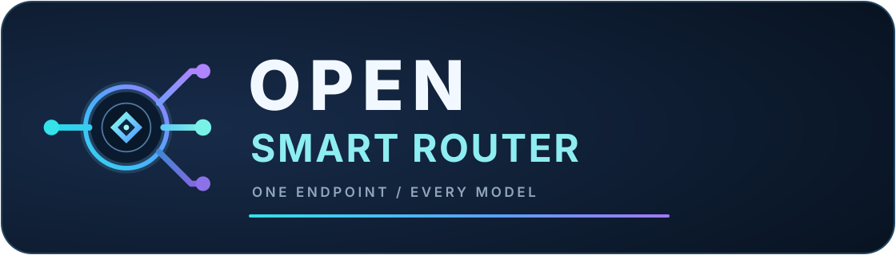

# Open Smart Router

Open Smart Router provides one OpenAI-compatible endpoint for a pool of self-hosted model servers. It discovers available models, chooses a model and host for each request, spreads load, and serves a chat UI. The project deploys as an unprivileged Debian 13 container on Proxmox, with optional containers for model servers, agents, tools, and supporting services.

## Components

| Component | Port | Purpose |
|---|---|---|
| Smart Router | 8000 | OpenAI API, model discovery, request classification, and host selection |
| Open WebUI | 8080 | Chat interface connected to the router |
| LiteLLM | 127.0.0.1:4000 | Static tier fallback, cloud models, and non-chat `/v1` routes |
| Health monitor | — | Host and service checks, Mattermost alerts, and Ollama keep-alive |
| Prometheus | 127.0.0.1:9090 | Router metrics |
| Grafana | 3000 | Authenticated metrics dashboard |

Normal request path: **client or Open WebUI → Smart Router → model host**. The router supports Ollama, LM Studio, llama.cpp, AirLLM, Strata, Basalt, Maya, Xolotl, Avalon, Kindi, and Colibri. See [Deployment](DEPLOYMENT.md) for container defaults and service details, and [ARCHITECTURE.md](ARCHITECTURE.md) for the design, request flow, security model, and service layout.

## Install

From a full checkout, run as root on the Proxmox host:

```bash
bash open-smart-router-install.sh
```

New users should follow the [first-time installation guide](INSTALLATION-GUIDE.md) from prerequisites through verification. The [installation reference](INSTALLATION.md) covers GPU and template support, every installer choice, and settings.

## Guides

| Guide | Details |
|---|---|
| [First-time installation](INSTALLATION-GUIDE.md) | Step-by-step setup and verification for a new user |
| [Deployment](DEPLOYMENT.md) | Router container defaults, services, ports, and request path |
| [Inference targets](INFERENCE_TARGETS.md) | Model server options, Proxmox tags, and provisioner questions; links to each target's own guide |
| [Agent coordination](AGENT_COORDINATION.md) | MQTT broker, hcom relay, and optional Mattermost observer |
| [Image generation](IMAGE_GENERATION.md) | Image API routing, ComfyUI, and Open WebUI setup |
| [Cloud models](CLOUD_MODELS.md) | Cloud API models, FreeLLMAPI, and signed-in subscription clients |
| [Routing](ROUTING.md) | Model selection, request IDs, metrics, and Grafana |
| [Managing model servers](MODEL_SERVERS.md) | Inventory, tiers, server kinds, model sizes, and keep-alive |
| [Configuration changes](CONFIGURATION.md) | Editing and applying router configuration |
| [Updating](UPDATING.md) | Full-stack and component upgrades, GPU drivers, and migration |
| [Troubleshooting](TROUBLESHOOTING.md) | Diagnostic commands and common failures |
| [Development](DEVELOPMENT.md) | Source layout, tests, and CI |

For implementation details, see [ARCHITECTURE.md](ARCHITECTURE.md). For the test suites, see [tests/README.md](tests/README.md).
