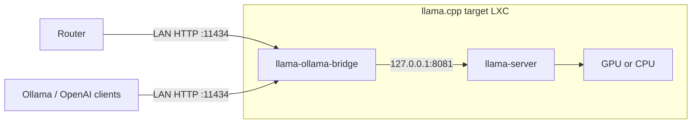

# llama.cpp inference target

A dedicated LXC running `llama-server` with one resident GGUF behind an
Ollama-compatible bridge on port 11434. Nothing is installed in the router CT;
the router uses the target as an Ollama host. Builds use CUDA (NVIDIA), Vulkan
(AMD Radeon, Intel Arc) or the CPU (`BACKEND=cuda|vulkan|cpu`).



Each target has its own alias, context and GPU settings. There is no model
swapping, eviction or Ollama registry emulation. Choosing the alias of the tag
already configured in the router makes replacing an Ollama host simple.

**Why a bridge.** The router discovers size, family and quantization from
`/api/tags` and dispatches OpenAI chat directly; its LiteLLM fallback uses the
Ollama provider and the monitor sends empty `/api/chat` keep-alives. The bridge
passes OpenAI requests through unchanged and translates native Ollama calls.
[Olla](https://thushan.github.io/olla/integrations/overview/) proxies native
Ollama only to Ollama backends, so it would add a routing layer without
removing the bridge; reconsider it if a target ever hosts a pool of processes.

## GPU backends

| | CUDA | Vulkan | CPU |
|---|---|---|---|
| Guest | Debian 13 or 12 | **Debian 13** (Mesa 25.0, Vulkan 1.4) | Debian 13 or 12 |
| Host driver | NVIDIA (580 branch or newer) | Kernel `amdgpu`, `i915` (Arc A) or `xe` (Arc B) | — |
| Passed through | `/dev/nvidia<minor>`, `nvidiactl`, `nvidia-uvm(-tools)` | The card's `/dev/dri/renderD<n>` | — |
| In the CT | Host-matched NVIDIA user-space; CUDA toolkit 13.1 (Debian 13) or 13.0 (Debian 12) | `mesa-vulkan-drivers libvulkan1 libvulkan-dev glslc spirv-headers vulkan-tools` | Build tools only |
| `GPU_LAYERS` default | `auto` | `auto` | `0` (required) |

Vulkan cards: AMD Radeon RX 7000/9000, Radeon PRO W7000, Radeon AI PRO R9700
(RDNA 3/4) and Intel Arc A/B. ROCm/HIP is not used because AMD supports it on
Radeon only for Ubuntu and RHEL, and SYCL needs Intel's multi-GB oneAPI;
Debian 12's Mesa 22.3 is too old for RDNA 4, Arc B and llama.cpp's shaders.

Set the host driver up first: `bash tools/setup-host-gpu.sh --vendors
nvidia,amd,intel [--card <address>]`. The router installer asks which card
llama.cpp gets, sets up its driver and passes `BACKEND` and `GPU_DEVICES`.
Device nodes are mapped with guest gid 993, mode 0660, and the installer checks
as `llama-target` that they open (for Vulkan, that `vulkaninfo` lists a real
GPU, not only Mesa's CPU renderer).

**CUDA architectures.** `CUDA_ARCHITECTURES=auto` (default) builds for the
compute capability of each GPU `nvidia-smi` sees in the CT (8.9 → `89`) and
records it in `build-info.txt`. Examples: RTX 3080/3090 `86`, RTX 2000 Ada
`89`, RTX PRO 2000/4000 Blackwell `120`; a fleet build may list several
(`86;89;120`, slower). `native` leaves detection to CMake, which on an RTX 2000
Ada produced no code for the card ("no kernel image is available"). Every CUDA
build is checked with `cuobjdump` and fails if it has no code for the CT's GPU.
Size GGUF, KV cache, context and slots against the card's actual VRAM.

## 1. Create the CT (PVE host)

From a repository checkout on the GPU's Proxmox host (check `pveam list
local`, `pvesm status`, `nvidia-smi -L` first):

```bash
bash targets/llamacpp/provision-lxc.sh            # interactive
BACKEND=vulkan MODEL_ALIAS=qwen3:8b \
MODEL_DOWNLOAD_URL=https://huggingface.co/<org>/<repo>/resolve/<rev>/<file>.gguf \
bash targets/llamacpp/provision-lxc.sh --install-target
```

On a terminal it asks, in order, for CT ID, name, template, root-disk storage
and size, cores, RAM, bridge, IPv4/CIDR (or `dhcp`) and an optional gateway,
then confirms a summary. The CT ID defaults to the cluster's next free ID
(Enter, or an unattended run, takes it; preset `CT_ID` to choose another); the
router CT's gateway is offered, and no address is chosen automatically. Downloaded Debian 13/12
templates (Vulkan: 13 only) and `rootdir` storage appear in numbered selectors
(`m` for manual entry); templates are not downloaded. Defaults: name
`llama-target`, bridge `vmbr0`, 4 cores, 16384 MiB RAM, 64 GiB disk, no swap,
`ONBOOT=0`.

Without `GPU_DEVICES`, CUDA runs offer the host's NVIDIA cards (from
`/proc/driver/nvidia/gpus/*/information`, falling back to `nvidia-smi`) and
pass that `/dev/nvidia<minor>` plus `nvidiactl`, `nvidia-uvm` and
`nvidia-uvm-tools`; Vulkan runs offer the render nodes. Set `GPU_DEVICES`
yourself for unusual paths or `/dev/nvidia-caps/*`. `NONINTERACTIVE=true`
requires `TEMPLATE`, `IP_CIDR`, `STORAGE` (and `GPU_DEVICES` for CUDA; `CT_ID`
only when the next free ID cannot be read):

```bash
NONINTERACTIVE=true CT_HOSTNAME=llama-target-01 CT_ID=<id> TEMPLATE=<volume> \
STORAGE=<storage> IP_CIDR=<a.b.c.d/nn|dhcp> GATEWAY=<gw> BRIDGE=vmbr0 \
CORES=8 MEMORY_MB=32768 ROOTFS_GB=100 \
GPU_DEVICES='/dev/nvidia0 /dev/nvidiactl /dev/nvidia-uvm /dev/nvidia-uvm-tools' \
bash targets/llamacpp/provision-lxc.sh --dry-run    # then without --dry-run
```

It refuses an existing ID, creates an unprivileged CT with nesting, starts it
and copies the deployment and `tools/install-nvidia-driver.sh` to
`/root/llama-target-deploy`. It changes no host drivers, IOMMU/VFIO or LXC
confinement. By default it stops there, so you choose the model inside the CT.
`--install-target` (or `INSTALL_TARGET=1`) also installs host-matched NVIDIA
user-space for CUDA and runs the guest installer; it needs `MODEL_ALIAS` and
either `MODEL_PATH` or a public `MODEL_DOWNLOAD_URL` (URL alone uses the
default store; `/blob/` links become `/resolve/`). `--create-only` forces the
CT-only behaviour.

The bridge has no authentication or TLS. Restrict TCP 11434 to the router and
trusted clients; 8081 stays on guest loopback.

## 2. NVIDIA user-space and CUDA (CUDA only)

After a CT-only create, install user-space matching the host driver:

```bash
HOST_NVIDIA_VERSION=$(nvidia-smi --query-gpu=driver_version --format=csv,noheader | head -n1)
pct exec "$CT_ID" -- env "DRIVER_VERSION=$HOST_NVIDIA_VERSION" bash /root/llama-target-deploy/install-nvidia-driver.sh lxc
```

Never run that helper's `host` mode in the guest. `install-target.sh` finds
`nvcc` on `PATH`, in `/usr/local/cuda/bin` or a versioned `/usr/local/cuda-*`;
if there is none it installs NVIDIA's toolkit-only package for the guest's
release (`cuda-toolkit-13-1` on Debian 13, `-13-0` on Debian 12; never the
`cuda`/`cuda-runtime` meta-packages, which bring drivers). Leave
`CUDA_COMPILER` unset unless you need a specific compiler. To recover a failed
download by hand (Debian 12: `debian12`, `13-0`):

```bash
wget -O /tmp/cuda-keyring.deb \
  https://developer.download.nvidia.com/compute/cuda/repos/debian13/x86_64/cuda-keyring_1.1-1_all.deb
dpkg -i /tmp/cuda-keyring.deb && apt-get update
apt-get install --no-install-recommends -y cuda-toolkit-13-1
find /usr/local -maxdepth 3 -type f -name nvcc -perm /111 -print
```

Branch 580 meets CUDA 13.x's minimum (13.1 runs under minor-version
compatibility because the build targets the card's own architecture).

## 3. Install in the CT

The installer builds the official **llama.cpp v0.5.0** release (commit
`7fe450e19305b828c199d602c23a8337aaa1f03b`), reviewed for Debian 12/CUDA 13.0,
Debian 13/CUDA 13.1 and the bridge's API, with OpenSSL and without the web UI
build. `LLAMA_CPP_REF` selects another tag or full commit; nothing ever
follows `latest`. The ref, commit and Python package versions are recorded.

```bash
cd /root/llama-target-deploy
bash install-target.sh       # interactive: alias, optional GGUF URL, model store
```

**Model URL.** Only public `https://huggingface.co/<org>/<repo>/resolve/<rev>/<file>.gguf`
links (optional query string; `/blob/` is converted) without a token, so gated
repos are unsupported. The download follows HTTPS-only redirects into a
same-directory `.part` file, checks it is non-empty with a `GGUF` header and
promotes it atomically without overwriting. Inspect or remove a kept `.part`
before retrying. A URL fetches one file: stage the other parts of a split
GGUF beside it and point at the first part.

**Model store.** Without `MODEL_PATH`/`MODEL_DIR` the installer lists
persistent writable mounts: option 1 is `/var/lib/llama-target/models`,
another mount uses `<mount>/llama-target/models`, `m` a custom path. Existing
GGUFs there are listed. Paths must be absolute, without spaces or traversal,
and outside home and temporary directories (hidden by the sandbox). Existing
files must be readable by `llama-target`.

Unattended (`NONINTERACTIVE=true` needs `MODEL_ALIAS` plus `MODEL_PATH`,
`MODEL_DIR`+`MODEL_FILE`, or a URL):

```bash
NONINTERACTIVE=true MODEL_ALIAS='model:tag' \
MODEL_DOWNLOAD_URL='https://huggingface.co/ORG/REPO/resolve/REVISION/MODEL.gguf?download=true' \
MODEL_PARAMETER_SIZE=8B MODEL_FAMILY=llama MODEL_QUANTIZATION=Q4_K_M \
MODEL_CAPABILITIES=completion,tools BACKEND=cuda CUDA_ARCHITECTURES=auto \
CONTEXT_SIZE=65536 PARALLEL_SLOTS=1 THREADS=8 BUILD_JOBS=4 GPU_LAYERS=auto \
bash install-target.sh
```

Use the model's **real** metadata: the parameter size drives the router's
choice (blank or `unknown` is filled from llama-server's `n_params`).
`MODEL_ALIAS` is `name` or `name:tag` (a bare name gets `:latest`).
`CONTEXT_SIZE` (65536) is shared by `PARALLEL_SLOTS`, so each request gets
`CONTEXT_SIZE / PARALLEL_SLOTS`; agents need 65536 per request, and the router
installer multiplies its per-request window by the slots. Under 16 GB VRAM,
lower it, quantize the cache (`--cache-type-k q8_0 --cache-type-v q8_0` in
`LLAMA_EXTRA_ARGS`) or use a smaller GGUF.

The installer creates the `llama-target` account (gid 993), builds the server,
installs the bridge and units and enables them, but leaves them stopped. It
refuses an existing installation or occupied ports 8081/11434. Then:

```bash
chown root:llama-target /var/lib/llama-target/models/*.gguf   # hand-staged files
chmod 0640 /var/lib/llama-target/models/*.gguf
runuser -u llama-target -- /opt/llama-target/bin/llama-server --list-devices
systemctl start llama-server llama-ollama-bridge
journalctl -u llama-server -u llama-ollama-bridge -n 80 --no-pager
curl --fail http://127.0.0.1:11434/healthz
```

Readiness fails until the model is loaded; the log must show the GPU and layer
offload. `GPU_LAYERS=auto` lets llama.cpp reduce offload when model, context
and buffers exceed free VRAM; `999`, `all` or a number disables that. Settings
live in `/etc/llama-target/llama-server.env` and `bridge.env`: keep aliases
and model paths in step and restart both services. Once healthy, enable
autostart on the host: `pct set "$CT_ID" --onboot 1`.

## 4. Verify and register

```bash
TARGET=http://<target-ip>:11434
curl --fail "$TARGET/api/tags"; curl --fail "$TARGET/v1/models"
curl --fail "$TARGET/v1/chat/completions" -H 'Content-Type: application/json' \
  -d '{"model":"model:tag","messages":[{"role":"user","content":"Reply with OK"}],"max_tokens":16}'
curl --fail -N "$TARGET/api/chat" -H 'Content-Type: application/json' \
  -d '{"model":"model:tag","messages":[{"role":"user","content":"Reply with OK"}],"stream":true}'
curl --fail "$TARGET/api/chat" -H 'Content-Type: application/json' \
  -d '{"model":"model:tag","messages":[],"keep_alive":-1,"stream":false}'
```

In the router CT:

```bash
manage-model-servers add <target-ip> --tier fast
manage-model-servers set-server-model fast <target-ip> model:tag --apply
manage-model-servers discover
```

Check `/routing/inventory` and a chat through the router before removing a
replaced backend; reusing its IP and tag avoids any router change.

## Compatibility

| Interface | Behaviour |
|---|---|
| OpenAI `/v1/chat/completions`, `/v1/completions`, `/v1/embeddings` | Passthrough (including SSE); alias validated |
| `/v1/models`, `/api/tags`, `/api/show` | Ready model with configured metadata and `MODEL_CAPABILITIES`; `/api/show` gives training and active per-slot context from `/props` (else `CONTEXT_SIZE / PARALLEL_SLOTS`) |
| `/api/ps` | The model while ready; empty while loading |
| `/api/chat` | Text, images, tools, structured output, reasoning fields; SSE → NDJSON |
| `/api/generate` | Chat template; `raw:true` uses text completions |
| `/api/embed`, `/api/embeddings` | When llama-server runs an embedding model |
| Empty chat/prompt with non-zero `keep_alive` | Health/keep-alive acknowledgement without inference |
| Non-zero `keep_alive` on inference | Accepted; the model always stays loaded |
| `keep_alive:0`, pull/create/copy/delete/push, blobs | 501 |

Unsupported native fields (`think`, `context`, `template`, `suffix`, ...)
return 400. Per-request sampling `options` (temperature, top_p/k, min_p,
typical_p, seed, stop, num_predict, penalties, repeat_last_n, mirostat*) are
forwarded; load-time ones such as `num_ctx`, `num_gpu`, `num_thread` (sent by
Open WebUI and LiteLLM) are ignored, logged once and listed in
`X-Bridge-Ignored-Options`; set them in `llama-server.env`. Native tool results
need `tool_name` when several calls are pending. Images must be base64
PNG/JPEG/WebP with a multimodal projector configured. **Add `tools` to
`MODEL_CAPABILITIES`** when the chat template supports tool calls: the router
sends tool requests only to models that report it. An embedding target needs
`--embedding`/pooling via a systemd override and accurate capabilities so it
is never picked for chat. Durations are measured totals; a failed upstream
stream ends with an NDJSON error; client disconnects close the upstream.

## Upgrading

```bash
LLAMA_CPP_REF=<tag-or-commit> bash install-target.sh --upgrade   # in the CT, from an updated copy
```

`--upgrade` keeps the model, `/etc/llama-target/*.env` and the account, only
adding new settings. If commit, ref, backend, CPU build, bridge, requirements,
units and settings are unchanged and the target is healthy (or stopped), it
prints "nothing to do". Otherwise it:

1. Rebuilds when commit, backend, CPU build or CUDA architectures differ from
   `build-info.txt` (or `FORCE_REBUILD=true`). The backend comes from
   `build-info.txt` unless `BACKEND` is set and must suit the Debian release
   (CUDA 12, Vulkan 13, CPU either); a backend change resets `GPU_LAYERS`
   (`auto` for GPU, `0` for CPU) unless given.
2. Refreshes `bridge.py`, its venv and both units (a bridge-only update needs
   no rebuild).
3. Restarts services that were running and waits `UPGRADE_HEALTH_TIMEOUT`
   (300 s) for `/healthz`.
4. Keeps every replaced file as `*.prev`; on any failure restores exactly
   those, restarts the previous build if it was running and reports whether
   it is healthy.

An explicitly stopped service stays stopped; a failed unit is restarted.
Snapshot the CT for a fallback that includes the GGUF.

**CPU build (`CPU_TARGET`).** llama.cpp's default build tunes for the build
CPU; on an AVX-only Xeon E3 v2 it compiled but died with `SIGILL` at start.
`auto` (default) uses `native` when the CPU has AVX, F16C, FMA, AVX2 and BMI2,
otherwise `portable` (`GGML_NATIVE=OFF` with only the sets the CPU reports).
The choice is recorded in `build-info.txt` (e.g. `cpu_build=portable:avx,f16c`)
and kept by `--upgrade`; installs that predate it count as `native` and are
rebuilt portable once on such a CPU.

**Moving to other hardware.** `bash /root/llama-target-deploy/install-target.sh
--rebuild` (the script alone suffices) keeps commit, model, settings, bridge and
units. It first checks the GPU and names the fix: missing host driver (pass
devices or switch with `BACKEND=vulkan|cpu ... --upgrade`), mismatched NVIDIA
user-space (`tools/update-gpu-drivers.sh` on the host or
`DRIVER_VERSION=<host version> bash install-nvidia-driver.sh lxc` in the CT),
unreadable nodes (`gid=993,mode=0660`) or a driver too old for the toolkit. It
then rebuilds offline from `/opt/llama-target/src/llama.cpp` only if the CPU
build or CUDA architectures changed (a GPU change recompiles every kernel:
slow on small CPUs), keeps `llama-server.prev`, and restores it if the new
build is not healthy within `UPGRADE_HEALTH_TIMEOUT`.

**Extra flags.** `LLAMA_EXTRA_ARGS` in `llama-server.env` (or passed to either
script), e.g. `--flash-attn on --cache-type-k q8_0 --cache-type-v q8_0`;
letters, digits, spaces and `. _ , : = / + -` only. Restart `llama-server`.

## Tests

`bash tests/run-tests.sh bridge` and the `llamacpp-*` suites
(`llamacpp-provision`, `-model-settings`, `-model-storage`, `-gguf-download`,
`-cuda-compiler`, `-container-settings`, `-gpu-selector`, `-upgrade`) cover API
translation, provisioning, model settings and storage, downloads, compiler
discovery, GPU selection and upgrade rollback with mocks. They do not prove GPU
performance, GGUF/chat-template compatibility or real PVE provisioning, so run
the live checks above on each GPU class before replacing an Ollama host.
