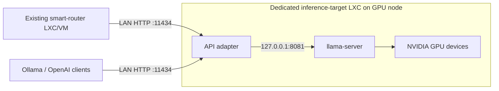

# llama.cpp inference target for Proxmox VE 9.2

This is a **separate inference-target LXC**, on the Proxmox node with the NVIDIA
GPU. It replaces an Ollama backend. Nothing here is installed in the
`ollama-smart-router` LXC/VM, and the existing router code is unchanged.



The initial deployment keeps **one GGUF model resident per target**. Each target
has its own alias, context limit, and GPU settings. There is no automatic model
swapping, eviction, or Ollama registry emulation. The installer can optionally
fetch one public GGUF from a direct Hugging Face URL; choose an alias matching
the tag already configured in the router to simplify replacement.

## Why the adapter, and where Olla fits

The current router discovers model size/family/quantization using `/api/tags`
and normally dispatches OpenAI chat requests directly to the chosen target.
Its LiteLLM fallback uses the Ollama provider; the generated monitor can also
send empty `/api/chat` requests to keep models loaded. The adapter covers those
paths on the usual target port 11434.

llama.cpp already implements OpenAI endpoints. The bridge forwards those
requests without translating their payloads, and translates native Ollama
inference into llama.cpp requests. [llama.cpp server documentation](https://github.com/ggml-org/llama.cpp/tree/master/tools/server)

Olla is useful for backend routing, discovery, and failover. Its documented
translation is Anthropic-to-OpenAI; its Ollama integration proxies native
Ollama endpoints to Ollama backends. It is therefore **not sufficient by itself
for the native Ollama facade required here**. Adding Olla now would add another
routing layer without removing the adapter. Reconsider it if the target later
hosts a pool of inference processes. [Olla supported translations](https://thushan.github.io/olla/integrations/overview/),
[Ollama backend profile](https://thushan.github.io/olla/integrations/backend/ollama/)

## NVIDIA baseline

Host: **PVE 9.2**, with the existing working NVIDIA kernel driver.
Guest: **Debian 13 or 12 amd64**, unprivileged LXC, native systemd services.
Build: CUDA toolkit **13.1** on Debian 13 (NVIDIA's Debian 13 repository starts
there) or **13.0** on Debian 12, plus guest NVIDIA user-space libraries matching
the host driver. The repository's `install_nvidia_580_173_02.sh lxc` mode can be
reused when the host actually runs **580.173.02**. It does not install the CUDA
compiler. Do not run its `host` mode inside the guest.

The guest release is independent of the host OS: NVIDIA's CUDA 13.0 support
table lists Debian 12, and 13.1's lists Debian 13. Driver branch 580 meets CUDA
13.x's documented minimum (13.1 runs on it under minor-version compatibility,
because the build targets the card's own architecture); toolkit 13.0 on Debian
12 avoids even that.
[CUDA 13.0 Linux support](https://docs.nvidia.com/cuda/archive/13.0.2/cuda-installation-guide-linux/index.html),
[driver compatibility](https://docs.nvidia.com/deploy/cuda-compatibility/minor-version-compatibility.html)

| Target GPU | `CUDA_ARCHITECTURES` |
|---|---|
| RTX 3080 / RTX 3090 | `86` |
| RTX 2000 Ada | `89` |
| RTX PRO 2000 / 4000 Blackwell | `120` |

`native` builds for visible GPUs. An explicit architecture makes the intended
hardware clear; a portable fleet build may use `86;89;120` (longer build).
These are CUDA compute capabilities, not VRAM sizes. Size the GGUF, KV cache,
context, and parallel slots against the actual card's available VRAM.
[NVIDIA compute capabilities](https://developer.nvidia.com/cuda/gpus),
[llama.cpp CUDA builds](https://github.com/ggml-org/llama.cpp/blob/master/docs/build.md#cuda)

## AMD Radeon and Intel Arc (Vulkan)

`BACKEND=vulkan` builds llama.cpp's Vulkan backend instead of CUDA, for
**AMD Radeon RX 7000/9000, Radeon PRO W7000, Radeon AI PRO R9700 (RDNA 3/4)**
and **Intel Arc A- and B-series** cards.

| | CUDA | Vulkan |
|---|---|---|
| Guest | Debian 13 or 12 | **Debian 13** (Mesa 25.0, Vulkan 1.4, glslc from Debian) |
| Host driver | NVIDIA 580.173.02 | the kernel's `amdgpu`, `i915` (Arc A) or `xe` (Arc B) |
| Passed through | `/dev/nvidia<n>`, `nvidiactl`, `nvidia-uvm(-tools)` | the card's render node, `/dev/dri/renderD<n>` |
| In the CT | NVIDIA user-space libraries, CUDA 13.0 toolkit | `mesa-vulkan-drivers libvulkan1 libvulkan-dev glslc spirv-headers vulkan-tools` |

Why not ROCm/HIP or SYCL: AMD supports ROCm on Radeon cards only on Ubuntu and
RHEL, not Debian, and SYCL needs Intel's multi-GB oneAPI toolkit. Vulkan runs
on both vendors with Debian's own packages; Debian 12's Mesa 22.3 and Vulkan
1.3 are too old for RDNA 4, Arc B and llama.cpp's shaders, hence Debian 13.

Set the host's driver up first: `bash tools/setup-host-gpu.sh --vendors amd,intel`
(`--card <address>` for one card). The router installer asks which card
llama.cpp should use, sets that card's driver up, and passes `BACKEND` and
`GPU_DEVICES`: `vulkan` and the card's `/dev/dri/renderD<n>` for AMD or Intel,
`cuda` and its `/dev/nvidia<minor>` with the control and UVM nodes for NVIDIA. The render node gets gid 993 like the CUDA
nodes. The installer checks, as `llama-target`, that the node opens and that
`vulkaninfo` lists a discrete GPU, not only Mesa's CPU renderer, before
building. `GPU_LAYERS` defaults to `auto`. A backend switch by `--upgrade` stays
on the CT's Debian release: CPU and Vulkan on Debian 13, CPU and CUDA on 12.

```bash
CT_ID=251 TEMPLATE=local:vztmpl/debian-13-standard_13.1-2_amd64.tar.zst \
STORAGE=local-lvm IP_CIDR=192.0.2.51/24 GATEWAY=192.0.2.1 \
BACKEND=vulkan GPU_DEVICES=/dev/dri/renderD128 \
MODEL_ALIAS=qwen3:8b MODEL_DOWNLOAD_URL=https://huggingface.co/<org>/<repo>/resolve/<rev>/<file>.gguf \
bash provision-lxc.sh --install-target
```

Without `GPU_DEVICES`, an interactive run lists the host's AMD and Intel render
nodes to choose from.

## 1. Create the target LXC on its Proxmox host

Copy this repository onto the **GPU's Proxmox host**. Select an unused CT ID,
an existing downloaded Debian 13 (or 12) amd64 template volume, rootdir storage,
bridge, and a free target IP. Check `pveam list local`, `pvesm status`, and
`nvidia-smi -L` first.

When `GPU_DEVICES` is unset, an interactive run reads each NVIDIA driver's
`/proc/driver/nvidia/gpus/*/information` file to map the authoritative `Device
Minor` to `/dev/nvidia<minor>`, with `nvidia-smi` as a fallback. Selecting one
exposes that device plus `/dev/nvidiactl`, `/dev/nvidia-uvm`, and
`/dev/nvidia-uvm-tools`. Set `GPU_DEVICES` yourself to skip that selector,
choose unusual paths, or add needed `/dev/nvidia-caps/*` devices. Noninteractive
CUDA provisioning requires an explicit `GPU_DEVICES` value. The host driver
must create these nodes before container startup after a reboot. NVIDIA documents
the Linux minor-number-to-device-node relationship in its
[nvidia-smi documentation](https://docs.nvidia.com/deploy/nvidia-smi/).

For interactive setup, run from the repository root on the PVE host:

```bash
unset CT_ID TEMPLATE CT_HOSTNAME IP_CIDR BRIDGE GATEWAY CORES MEMORY_MB STORAGE ROOTFS_GB GPU_DEVICES NONINTERACTIVE
bash targets/llamacpp/provision-lxc.sh
```

The script prompts for the **CT template, name, IPv4/CIDR (or `dhcp`), CPU
cores, RAM in MiB, root disk storage ID, and disk size in GiB**. It also asks
for the CT ID, network bridge, and an optional static gateway. The next free
cluster ID is suggested when available. Downloaded Debian 13 and 12 templates (13 first) and
active storage that supports container root disks appear in numbered selectors.
Choose a number, paste an exact listed ID, or enter `m` to provide a manual
value. CUDA runs also present a numbered NVIDIA GPU selector. Templates are not
downloaded automatically.

Press Enter to accept an offered default: name `llama-target`, bridge `vmbr0`,
4 CPU cores, 16384 MiB RAM, and a 64 GiB disk. Invalid entries are prompted
again. A static gateway can be blank; DHCP skips that prompt. The disk location
is a Proxmox storage ID such as `local-lvm` or `vm_pool`, not a host filesystem
path. Template storage IDs such as `iso_fs` are supported.

Environment presets skip the corresponding prompts. `NONINTERACTIVE=true`
disables prompting; without a terminal, the script also requires `CT_ID`,
`TEMPLATE`, `IP_CIDR`, and `STORAGE` and uses defaults for optional settings.
Use `--dry-run` to preview the commands without creating a CT. The default
creates the CT and copies the deployment files, then stops so you can prepare
NVIDIA user-space/CUDA and choose the model interactively inside the CT. This
avoids requiring `MODEL_ALIAS`, `MODEL_PATH`, or `MODEL_DOWNLOAD_URL` on the
PVE host. Interactive answers apply to that invocation, so a subsequent run
asks again unless you export the settings. After interactive creation, set
`CT_ID` in your host shell to the ID printed by the script before using the
commands in section 2.

For unattended setup, provide the settings explicitly:

```bash
export NONINTERACTIVE=true
export CT_ID=230
export CT_HOSTNAME=llama-target-01
export TEMPLATE='local:vztmpl/REPLACE_WITH_DOWNLOADED_DEBIAN_12_AMD64_TEMPLATE.tar.zst'
export STORAGE=local-lvm
export IP_CIDR=192.168.11.30/24
export GATEWAY=192.168.11.1
export BRIDGE=vmbr0
export CORES=8 MEMORY_MB=32768 ROOTFS_GB=100
export GPU_DEVICES='/dev/nvidia0 /dev/nvidiactl /dev/nvidia-uvm /dev/nvidia-uvm-tools'
bash targets/llamacpp/provision-lxc.sh --dry-run
bash targets/llamacpp/provision-lxc.sh
```

The script refuses to reuse an existing guest ID, creates an unprivileged CT
with nesting enabled, passes the listed devices using Proxmox `devN` entries
with guest group 993 and mode 0660, starts the CT, and copies the deployment plus
`install_nvidia_580_173_02.sh` to `/root/llama-target-deploy` inside it. It does not install host drivers, change
IOMMU/VFIO configuration, or disable LXC confinement.
[Proxmox device options](https://github.com/proxmox/pve-docs/blob/master/generated/pct.conf.5-opts.adoc)

`--install-target` (or `INSTALL_TARGET=1`) runs the copied NVIDIA helper in
`lxc` mode for a CUDA target and then runs the guest installer. It requires explicit
`MODEL_ALIAS` plus either `MODEL_PATH` or a direct public
`MODEL_DOWNLOAD_URL`, because the guest command is non-interactive. URL-only
installation uses the default model store; combine a URL with `MODEL_PATH` to
choose its destination. `--create-only` always preserves the default CT-only
behavior.

These scripts do not create a complete network firewall policy. Restrict target
TCP 11434 to the router and trusted clients using your Proxmox/network firewall.
The adapter has no API authentication or TLS; it is intended for that private
inference network. Port 8081 stays on guest loopback.

## 2. Prepare NVIDIA user-space and CUDA inside the target

Provisioning copies the driver helper into the target. Use it only when its
version matches the PVE host driver. With the default create-only flow, run:

```bash
nvidia-smi --query-gpu=driver_version --format=csv,noheader
pct exec "$CT_ID" -- bash /root/llama-target-deploy/install_nvidia_580_173_02.sh lxc
pct enter "$CT_ID"
```

The remaining commands in this section run **inside the target LXC**. For a
fresh guest, install NVIDIA's toolkit-only package; the `cuda` and
`cuda-runtime` meta-packages also bring drivers and should not replace the
host-matched user-space installation.

```bash
# Debian 13: debian13 and 13-1 / cuda-13.1 (its repository starts at 13.1)
# Debian 12: debian12 and 13-0 / cuda-13.0
apt-get update
apt-get install -y ca-certificates wget
wget -O /tmp/cuda-keyring.deb \
  https://developer.download.nvidia.com/compute/cuda/repos/debian13/x86_64/cuda-keyring_1.1-1_all.deb
dpkg -i /tmp/cuda-keyring.deb
apt-get update
apt-get install --no-install-recommends -y cuda-toolkit-13-1
nvidia-smi
/usr/local/cuda-13.1/bin/nvcc --version
```

`install-target.sh` does this itself when no `nvcc` is found, picking the
repository and release from the guest's Debian version.

The package repository and versioned toolkit-only convention follow the
[NVIDIA installation guide](https://docs.nvidia.com/cuda/archive/13.0.2/cuda-installation-guide-linux/index.html#debian).
The NVIDIA LXC user-space helper does not install `nvcc`; `cuda-toolkit-13-1`
(or `-13-0`) does. The target installer first discovers an executable compiler from `PATH`,
`/usr/local/cuda/bin/nvcc`, `/usr/local/cuda-13.1/bin/nvcc` (`13.0` on Debian 12), or another
versioned `/usr/local/cuda-*` directory. When none exists, it automatically
runs the toolkit-only installation sequence above and then verifies `nvcc`.
Leave `CUDA_COMPILER` unset unless you need to select a specific installed
compiler. The commands above remain useful for preparing a template or manually
recovering a failed repository/package download.

To diagnose an existing target before rerunning the installer:

```bash
dpkg-query -W cuda-toolkit-13-0 2>/dev/null || true
command -v nvcc || true
find /usr/local -maxdepth 3 -type f -name nvcc -perm /111 -print
```

An already prepared template can skip this section; it must still have working
GPU access and compatible user-space libraries on the new host.

## 3. Build and configure the target

Still inside the target LXC, the installer defaults to the official **llama.cpp
v0.5.0** release (release commit
`7fe450e19305b828c199d602c23a8337aaa1f03b`). No version selection is required.
This is a fixed, source-reviewed baseline for the Debian 12 / CUDA 13.0 and Debian 13 / CUDA 13.1 setups
and the adapter's API; compatibility with your exact GGUF still needs the live
checks below. The installer builds locally with your CUDA toolkit, explicitly
includes the OpenSSL development dependency, and disables the separate app/UI
build and prebuilt UI download.
[Official release](https://github.com/ggml-org/llama.cpp/releases/tag/v0.5.0),
[CUDA build configuration at this release](https://github.com/ggml-org/llama.cpp/blob/v0.5.0/ggml/src/ggml-cuda/CMakeLists.txt)

An optional `LLAMA_CPP_REF` overrides the default with another release tag or
full 40-character commit when a model needs it. Unset or empty uses the default;
the installer never looks up a moving `latest` version. It records the selected
ref, resolved commit, and installed Python package versions in the target.
The Proxmox provisioning script preserves this default when no override is set.

For an interactive installation inside the CT, run:

```bash
cd /root/llama-target-deploy
unset MODEL_ALIAS MODEL_DOWNLOAD_URL MODEL_PATH MODEL_DIR MODEL_FILE NONINTERACTIVE
unset CUDA_COMPILER  # Let the installer discover the installed nvcc.
bash install-target.sh
```

The installer asks for the API model name/tag, then an optional direct Hugging
Face GGUF URL. It accepts only public HTTPS URLs in the form
`https://huggingface.co/<org>/<repo>/resolve/<revision>/<file>.gguf`, with an
optional query string such as `?download=true`. The actual download host is
`huggingface.co`, not `huggingface.com`. A supplied URL provides the default
GGUF filename; `MODEL_PATH` still controls the local destination when set.

When neither `MODEL_PATH` nor `MODEL_DIR` is preset, the installer lists the
persistent, writable storage mounts visible inside the CT. Option 1 is always
`/var/lib/llama-target/models`. Selecting another mount uses
`<mountpoint>/llama-target/models`; `m` accepts a custom safe directory. It
omits the root/default store, read-only mounts, and pseudo, home, or temporary
filesystems. Existing GGUF files in the selected directory are listed, and a
single file is offered as the filename default. For split GGUFs, select the
first part.

For a URL download, the installer uses HTTPS-only redirects, writes a
same-directory `.part` file, checks that it is nonempty and starts with the
`GGUF` header, then atomically promotes it without overwriting an existing
GGUF. It does not use a Hugging Face token, so gated/private repositories are
not supported by this prompt. Inspect or remove a retained `.part` file before
retrying a failed download.

To skip prompts, preconfigure `MODEL_ALIAS` and either `MODEL_PATH` or
`MODEL_DIR` plus `MODEL_FILE`. `MODEL_DOWNLOAD_URL` can supply the filename, so
`NONINTERACTIVE=true` also permits `MODEL_ALIAS` plus a valid URL alone and
uses the default store. Set `MODEL_PATH` to choose a different destination.
Without a terminal, a missing file setting and no URL fails immediately.
Existing stores retain their ownership and permissions. New directories are
created for the service account, and existing files must already be readable by
it. Paths must be absolute and contain no spaces or traversal components. Home
and temporary directories are rejected because the service sandbox hides them.

Example unattended installation:

```bash
cd /root/llama-target-deploy
unset LLAMA_CPP_REF  # Use the installer's pinned v0.5.0 default
export NONINTERACTIVE=true
export MODEL_ALIAS='model:tag'
export MODEL_DOWNLOAD_URL='https://huggingface.co/ORG/REPO/resolve/REVISION/MODEL.gguf?download=true'
# Optional: choose a local name or a selected mounted-volume destination.
export MODEL_PATH=/var/lib/llama-target/models/model.gguf
export MODEL_PARAMETER_SIZE=8B
export MODEL_FAMILY=llama
export MODEL_QUANTIZATION=Q4_K_M
export BACKEND=cuda
unset CUDA_COMPILER  # Let the installer discover the installed nvcc.
export CUDA_ARCHITECTURES=89  # use the table above for this target
export CONTEXT_SIZE=8192 PARALLEL_SLOTS=1 THREADS=8 BUILD_JOBS=4
export GPU_LAYERS=auto  # preserve llama.cpp VRAM auto-fitting
bash install-target.sh
```

Replace the example alias and metadata with the **actual** model's values;
parameter size influences the smart router's selection. The installer creates
the `llama-target` account (group 993), builds the server, installs the bridge
and units, and enables the services. It leaves them stopped after downloading
or staging the model. It refuses to overwrite an existing target installation
or occupied API ports.

Without `MODEL_DOWNLOAD_URL`, stage your existing compatible GGUF at
`MODEL_PATH`. A URL downloads only its one selected file; for a split GGUF,
stage every other part alongside it and point to the first part. Make manually
staged files and every parent directory readable/traversable by `llama-target`.
After copying, for example, adjust these paths to the directory printed by the
installer if you chose a custom location.

```bash
chown root:llama-target /var/lib/llama-target/models/*.gguf
chmod 0640 /var/lib/llama-target/models/*.gguf
runuser -u llama-target -- test -r /var/lib/llama-target/models/model.gguf
runuser -u llama-target -- /opt/llama-target/bin/llama-server --list-devices
systemctl start llama-server llama-ollama-bridge
journalctl -u llama-server -u llama-ollama-bridge -n 80 --no-pager
curl --fail http://127.0.0.1:11434/healthz
```

Once the target passes the checks, enable container autostart on the PVE host
with `pct set "$CT_ID" --onboot 1`; creation leaves it off until the setup is ready.

Readiness fails until llama.cpp finishes loading. The server log must show CUDA
devices and GPU layer offload; a running Python adapter alone is not success.
Leave `GPU_LAYERS=auto` so llama.cpp can reduce GPU offload when the model,
context, recurrent-state cache, and compute buffers exceed free VRAM. Setting
`GPU_LAYERS=999`, `all`, or an exact number disables that adjustment. If VRAM
is still insufficient, reduce context/parallelism or use a smaller quantized
model. Configuration lives in
`/etc/llama-target/llama-server.env` and `/etc/llama-target/bridge.env`.
Keep their aliases and model paths synchronized, then restart both services.

## 4. Verify API behavior and register the target

Run from a machine allowed to reach the target; use its actual alias:

```bash
export TARGET=http://192.168.11.30:11434
curl --fail "$TARGET/api/tags"
curl --fail "$TARGET/v1/models"
curl --fail "$TARGET/v1/chat/completions" -H 'Content-Type: application/json' \
  -d '{"model":"model:tag","messages":[{"role":"user","content":"Reply with OK"}],"max_tokens":16}'
curl --fail -N "$TARGET/api/chat" -H 'Content-Type: application/json' \
  -d '{"model":"model:tag","messages":[{"role":"user","content":"Reply with OK"}],"stream":true}'
curl --fail "$TARGET/api/generate" -H 'Content-Type: application/json' \
  -d '{"model":"model:tag","prompt":"Reply with OK","stream":false}'
curl --fail "$TARGET/api/chat" -H 'Content-Type: application/json' \
  -d '{"model":"model:tag","messages":[],"keep_alive":-1,"stream":false}'
```

Only **configuration registration** happens on the existing router. Its
services and runtime remain where they are:

```bash
manage-model-servers add 192.168.11.30 --tier fast
manage-model-servers set-server-model fast 192.168.11.30 model:tag --apply
manage-model-servers discover
```

Use the appropriate tier. Test through the router's `/routing/inventory` and
`/v1/chat/completions` before removing the previous backend. Discovery sees
only ready models; the normal direct OpenAI path and the Ollama LiteLLM
fallback both terminate at this target. Retaining the existing target IP/tag
after a controlled replacement can avoid a router configuration change.

## Compatibility boundary

| Interface | Behavior |
|---|---|
| OpenAI `/v1/chat/completions`, `/v1/completions`, `/v1/embeddings` | Request and response passthrough, including SSE, to the local server; model alias validated |
| `/v1/models`, `/api/tags`, `/api/show` | Ready model plus configured metadata/capabilities. An empty or `unknown` `MODEL_PARAMETER_SIZE` is filled in from llama-server's own `n_params`, so the router can size-band the target; `/api/show` reports the training context length and the active serving context from llama-server's `/props` (falling back to installed `CONTEXT_SIZE` divided among `PARALLEL_SLOTS`) |
| `/api/ps` (GET) | The resident model while llama-server is ready; an empty list while it loads |
| `/api/chat` | Text, image messages, tools, structured output, reasoning response fields; streaming SSE converted to NDJSON |
| `/api/generate` | Prompt uses the model's chat template; `raw:true` uses text completions; streaming and non-streaming |
| `/api/embed`, `/api/embeddings` | Text embedding translation when llama-server is configured for an embedding model |
| Empty chat/prompt + nonzero `keep_alive` | Health check and successful resident-model acknowledgment, without inference |
| Nonzero `keep_alive` on inference | Accepted; model always remains loaded, duration is not an eviction timer |
| `keep_alive:0`, pull/create/copy/delete/push, blobs | Explicit 501; lifecycle is managed on the target |

This is an **inference compatibility subset**, not a replacement for every
Ollama CLI or model-management operation. Native Ollama unsupported fields
(`think`, `context`, `template`, `suffix`, etc.) return 400 instead of being
silently discarded. In `options`, the sampling settings llama-server accepts
per request (temperature, top_p/top_k/min_p/typical_p, seed, stop, num_predict,
repeat/presence/frequency penalties, repeat_last_n, mirostat*) are forwarded.
Anything else, typically load-time settings such as `num_ctx`, `num_gpu` or
`num_thread` that Open WebUI and LiteLLM send on ordinary requests, is ignored.
Each ignored option is logged once and listed in an `X-Bridge-Ignored-Options`
response header; configure those in `llama-server.env` instead. Use OpenAI passthrough for
backend-specific advanced controls. Native tool results need `tool_name` when
more than one call is pending; repeated pending calls to the same function are
ambiguous and rejected. Streaming tool argument fragments are buffered until
complete. Images must be base64 PNG/JPEG/WebP and require a suitable multimodal
model/projector configured in the server. Capabilities are declared explicitly,
not inferred from a file name. Include `tools` in `MODEL_CAPABILITIES` when
the GGUF's chat template supports tool calls: the router sends requests that
offer tools (agents, Open WebUI function calling) only to models that report it.

Embedding routes require a suitable model and server settings (`--embedding`,
pooling, and related options); the supplied unit starts a generative model.
Add such settings with a systemd override for a dedicated embedding target.
`MODEL_CAPABILITIES` and family/name metadata should accurately reflect that
target so the smart router does not choose it for chat. `/api/show` does not
reconstruct a Modelfile or GGUF metadata dump. `/api/tags` file size, when
available, measures only `MODEL_PATH`, not aggregate split-model/GPU memory.

The adapter returns measured total request duration and upstream token counts
when available. It does not invent separate load/evaluation durations. After
an upstream stream failure it emits an NDJSON error without a success marker.
Client disconnects close the upstream response.

## Tests and operational status

From this directory in a Python environment with `requirements.txt` installed:

```bash
python -m unittest -v test_bridge
bash test-provision.sh
bash test-model-settings.sh
bash test-model-storage.sh
bash test-gguf-download.sh
bash test-cuda-compiler.sh
bash test-container-settings.sh
bash test-gpu-selector.sh
bash test-upgrade.sh
```

The suites cover API translation, provisioning plans, model settings and
storage, downloads, CUDA compiler discovery, container settings, GPU selection,
and upgrades with rollback. Each suite reports its current case count. Adapter
tests use mock llama.cpp HTTP responses and do not need a GPU.
They do not establish real GPU performance, GGUF/chat-template compatibility,
or successful PVE provisioning. Complete the live checks above on each GPU
class before replacing an existing Ollama target. No live Proxmox container was
created as part of preparing these files.

## Upgrading an installed target

```bash
# inside the target CT, from an updated copy of this directory
LLAMA_CPP_REF=<new-release-tag-or-commit> bash install-target.sh --upgrade
```

`--upgrade` keeps the model, `/etc/llama-target/*.env` and the service
account. It only adds settings that are new (for example `LLAMA_EXTRA_ARGS=`)
and never rewrites existing ones. When nothing would change (the same commit,
requested ref and backend, the same `bridge.py`, requirements and unit files,
and no new settings) and the target is healthy, or its services are stopped,
it prints "nothing to do" and leaves everything as it is, including the kept
`*.prev`. Otherwise it does the following:

1. Rebuilds llama.cpp when the resolved commit or backend differs from
   `build-info.txt` (`FORCE_REBUILD=true` also forces a rebuild). The
   backend comes from `build-info.txt` unless `BACKEND` is set. A backend
   change also sets `GPU_LAYERS` for the new backend (`auto` for cuda or
   vulkan, `0` for cpu), unless `GPU_LAYERS` is given on the command line; a
   CPU build refuses anything but `0`. Otherwise `GPU_LAYERS` is never
   rewritten. The backend must suit the CT's Debian release (CUDA: 12, Vulkan:
   13, CPU: either); switching to Vulkan installs its packages and checks the
   GPU first.
2. Refreshes `bridge.py`, its venv and both unit files. Updating only the
   bridge therefore needs no llama.cpp change.
3. Restarts services that were running, and waits up to
   `UPGRADE_HEALTH_TIMEOUT` seconds (default 300) for `/healthz`.
4. Keeps every replaced file as `*.prev`, including copies of
   `llama-server.env` and `bridge.env` before new settings are added. On any
   failure (build, pip, or health) it restores exactly what this run replaced,
   restarts the previous build if it was running, waits for it to report
   healthy, and says whether it did.

Snapshot the CT first if you want a fallback that covers the GGUF too. The
fresh-install path still refuses to overwrite an existing install.

## Extra llama-server flags

Set `LLAMA_EXTRA_ARGS` in `/etc/llama-target/llama-server.env`, for example
`--flash-attn on --cache-type-k q8_0 --cache-type-v q8_0`. You can also pass it
to `install-target.sh` or `provision-lxc.sh`. Only letters, digits, spaces and
`. _ , : = / + -` are accepted. Restart `llama-server` after changing it.

`MODEL_ALIAS` follows the same rule in both scripts: `name` or `name:tag`, and
a bare name becomes `name:latest`.

Only an explicitly inactive service is kept stopped during upgrades. Failed
units are reapplied and restarted, even when the deployed files are unchanged.
